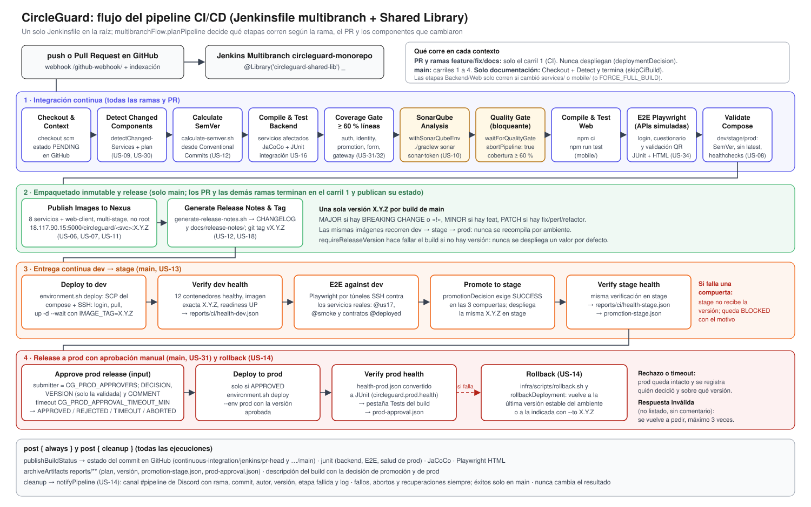

# CircleGuard: pipeline DevOps de extremo a extremo

CircleGuard es un sistema universitario de rastreo de contactos y cercos sanitarios. Identifica grupos de contacto (*Circles*) y aplica cercos de salud sin exponer la identidad de las personas. Este monorepo contiene:

- los 8 microservicios Spring Boot (Java 21) y el cliente Expo (React Native) del código base;
- la infraestructura, el pipeline CI/CD y la documentación construidos por el equipo **SuperPoderosos** para el Proyecto Final de Ingeniería de Software V (Universidad Icesi, 2026-2).

| Recurso | Enlace |
|---|---|
| Repositorio | <https://github.com/CrubioII/circle-guard-finalproject-A00401838-A00402548-A00395559-A00378093> |
| Tablero ágil (Jira) | Proyecto **SuperPoderosos** (clave `SCRUM`) en <https://circleguard777.atlassian.net> |
| Jenkins | <http://52.14.6.11:8080/job/circleguard-monorepo/> |
| Informe de la Parte 1 | [`docs/informe/INFORME_PARTE1.md`](docs/informe/INFORME_PARTE1.md) |
| Declaración de uso de IA generativa | [`docs/BITACORA_IAG_EQUIPO.md`](docs/BITACORA_IAG_EQUIPO.md) (Nivel 3) |

## Contenido

1. [Estructura del repositorio](#1-estructura-del-repositorio)
2. [URLs de los ambientes y herramientas](#urls-de-los-ambientes-y-herramientas)
3. [Matriz de puertos y servicios](#3-matriz-de-puertos-y-servicios)
4. [Reproducir la solución desde cero](#4-reproducir-la-solución-desde-cero)
5. [Operar el pipeline CI/CD](#5-operar-el-pipeline-cicd)
6. [Desarrollo local](#6-desarrollo-local)
7. [Pruebas y validaciones](#7-pruebas-y-validaciones)
8. [Gestión de cambios y releases](#8-gestión-de-cambios-y-releases)
9. [Índice de documentación](#9-índice-de-documentación)
10. [Seguridad, secretos y costos](#10-seguridad-secretos-y-costos)

## 1. Estructura del repositorio

```text
services/<servicio>/            8 microservicios Spring Boot (Gradle multi-proyecto)
mobile/                         cliente Expo (web export servido por nginx) + Dockerfile multi-stage
e2e/                            pruebas E2E con Playwright (flujos, smoke y contratos @deployed)
Jenkinsfile                     pipeline Multibranch (raíz)
jenkins/vars/                   Shared Library: detectChangedServices, multibranchFlow, pipelineUtils,
                                publishBuildStatus, rollbackDeployment, notifyPipeline (Discord),
                                sonarQualityGate (SonarQube)
jenkins/ci/                     JCasC (jenkins.yaml: cuentas, permisos, job y SonarQube) y scripts
                                idempotentes del webhook de GitHub y del Quality Gate de SonarQube
jenkins/test/                   validadores del pipeline, la Shared Library, SonarQube y la seguridad
infra/bootstrap/                scripts Bash idempotentes: plano de control CI/CD y ambientes
                                (jenkins/: imagen de Jenkins, plugins y entrypoint que valida secretos)
infra/scripts/                  SemVer, publicación en Nexus, release notes, tag y rollback
deploy/compose/                 docker-compose.{dev,stage,prod}.yml con healthchecks
deploy/scripts/                 despliegue por SSH, verificación de salud y E2E contra ambientes
docker-compose.ci.yml           Jenkins + SonarQube (+ PostgreSQL) + Nexus
docs/                           arquitectura, ágil, operaciones, release-notes, informe y bitácora de IAG
CHANGELOG.md
```

## URLs de los ambientes y herramientas

Las instancias EC2 están en AWS `us-east-2`. Los datos de la tabla salen de `docs/arquitectura/BOOTSTRAP_CI_US04.md` y `BOOTSTRAP_ENV_US05.md`.

| Componente | URL | Healthcheck | Acceso |
|---|---|---|---|
| Jenkins 2.580.2 | <http://52.14.6.11:8080/> | `GET /login` → 200 | Requiere sesión (cuentas de US-31; ver §4.3) |
| SonarQube 10.6 | <http://52.14.6.11:9000/> | `GET /api/system/status` → `{"status":"UP"}` | Requiere sesión. Proyecto `circleguard-monorepo` |
| Nexus 3.70.1 (interfaz web) | <http://52.14.6.11:8081/> | `GET /service/rest/v1/status` → 200 | Público |
| Registro Docker (Nexus) | `52.14.6.11:5000` (`/v2/`) | `GET /v2/` → 401 sin credenciales | `docker login` con `nexus-credentials` |
| **dev**, cliente web | <http://52.15.213.209:8080/> | `GET /healthz` | Público |
| **dev**, auth / gateway | <http://52.15.213.209:8180/> y <http://52.15.213.209:8087/> | `/actuator/health/readiness` | Público |
| **stage** (`3.17.163.44`) | web `9080` · auth `9180` · identity `9083` · promotion `9088` · form `9086` · gateway `9087` | igual | Túnel SSH (ver abajo) |
| **prod** (`3.19.74.9`) | web `10080` · auth `10180` · identity `10083` · promotion `10088` · form `10086` · gateway `10087` | igual | Túnel SSH (ver abajo) |

Los security groups de los ambientes solo abren los puertos 22, 8080, 8180 y 8087. Por eso stage y prod, que usan puertos desplazados +1000 y +2000, y los demás servicios de dev se consultan con un túnel SSH. Usa la llave de los nodos, que nunca se versiona:

```bash
# stage: cliente web en http://localhost:9080 y auth en http://localhost:9180
ssh -i ~/.ssh/proyectoIngeClave.pem -N -L 9080:127.0.0.1:9080 -L 9180:127.0.0.1:9180 ec2-user@3.17.163.44
# prod: cliente web en http://localhost:10080
ssh -i ~/.ssh/proyectoIngeClave.pem -N -L 10080:127.0.0.1:10080 ec2-user@3.19.74.9
# estado de un ambiente sin túnel (mismo script que usa el pipeline)
SSH_KEY=~/.ssh/proyectoIngeClave.pem bash deploy/scripts/environment.sh verify --env stage --version <X.Y.Z> --host 3.17.163.44
```

> Las instancias se apagan fuera de las ventanas de evaluación para ahorrar costos. Si una URL no responde, revisa en la consola de EC2 que la instancia esté *running*. Las IP públicas se conservan solo si la instancia no se destruye.

## 3. Matriz de puertos y servicios

| Contenedor | Imagen | dev | stage | prod | Healthcheck |
|---|---|---|---|---|---|
| `web-client` | `circleguard/web-client:X.Y.Z` | 8080 | 9080 | 10080 | `GET /healthz` y `/runtime-config.js` generado |
| `auth-service` | `circleguard/auth-service:X.Y.Z` | 8180 | 9180 | 10180 | `/actuator/health/readiness` (db, ldap) |
| `identity-service` | `circleguard/identity-service:X.Y.Z` | 8083 | 9083 | 10083 | readiness (db) |
| `promotion-service` | `circleguard/promotion-service:X.Y.Z` | 8088 | 9088 | 10088 | readiness (db, neo4j, redis) |
| `form-service` | `circleguard/form-service:X.Y.Z` | 8086 | 9086 | 10086 | readiness (db) |
| `gateway-service` | `circleguard/gateway-service:X.Y.Z` | 8087 | 9087 | 10087 | readiness (redis) |
| `postgres` | `postgres:16.4-alpine` | 5432 | interno | interno | `pg_isready` + `SELECT 1` |
| `neo4j` | `neo4j:5.26.0` | 7474 / 7687 | interno | interno | `cypher-shell 'RETURN 1'` |
| `zookeeper` / `kafka` | `confluentinc/cp-*:7.6.0` | — / 9092 | interno | interno | `srvr` / `kafka-broker-api-versions` |
| `redis` | `redis:7.2.5-alpine` | 6379 | interno | interno | `redis-cli ping` autenticado |
| `openldap` | `osixia/openldap:1.5.0` | 389 / 636 | interno | interno | `ldapwhoami` |
| `notification` · `file` · `dashboard` | `circleguard/<svc>:X.Y.Z` | 8082 · 8085 · 8084 (solo locales) | — | — | Se publican en Nexus; se despliegan en la Parte 2 |

Plano de control (`52.14.6.11`): Jenkins `8080`/`50000`, SonarQube `9000` con su PostgreSQL interno, Nexus `8081` y registro `5000`. Los diagramas están en [`docs/arquitectura/ARQUITECTURA_P1.md`](docs/arquitectura/ARQUITECTURA_P1.md).

## 4. Reproducir la solución desde cero

Los ambientes se construyen con los mismos comandos, en este orden. Todos los scripts son **idempotentes**: volver a ejecutarlos reconcilia el estado sin duplicar recursos ni sobrescribir secretos.

### 4.0 Prerrequisitos

| Herramienta | Uso |
|---|---|
| Bash 4+, `git`, `curl`, `jq`, `ssh` | Scripts de `infra/` y `deploy/`. En Windows, usa Git Bash |
| AWS CLI v2 con un perfil (por defecto `personal`) y permisos de EC2 | Solo para `--provision-aws` |
| Llave SSH de los nodos (`proyectoIngeClave.pem`) | Fuera del repositorio (`*.pem` está en `.gitignore`); se pasa con `--ssh-key-path` |
| Docker 24+ con Compose v2 | Pila local y pruebas de imágenes |
| JDK 21 y Node.js 20 | Compilación y pruebas locales (Gradle usa el *wrapper*) |

### 4.1 Plano de control CI/CD: Jenkins, SonarQube y Nexus (US-04)

```bash
# Desde tu estación: crea o reutiliza el SG y la instancia EC2 y ejecuta el bootstrap dentro de ella
bash infra/bootstrap/bootstrap-ci.sh --provision-aws --aws-profile personal --aws-region us-east-2 \
     --ssh-key-path ~/.ssh/proyectoIngeClave.pem
# O directamente dentro de la instancia
sudo bash infra/bootstrap/bootstrap-ci.sh --public-host 52.14.6.11
```

El script:

- ajusta el kernel (`vm.max_map_count`), la swap, Docker y Compose;
- genera `infra/bootstrap/.env.ci` (`0600`) desde [`.env.ci.example`](infra/bootstrap/.env.ci.example). Si ya existe, solo le agrega las variables nuevas de la plantilla;
- genera una contraseña aleatoria para cada cuenta de Jenkins que no tenga una (US-31). Nunca las reemplaza ni las imprime;
- levanta [`docker-compose.ci.yml`](docker-compose.ci.yml) y espera a que los 4 contenedores estén `healthy`;
- crea el repositorio Docker `circleguard-docker` en Nexus, en el puerto 5000.

Para verificarlo, abre las URLs de la tabla anterior o ejecuta `bash infra/bootstrap/test-bootstrap-ci-idempotency.sh`.

### 4.2 Ambientes aislados dev, stage y prod (US-05)

```bash
bash infra/bootstrap/bootstrap-env.sh all --provision-aws --aws-profile personal --aws-region us-east-2 \
     --instance-type m7i-flex.large --ssh-key-path ~/.ssh/proyectoIngeClave.pem
# O, dentro de cada nodo
sudo bash infra/bootstrap/bootstrap-env.sh dev     # stage | prod
```

Por cada ambiente se crea:

- el security group `circleguard-<env>-sg` y la red Docker `circleguard_<env>_net`;
- `/opt/circleguard/<env>/{compose,config,logs,backups}`;
- `daemon.json` con el registro de Nexus;
- `/opt/circleguard/<env>/.env` con permisos `0600`, mediante [`inject-jenkins-secrets.sh`](infra/bootstrap/inject-jenkins-secrets.sh). Si no recibe variables, genera los secretos con `openssl rand` y los conserva en las corridas siguientes.

El script no levanta la aplicación: la primera versión la despliega el pipeline.

### 4.3 Configurar Jenkins (una sola vez)

1. **JCasC.** [`jenkins/ci/jenkins.yaml`](jenkins/ci/jenkins.yaml) declara:
   - las cuentas y la matriz de permisos;
   - las variables globales `CG_*`;
   - la Shared Library `circleguard-shared-lib`;
   - el servidor GitHub y el servidor `SonarQube`;
   - el job Multibranch `circleguard-monorepo`.

   Recárgalo, como `admin`, en *Manage Jenkins → Configuration as Code → Reload*.
2. **Credenciales** (*Manage Jenkins → Credentials*). Nunca van en el repositorio:

   | ID | Tipo | Para qué |
   |---|---|---|
   | `github-token` | Secret text (PAT) | API de GitHub y descubrimiento de ramas y PR |
   | `github-credentials` | Username with password (usuario + PAT) | Clonar la Shared Library y publicar estados de commit |
   | `nexus-credentials` | Username with password | `docker push` desde Jenkins y `docker login` en los nodos |
   | `circleguard-env-ssh` | SSH Username with private key (`ec2-user` + llave de los nodos) | Despliegue, verificación y túneles E2E |
   | `discord-webhook` | Secret text (URL del webhook del canal `#pipeline`) | Notificaciones del pipeline (US-14). Si falta, el build solo deja una advertencia |
   | `sonar-token` | Secret text (token de análisis de SonarQube) | Etapa `SonarQube Analysis` (US-10) |

3. **Variables globales.** Se definen en `infra/bootstrap/.env.ci` del servidor y `jenkins.yaml` las publica en Jenkins. No se escriben en la UI: JCasC reemplaza las variables globales en cada arranque.

   | Variable | Valor en la plantilla | Uso |
   |---|---|---|
   | `CG_DEV_HOST` / `CG_STAGE_HOST` / `CG_PROD_HOST` | `52.15.213.209` / `3.17.163.44` / `3.19.74.9` | Nodos de cada ambiente |
   | `CG_REGISTRY_URL` | `52.14.6.11:5000` | Registro Docker |
   | `CG_PROD_APPROVERS` | `jrubio,jpordonez` | IDs de las cuentas de Jenkins que pueden aprobar prod. Vacío = no hay release a prod |
   | `CG_PROD_APPROVAL_TIMEOUT_MIN` | `60` | Minutos que el build espera la aprobación |

4. **Webhook de GitHub** (idempotente):

   ```bash
   GITHUB_TOKEN=<pat> JENKINS_URL=http://52.14.6.11:8080 ./jenkins/ci/setup-github-webhook.sh
   ```

5. **SonarQube** (idempotente; crea el proyecto, el Quality Gate `CircleGuard-Quality-Gate` con cobertura ≥ 60 % y el webhook de retorno a Jenkins). Ejecútalo con un token de administración de SonarQube y luego guarda un token de análisis del proyecto como `sonar-token`:

   ```bash
   SONAR_TOKEN=<token> SONAR_HOST_URL=http://localhost:9000 JENKINS_URL=http://jenkins:8080 \
     ./jenkins/ci/setup-sonarqube-quality-gate.sh
   ```

   Detalle en [`JENKINS_SONARQUBE_JACOCO_US10.md`](docs/agil/JENKINS_SONARQUBE_JACOCO_US10.md).

6. **Cuentas y permisos (US-31).** Jenkins usa cuentas locales sin registro público y autorización por matriz (`matrix-auth`):

   | Cuenta | Permisos |
   |---|---|
   | `admin` | Administración (emergencia, credenciales, plugins) |
   | `jrubio`, `ecuellar`, `scastillo`, `jpordonez` | Lectura, lanzar y cancelar builds, responder la aprobación de prod |
   | `docente` | Solo lectura |
   | Anónimo | Ninguno; solo `/login` y los webhooks de GitHub y SonarQube |

   Las contraseñas viven solo en `.env.ci` del servidor y llegan a Jenkins como secretos de Docker Compose (`/run/secrets`), nunca como variables de entorno. El contenedor no arranca si falta alguna. Despliegue, operación y recuperación de acceso: [`JENKINS_SEGURIDAD_US31.md`](docs/operaciones/JENKINS_SEGURIDAD_US31.md).

### 4.4 Primera ejecución

Haz *merge* de un PR a `main`, o pulsa *Build with Parameters* en el job `main` con `FORCE_FULL_BUILD=true`. El build:

1. calcula la versión;
2. compila y prueba, y verifica la cobertura de los servicios núcleo;
3. analiza el código en SonarQube y espera el Quality Gate: si falla, se detiene antes de publicar o desplegar;
4. publica las 9 imágenes `X.Y.Z` en Nexus y etiqueta `vX.Y.Z` (por ahora el tag queda solo en el workspace de Jenkins; ver las brechas en [`PIPELINE_CICD.md`](docs/arquitectura/PIPELINE_CICD.md));
5. despliega en dev, verifica la salud y corre los E2E contra dev;
6. promueve a stage y espera la aprobación de prod. Si `CG_PROD_APPROVERS` está vacía, omite prod y lo registra como `NOT_CONFIGURED`;
7. publica el resultado en el canal `#pipeline` de Discord.

Ejemplo verificado: el build #18 de `main` (commit `ab2aa2a`) publicó `0.2.0`, la desplegó en dev y en stage con todos los healthchecks en verde y avisó en Discord.

Para comprobar el resultado:

- revisa la *Stage View* del job `main`;
- abre `reports/ci/promotion-stage.json` y `reports/ci/prod-approval.json` en los artefactos del build;
- ejecuta `environment.sh verify` contra cada ambiente.

## 5. Operar el pipeline CI/CD



El detalle de cada etapa está en [`docs/arquitectura/PIPELINE_CICD.md`](docs/arquitectura/PIPELINE_CICD.md).

### 5.1 Flujo de trabajo del equipo

1. Crea la rama desde `main` con el formato `<tipo>/US-<n>-<slug>`, por ejemplo `feature/US-13-deploy-dev`. Las reglas están en [`BRANCHING_STRATEGY.md`](docs/agil/BRANCHING_STRATEGY.md).
2. Escribe los commits con Conventional Commits (`feat(ci): …`, `fix(auth): …`). Su tipo determina el incremento SemVer.
3. Abre un PR con la [plantilla](.github/pull_request_template.md). Jenkins ejecuta solo el carril de CI y publica `continuous-integration/jenkins/pr-head`. Hace falta 1 aprobación para fusionar.
4. El *merge* a `main` dispara la entrega: versión, pruebas, SonarQube, imágenes, tag, dev, E2E, stage y la espera de aprobación para prod.

### 5.2 Parámetros del job

| Parámetro | Valor por defecto | Efecto |
|---|---|---|
| `FORCE_FULL_BUILD` | `false` | Construye los 8 servicios y el cliente web aunque no hayan cambiado |
| `TARGET_ENV` | `none` | Pide la compuerta `Release Gate` hacia un ambiente. Solo `main` puede usarla |
| `E2E_BASE_URL` | vacío | Corre Playwright contra una URL en vez del *export* local |
| `NOTIFY_DISCORD` | `true` | Publica el resultado en el canal `#pipeline` de Discord (US-14) |
| `ENABLE_SONARQUBE_GATE` | `true` | Ejecuta `SonarQube Analysis` y el Quality Gate bloqueante (US-10) |
| `PUBLISH_GITHUB_STATUS` | `true` | Publica los estados de commit |

### 5.3 Aprobar o rechazar un release a prod (US-31)

Cuando stage queda verificado, el build se detiene en `Approve prod release`. Un aprobador de `CG_PROD_APPROVERS` (`jrubio` o `jpordonez`) entra con su cuenta, abre el build, pulsa **Input requested** y completa el formulario:

- `DECISION`: `APROBAR` o `RECHAZAR`;
- `VERSION`: solo ofrece la versión validada;
- `COMMENT`: obligatorio para aprobar, por ejemplo el ID de la RFC.

Solo `APROBAR` despliega en prod. Jenkins impide que apruebe alguien fuera de la lista, y el pipeline lo vuelve a validar. Cualquier integrante puede abortar la espera, lo que nunca despliega. La salud de prod aparece en la pestaña **Tests** del build. Las reglas de cada decisión están en [`PROD_APPROVAL_US31.md`](docs/arquitectura/PROD_APPROVAL_US31.md).

### 5.4 Rollback (US-14)

```bash
./infra/scripts/rollback.sh status stage                  # versión actual, última estable e historial
./infra/scripts/rollback.sh rollback stage                # vuelve a la última versión estable
./infra/scripts/rollback.sh rollback stage --to 0.1.1     # vuelve a una versión concreta
```

El script vuelve a desplegar imágenes que ya están en Nexus con el mismo compose del ambiente. Ver [`ROLLBACK_US14.md`](docs/operaciones/ROLLBACK_US14.md).

### 5.5 Dónde ver los resultados

| Qué | Dónde |
|---|---|
| Pruebas unitarias e integración | Pestaña **Tests** del build (JUnit) |
| Cobertura | **Coverage Report** (JaCoCo) del build y `services/<svc>/build/reports/jacoco/` |
| Análisis estático y Quality Gate | <http://52.14.6.11:9000/dashboard?id=circleguard-monorepo>, y en el build `reports/ci/sonarqube-analysis.json` y `reports/ci/quality-gate.json` |
| E2E | Artefactos `e2e/reports/` (JUnit y HTML) y `e2e/reports/dev/` para la corrida contra dev |
| Decisiones de entrega | `reports/ci/promotion-stage.json`, `reports/ci/prod-approval.json` y la descripción del build |
| Salud por ambiente | `reports/ci/health-<env>.json`; prod también como JUnit |
| Imágenes publicadas | <http://52.14.6.11:8081/service/rest/repository/browse/circleguard-docker/v2/circleguard/> |
| Estado en GitHub | Checks del commit o del PR |
| Avisos del equipo | Canal `#pipeline` del servidor de Discord **CircleGuard CI**: fallos, abortos, inestables y recuperaciones de cualquier rama, y éxitos de `main`. Ver [`NOTIFICACIONES_US14.md`](docs/operaciones/NOTIFICACIONES_US14.md) |

## 6. Desarrollo local

```bash
cp .env.example .env                                     # define contraseñas locales
docker compose --env-file .env -f docker-compose.dev.yml up -d   # middleware: PostgreSQL, Neo4j, Kafka, Redis, OpenLDAP
./gradlew bootRun --parallel                             # los 8 servicios (o :services:<svc>:bootRun)
cd mobile && npm install && npm run web                  # cliente web
```

Para levantar la pila completa de un ambiente (12 contenedores con `up --wait`):

```bash
IMAGE_TAG=1.0.0 KEEP_UP=1 bash deploy/compose/smoke-up.sh dev        # dev construye las 6 imágenes en local
REGISTRY_URL=52.14.6.11:5000 IMAGE_TAG=<X.Y.Z> PUBLIC_HOST=localhost KEEP_UP=1 \
  bash deploy/compose/smoke-up.sh stage                               # stage/prod descargan las publicadas
```

Cada servicio expone su documentación OpenAPI en `http://localhost:<puerto>/swagger-ui/index.html`.

## 7. Pruebas y validaciones

| Comando | Qué valida | Resultado esperado |
|---|---|---|
| `./gradlew test` | Pruebas unitarias e integración (Testcontainers) de los 8 servicios, incluido el flujo `form → Kafka → promotion` con un broker real (US-16) | Verde |
| `./gradlew test jacocoTestCoverageVerification` | ≥ 60 % de líneas en auth, identity, promotion, form y gateway | Verde |
| `cd e2e && npm ci && npx playwright install chromium && npm test` | Flujos E2E de login, cuestionario y validación QR | Verde |
| `./gradlew validateJenkinsSharedLibrary` | Shared Library | 6 casos |
| `./gradlew validateJenkinsMultibranchPipeline` | Plan multibranch, compuertas de despliegue, promoción y aprobación de prod | 22 casos |
| `./gradlew validateJenkinsNotifications` (o `bash jenkins/test/run-notify-validation.sh`) | Paso `notifyPipeline`: mensaje, política de envío y errores de Discord, sin red | 8 casos |
| `./gradlew validateJenkinsSonarQualityGate` (o `bash jenkins/test/run-sonarqube-validation.sh`) | JaCoCo, comando de SonarQube, Quality Gate bloqueante, orden de etapas y script del webhook | 13 casos |
| `./gradlew validateJenkinsSecurity` | Cuentas, matriz de permisos, aprobadores de prod y secretos de Jenkins | 32 verificaciones |
| `./gradlew validateComposeEnvironments` | `docker-compose.{dev,stage,prod}.yml` | 53 verificaciones |
| `bash deploy/scripts/test-deploy-scripts.sh` | Scripts de despliegue, SSH, salud y JUnit | 40 pruebas |
| `bash infra/bootstrap/test-bootstrap-ci-idempotency.sh` | Idempotencia del plano de control y generación de las contraseñas de Jenkins | 65 pruebas |
| `bash infra/bootstrap/test-bootstrap-env-idempotency.sh` | Idempotencia de los ambientes y externalización de secretos | 38 pruebas |
| `bash infra/scripts/test-calculate-semver.sh` | Cálculo SemVer | 5 casos |
| `bash infra/scripts/test-rollback.sh` | Rollback | 10 casos |

> En Windows, `validateJenkinsMultibranchPipeline` necesita un `python3` real en el `PATH`; el alias de Microsoft Store no sirve. El caso 12 de `validateJenkinsSonarQualityGate` invoca `bash` y Java resuelve el de WSL, así que en Windows ejecuta ese script directamente: `bash jenkins/test/validateSonarWebhookScript.sh`.

## 8. Gestión de cambios y releases

- **Política de cambios** (estándar, normal y emergencia) y aprobadores: [`docs/release-notes/POLITICA_GESTION_CAMBIOS.md`](docs/release-notes/POLITICA_GESTION_CAMBIOS.md).
- **Plantillas de solicitud de cambio:** [`docs/release-notes/PLANTILLA_RFC.md`](docs/release-notes/PLANTILLA_RFC.md) y [`.github/ISSUE_TEMPLATE/change_request.md`](.github/ISSUE_TEMPLATE/change_request.md).
- **Release notes automáticas** generadas desde commits y PR: [`CHANGELOG.md`](CHANGELOG.md) y [`docs/release-notes/`](docs/release-notes/).
- **Etiquetado:** `vX.Y.Z` en Git; las imágenes usan `X.Y.Z`.

## 9. Índice de documentación

| Tema | Documento |
|---|---|
| Arquitectura de microservicios y despliegue (diagramas) | [`docs/arquitectura/ARQUITECTURA_P1.md`](docs/arquitectura/ARQUITECTURA_P1.md) |
| Flujo del pipeline (diagrama) | [`docs/arquitectura/PIPELINE_CICD.md`](docs/arquitectura/PIPELINE_CICD.md) |
| Marco ágil, roles, estimación y backlog (US-01) | [`docs/agil/MARCO_AGIL.md`](docs/agil/MARCO_AGIL.md) |
| Actas de Sprint 0 y Sprint 1: planning, review, retrospectiva y burndown (US-03) | [`docs/agil/SPRINT_0_Y_1_CEREMONIAS.md`](docs/agil/SPRINT_0_Y_1_CEREMONIAS.md) |
| Branching, protección de `main` y Conventional Commits (US-02) | [`docs/agil/BRANCHING_STRATEGY.md`](docs/agil/BRANCHING_STRATEGY.md) |
| Plano de control CI/CD (US-04) | [`docs/arquitectura/BOOTSTRAP_CI_US04.md`](docs/arquitectura/BOOTSTRAP_CI_US04.md) |
| Ambientes y secretos (US-05) | [`docs/arquitectura/BOOTSTRAP_ENV_US05.md`](docs/arquitectura/BOOTSTRAP_ENV_US05.md) |
| Dockerfile del cliente web (US-07) | [`docs/arquitectura/DOCKERFILE_WEB_US07.md`](docs/arquitectura/DOCKERFILE_WEB_US07.md) |
| Compose por ambiente (US-08) | [`docs/arquitectura/COMPOSE_ENVIRONMENTS_US08.md`](docs/arquitectura/COMPOSE_ENVIRONMENTS_US08.md) |
| Shared Library (US-09) y Multibranch (US-30) | [`docs/agil/JENKINS_SHARED_LIBRARY_US09.md`](docs/agil/JENKINS_SHARED_LIBRARY_US09.md) y [`docs/agil/JENKINS_MULTIBRANCH_US30.md`](docs/agil/JENKINS_MULTIBRANCH_US30.md) |
| JaCoCo, SonarQube y Quality Gate (US-10) | [`docs/agil/JENKINS_SONARQUBE_JACOCO_US10.md`](docs/agil/JENKINS_SONARQUBE_JACOCO_US10.md) |
| Despliegue a dev y promoción a stage (US-13) | [`docs/arquitectura/DEPLOY_PROMOTION_US13.md`](docs/arquitectura/DEPLOY_PROMOTION_US13.md) |
| Rollback (US-14) | [`docs/operaciones/ROLLBACK_US14.md`](docs/operaciones/ROLLBACK_US14.md) |
| Notificaciones del pipeline en Discord (US-14) | [`docs/operaciones/NOTIFICACIONES_US14.md`](docs/operaciones/NOTIFICACIONES_US14.md) |
| Aprobación manual de prod (US-31) | [`docs/arquitectura/PROD_APPROVAL_US31.md`](docs/arquitectura/PROD_APPROVAL_US31.md) |
| Seguridad de Jenkins: cuentas, permisos y aprobadores (US-31) | [`docs/operaciones/JENKINS_SEGURIDAD_US31.md`](docs/operaciones/JENKINS_SEGURIDAD_US31.md) |
| E2E con Playwright (US-34) | [`docs/agil/PLAYWRIGHT_E2E_US34.md`](docs/agil/PLAYWRIGHT_E2E_US34.md) |
| Kubernetes: namespaces por ambiente y middleware con Kustomize sobre k3s (US-21) | [`docs/arquitectura/KUBERNETES_PLATAFORMA_US21.md`](docs/arquitectura/KUBERNETES_PLATAFORMA_US21.md) y [`deploy/k8s/README.md`](deploy/k8s/README.md) |
| Terraform: módulos de red y cómputo con clúster k3s por ambiente (US-20) | [`docs/arquitectura/TERRAFORM_RED_COMPUTO_US20.md`](docs/arquitectura/TERRAFORM_RED_COMPUTO_US20.md) |
| Terraform: módulos de registro, almacenamiento y observabilidad (US-35) | [`docs/arquitectura/TERRAFORM_PLATAFORMA_US35.md`](docs/arquitectura/TERRAFORM_PLATAFORMA_US35.md) y [`infra/terraform/README.md`](infra/terraform/README.md) |
| Informe de la Parte 1 y cómo actualizarlo | [`docs/informe/INFORME_PARTE1.md`](docs/informe/INFORME_PARTE1.md) y [`docs/informe/README.md`](docs/informe/README.md) |
| Uso de IA generativa | [`docs/BITACORA_IAG_EQUIPO.md`](docs/BITACORA_IAG_EQUIPO.md) |

## 10. Seguridad, secretos y costos

- **El repositorio y los PDF no contienen secretos.**
  - `*.pem`, `.env*`, `infra/bootstrap/.env.ci` y `deploy/compose/.env*` están en `.gitignore`.
  - Los secretos de los ambientes viven en `/opt/circleguard/<env>/.env` (`0600`) y en el almacén de credenciales de Jenkins.
  - Las contraseñas de las cuentas de Jenkins viven solo en `infra/bootstrap/.env.ci` del servidor (`0600`).
- **Jenkins exige sesión.** Solo `admin` administra; el usuario anónimo no tiene permisos. Ver [`JENKINS_SEGURIDAD_US31.md`](docs/operaciones/JENKINS_SEGURIDAD_US31.md).
- **Los secretos se mantienen fuera de argumentos y logs.** La contraseña del registro viaja por stdin, y `test-deploy-scripts.sh` lo verifica.
- **Costos.**
  - Al terminar cada sesión de trabajo o evaluación, detén las 4 instancias EC2 (`aws ec2 stop-instances --instance-ids …`).
  - En la Parte 2 la infraestructura se destruye con `terraform destroy`.
