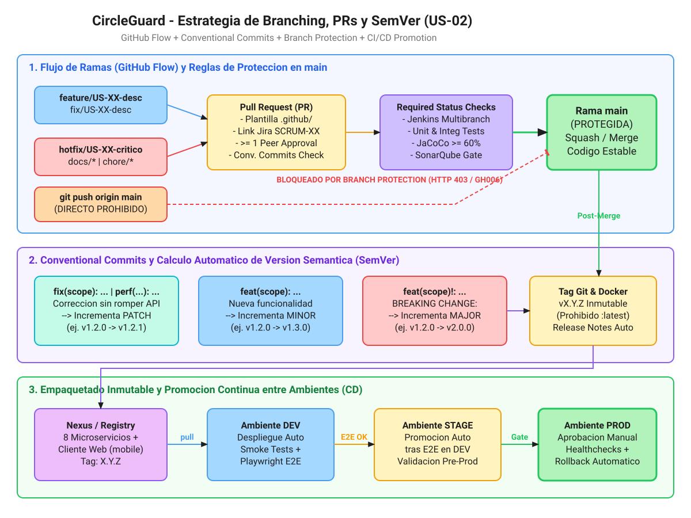

# Estrategia de Branching, Protección de Ramas y Conventional Commits (`US-02` / `SCRUM-15`)

> **Proyecto:** CircleGuard — Ingeniería de Software V (Universidad Icesi)  
> **Espacio en Jira:** `SuperPoderosos` (`circleguard777.atlassian.net`)  
> **Épica Asociada:** `EPIC-01` (`SCRUM-5`) — Gestión Ágil, Backlog y Estrategia de Branching (`E1.1`)  
> **Historia de Usuario:** `US-02` (`SCRUM-15`) — Implementación de estrategia de Branching, protección de ramas y Conventional Commits (`3 SP`)  
> **Subtareas Cubiertas:** `SCRUM-35` (Documentación de estrategia y Conventional Commits), `SCRUM-36` (Reglas de protección en `main`), `SCRUM-37` (Plantilla de Pull Request).

---

## 1. Propósito y Alcance

Este documento define las normas obligatorias de control de versiones, flujo de ramas (*branching*), revisión de código mediante *Pull Requests* (PR), reglas de protección sobre la rama principal `main` y la convención de mensajes de commit (**Conventional Commits v1.0.0**) para el monorepo de **CircleGuard** (conformado por 8 microservicios backend en Spring Boot / Java 21, el cliente web/móvil en Expo React Native y la infraestructura DevOps).

Sus objetivos técnicos son:
1. **Impedir entregas directas sin control (`git push` directo) sobre `main`**, exigiendo revisión por pares y validación automatizada de calidad antes de cualquier integración.
2. **Habilitar el cálculo automático de Versionado Semántico (`SemVer`)** y la generación automatizada de *Release Notes* (`US-12` y `US-18`) a partir del historial de commits.
3. **Garantizar trazabilidad de extremo a extremo** entre cada cambio en el código fuente, los *Pull Requests* en GitHub y las incidencias (`SCRUM-XX` / `US-XX`) en Jira.

---

## 2. Estrategia de Branching: GitHub Flow Adaptado a Entrega Continua

Para **CircleGuard** se adopta **GitHub Flow orientado a Trunk-Based Development con Promoción Inmutable entre Ambientes**, en lugar de un GitFlow clásico de múltiples ramas longevas.

### 2.1 Justificación Técnica
- En la arquitectura DevOps de CircleGuard (`EPIC-03`, `EPIC-04`, `EPIC-05`), los ambientes `dev`, `stage` y `prod` **no se representan mediante ramas de Git separadas** (`env/dev`, `env/prod`), ya que eso rompería el principio de **inmutabilidad del artefacto** (recompilar código distinto por ambiente).
- En su lugar, **`main` es la única rama de integración y liberación (*single source of truth*)**. Cada integración exitosa en `main` calcula una única versión semántica (`vX.Y.Z`), construye una sola vez las imágenes Docker inmutables (`circleguard/<servicio>:X.Y.Z`) y las promueve secuencialmente a través de **`dev` → `stage` → `prod`**.

### 2.2 Diagrama de Flujo de Ramas, Pull Requests, SemVer y Promoción CD

El siguiente diagrama (diseñado y exportado con **Excalidraw**) ilustra el ciclo completo desde la creación de ramas de trabajo hasta la protección de `main`, el versionado semántico y la promoción continua:

- **Archivo fuente editable Excalidraw:** [`docs/agil/diagramas/branching-strategy-flow.excalidraw`](diagramas/branching-strategy-flow.excalidraw)
- **Vista renderizada SVG:**



---

## 3. Taxonomía y Nomenclatura de Ramas

Toda rama de trabajo debe crearse a partir del estado más reciente de `main` (`git checkout main && git pull origin main`) y seguir estrictamente el formato:

```text
<tipo>/US-<numero>-<descripcion-corta-kebab-case>
```
*(Alternativamente se admite el código interno de Jira `SCRUM-<numero>` cuando aplique a subtareas específicas).*

| Tipo de Rama | Patrón de Nombre | Propósito | Origen | Destino (PR) | Tiempo de Vida |
| :--- | :--- | :--- | :---: | :---: | :--- |
| **Principal (Producción / Troncal)** | `main` | Contiene únicamente código estable, compilable, probado y aprobado. Dispara el versionado `SemVer`, publicación en Nexus/Registry y promoción `dev` → `stage` → `prod`. | Inicial | — | Permanente (Protegida) |
| **Funcionalidad (*Feature*)** | `feature/US-XX-<slug>` | Desarrollo de nuevas historias de usuario, scripts de infraestructura, pipelines o componentes (ej. `feature/US-02-proteger-main`, `feature/US-06-dockerfiles-backend`). | `main` | `main` | Corta (1 a 3 días) |
| **Corrección (*Bugfix*)** | `fix/US-XX-<slug>` | Corrección de defectos detectados durante el desarrollo, pruebas unitarias/integración o en el ambiente `dev`/`stage` (ej. `fix/US-10-jacoco-xml-path`). | `main` | `main` | Corta (< 2 días) |
| **Parche Crítico (*Hotfix*)** | `hotfix/US-XX-<slug>` | Corrección urgente de un incidente crítico detectado en `prod` o bloqueo severo del pipeline (ej. `hotfix/US-14-rollback-healthcheck`). | `main` | `main` | Inmediata (Horas) |
| **Documentación / Mantenimiento** | `docs/US-XX-<slug>` o `chore/US-XX-<slug>` | Actualizaciones exclusivas de documentación ágil/arquitectura, plantillas o ajustes menores de herramientas que no alteran lógica de negocio. | `main` | `main` | Corta (1 día) |

---

## 4. Estándar de Mensajes de Commit (Conventional Commits v1.0.0)

Todos los commits del repositorio y los títulos de los *Pull Requests* (al integrarse mediante *Squash & Merge* o *Merge Commit*) **deben cumplir obligatoriamente** la especificación [Conventional Commits v1.0.0](https://www.conventionalcommits.org/es/v1.0.0/).

### 4.1 Estructura Formal

```text
<tipo>(<alcance>): <descripción corta en imperativo y minúscula>

[cuerpo opcional explicando el "qué" y el "porqué" del cambio]

[pie(s) opcional(es): Refs: US-XX / SCRUM-XX o BREAKING CHANGE: <detalle>]
```

### 4.2 Expresión Regular de Validación

El pipeline de CI y las revisiones de PR validan el encabezado del commit contra la siguiente expresión regular:

```regex
^(feat|fix|perf|refactor|docs|test|build|ci|chore|revert)(\([a-z0-9-]+(\/[a-z0-9-]+)*\))?(!)?: .{3,100}$
```

### 4.3 Tabla de Tipos Permitidos e Impacto en Versionado Semántico (`SemVer`)

El script de cálculo automático de versión (`US-12`) inspecciona los commits integrados en `main` desde el último tag `vX.Y.Z` y aplica la siguiente matriz de decisión:

| Tipo (`<tipo>`) | Cuándo utilizarlo | Impacto en `SemVer` (`MAJOR.MINOR.PATCH`) | Ejemplo Válido |
| :--- | :--- | :---: | :--- |
| **`feat`** | Añade una nueva funcionalidad en un microservicio, cliente web o capacidad nueva en la plataforma. | **`MINOR`** (`0.X.0`) | `feat(auth): add JWT refresh token rotation endpoint` |
| **`fix`** | Corrige un *bug* o fallo funcional en el código o en el empaquetado de despliegue. | **`PATCH`** (`0.0.X`) | `fix(gateway): handle timeout on identity-service route` |
| **`perf`** | Mejora el rendimiento (consultas, caché, tiempos de respuesta o tiempos de imagen) sin cambiar funcionalidad externa. | **`PATCH`** (`0.0.X`) | `perf(promotion): optimize Neo4j cypher query for rules` |
| **`refactor`** | Reestructuración interna de código sin añadir funcionalidad ni corregir un bug. | **`PATCH`** (`0.0.X`) | `refactor(form): extract schema validation to service layer` |
| **`docs`** | Cambios exclusivos en documentación (`docs/`, `README.md`, comentarios). | Ninguno *(o `PATCH` si es release documental)* | `docs(agile): define branching strategy and PR template for US-02` |
| **`test`** | Adición o corrección de pruebas unitarias, integración (Testcontainers) o E2E (Playwright). | Ninguno | `test(identity): add integration tests with PostgreSQL container` |
| **`build`** | Cambios en el sistema de construcción (`build.gradle.kts`, `Dockerfile`, dependencias npm/Gradle). | **`PATCH`** (`0.0.X`) | `build(docker): create multi-stage non-root Dockerfile for auth` |
| **`ci`** | Cambios en el `Jenkinsfile`, *Shared Library* (`jenkins/vars/`) o configuraciones de SonarQube. | Ninguno | `ci(jenkins): add waitForQualityGate blocking step in pipeline` |
| **`chore`** | Tareas de mantenimiento general, `.gitignore`, plantillas de `.github/`. | Ninguno | `chore(github): add pull request template linked to Jira` |
| **`revert`** | Revierte un commit previo. | Según el commit revertido | `revert: feat(auth): add JWT refresh token rotation endpoint` |
| **`<tipo>(<scope>)!`** o pie **`BREAKING CHANGE:`** | Introduce un cambio incompatible hacia atrás en APIs REST, esquemas de eventos Kafka o contratos de datos. | **`MAJOR`** (`X.0.0`) | `feat(auth)!: change login payload from username to email` |

### 4.4 Alcances (`<alcance>`) Oficiales del Monorepo CircleGuard

Para mantener trazabilidad con la detección selectiva de cambios del *Multibranch Pipeline* (`US-09`), se deben emplear los siguientes alcances (`scope`):

- **Microservicios Backend:** `auth`, `identity`, `promotion`, `notification`, `form`, `file`, `gateway`, `dashboard`.
- **Cliente Frontend/Móvil:** `mobile`.
- **Infraestructura y DevOps:** `infra`, `docker`, `compose`, `jenkins`, `sonar`, `nexus`, `k8s`, `terraform`.
- **Gestión y Documentación:** `agile`, `docs`, `github`, `release`.

---

## 5. Reglas de Protección de la Rama `main` (`SCRUM-36` / CA2)

La rama `main` en el repositorio oficial de GitHub (`CrubioII/circle-guard-finalproject-A00401838-A00402548-A00395559-A00378093`, alias `CrubioII/YamlPaQue_FinalProjectIngesoft5`) cuenta con reglas estrictas de protección (**Branch Protection Rules**) activas y verificadas vía GitHub REST API (`HTTP 200 OK`).

### 5.1 Parámetros de Protección Exigidos

| Regla de Protección en GitHub | Configuración Activa | Propósito en CircleGuard |
| :--- | :--- | :--- |
| **Target Branch** | `main` | Protege la rama troncal de integración y producción. |
| **Restrict direct pushes / Require a pull request before merging** | **Activado (`true`)** | Bloquea cualquier `git push origin main` directo. Todo cambio debe entrar vía Pull Request desde una rama `feature/*`, `fix/*`, `hotfix/*`, `docs/*` o `chore/*`. |
| **Required number of approvals before merging** | **Mínimo `1` aprobación** (`required_approving_review_count: 1`) | Garantiza revisión por pares (*Peer Review*) de otro integrante del equipo antes de integrar cambios. |
| **Dismiss stale pull request approvals when new commits are pushed** | **Activado (`true`)** | Si el autor sube nuevos commits después de haber recibido aprobación, la aprobación anterior se invalida y requiere nueva revisión. |
| **Require conversation resolution before merging** | **Activado (`true`)** | Todos los comentarios o hallazgos abiertos en la revisión del PR deben resolverse antes del *merge*. |
| **Require status checks to pass before merging** | **Activado (`true`)** con `strict: true` (*Require branches to be up to date*) | Exige que el pipeline de CI en Jenkins y el *Quality Gate* de SonarQube pasen en verde antes de habilitar el botón de *merge*. |
| **Do not allow bypassing the above settings (`enforce_admins`)** | **Activado (`true`)** | Aplica las reglas incluso a los administradores del repositorio para evitar saltarse el control de cambios. |
| **Allow force pushes (`allow_force_pushes`)** | **Desactivado (`false`)** | Impide reescribir la historia de `main` (`git push --force`), preservando la integridad de los tags `SemVer`. |
| **Allow deletions (`allow_deletions`)** | **Desactivado (`false`)** | Impide eliminar accidentalmente la rama `main`. |

### 5.2 Activación Escalonada de *Status Checks* Obligatorios

Siguiendo las mejores prácticas de ingeniería de plataformas:
1. **Fase Inicial (`US-02`):** Se activan de inmediato el bloqueo de *push* directo, la exigencia de Pull Request, mínimo 1 aprobación de pares, resolución de conversaciones y bloqueo de *force-push*.
2. **Fase de Integración con CI (`US-30` y `US-10`):** En cuanto el *Multibranch Pipeline* de Jenkins y SonarQube publican sus primeros estados estables hacia la API de GitHub, se marcan como **Required Status Checks** los contextos:
   - `continuous-integration/jenkins/pr-head` (Compilación Gradle, Pruebas Unitarias, Integración y Cobertura JaCoCo $\geq 60\%$)
   - `SonarQube Quality Gate` (Análisis estático sin vulnerabilidades ni *bugs* bloqueantes)

### 5.3 Automatización de Configuración vía GitHub CLI / REST API

Para aplicar o auditar estas reglas de forma reproducible desde la terminal (usando un token con permisos `repo` / `administration:write`), ejecuta el siguiente comando:

```bash
# Aplicar Branch Protection sobre 'main' vía GitHub REST API (gh api o curl)
gh api \
  --method PUT \
  -H "Accept: application/vnd.github+json" \
  -H "X-GitHub-Api-Version: 2022-11-28" \
  /repos/CrubioII/circle-guard-finalproject-A00401838-A00402548-A00395559-A00378093/branches/main/protection \
  --input - << 'EOF'
{
  "required_status_checks": {
    "strict": true,
    "contexts": []
  },
  "enforce_admins": true,
  "required_pull_request_reviews": {
    "dismiss_stale_reviews": true,
    "require_code_owner_reviews": false,
    "required_approving_review_count": 1,
    "require_last_push_approval": false
  },
  "restrictions": null,
  "required_linear_history": false,
  "allow_force_pushes": false,
  "allow_deletions": false,
  "block_creations": false,
  "required_conversation_resolution": true,
  "lock_branch": false,
  "allow_fork_syncing": false
}
EOF
```

*(Si no se dispone de `gh`, el mismo payload JSON puede enviarse con `curl -L -X PUT -H "Authorization: Bearer $GITHUB_TOKEN" https://api.github.com/repos/CrubioII/circle-guard-finalproject-A00401838-A00402548-A00395559-A00378093/branches/main/protection -d @protection.json`).*

---

## 6. Flujo de Trabajo Paso a Paso para el Equipo (Developer Workflow)

Todo integrante del equipo **SuperPoderosos** debe seguir este procedimiento estándar para cualquier historia o subtarea del Sprint:

```bash
# 1. Sincronizar la rama principal local
git checkout main
git pull origin main

# 2. Crear la rama de trabajo vinculada a la Historia de Usuario en Jira
git checkout -b feature/US-XX-descripcion-corta

# 3. Realizar cambios y verificar compilación / pruebas localmente
./gradlew test jacocoTestReport

# 4. Registrar commits cumpliendo Conventional Commits
git add <archivos>
git commit -m "feat(auth): implement token validation filter" -m "Refs: US-XX, SCRUM-YY"

# 5. Publicar la rama en el repositorio remoto
git push -u origin feature/US-XX-descripcion-corta
```

6. **Abrir el Pull Request en GitHub:**
   - Seleccionar `base: main` $\leftarrow$ `compare: feature/US-XX-descripcion-corta`.
   - Completar **todos los campos** de la plantilla automática [`.github/pull_request_template.md`](../../.github/pull_request_template.md).
   - Asignar al menos a **1 compañero del equipo** como *Reviewer*.
7. **Revisión por Pares y CI Quality Gate:**
   - El revisor verifica el código, la vinculación con Jira (`US-XX` / `SCRUM-XX`), el formato *Conventional Commits* y aprueba el PR.
   - Jenkins ejecuta automáticamente las pruebas y el *Quality Gate* de SonarQube.
8. **Integración (*Squash and Merge*) y Cierre:**
   - Una vez aprobado y con los *checks* en verde, se realiza **Squash and Merge** (o *Merge Commit*) asegurando que el mensaje final siga el formato `tipo(alcance): descripción (US-XX)`.
   - Se elimina la rama temporal en GitHub y la historia en Jira pasa a `Done`.
