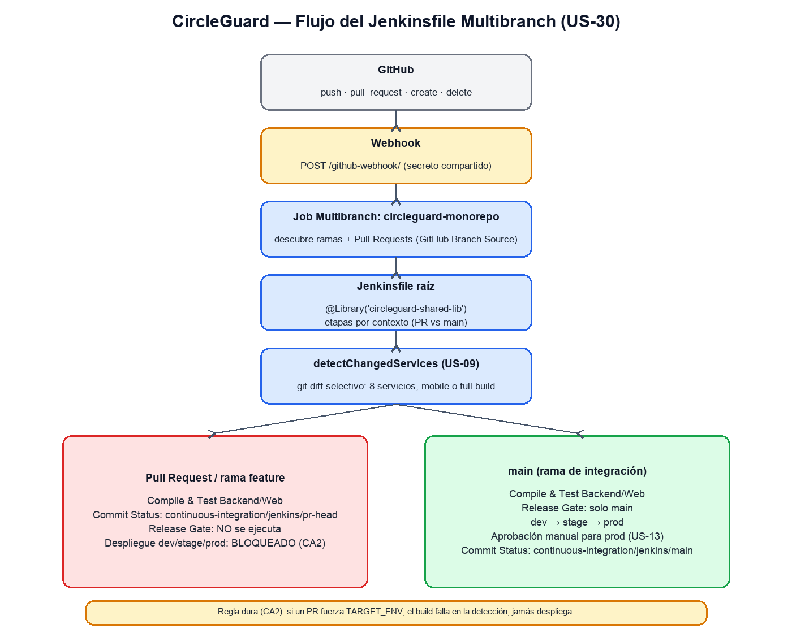

# Jenkinsfile Multibranch y consumo de la Shared Library (`US-30` / `SCRUM-113`)

> **Proyecto:** CircleGuard — Ingeniería de Software V (Universidad Icesi)  
> **Espacio en Jira:** `SuperPoderosos` (`circleguard777.atlassian.net`)  
> **Épica Asociada:** `EPIC-04` (`SCRUM-7`) — Integración Continua (CI) con Jenkins y SonarQube (`E1.4`)  
> **Historia de Usuario:** `US-30` (`SCRUM-113`) — Jenkins Multibranch que consume la Shared Library (`5 SP`)  
> **Subtareas Cubiertas:** `SCRUM-56` (`3 SP`, Jenkinsfile principal) y `SCRUM-57` (`2 SP`, registro de la Shared Library, job Multibranch y webhook de GitHub).  
> **Dependencia:** `US-09` (`SCRUM-21`) — Shared Library `detectChangedServices` + `pipelineUtils` (`3 SP`).

---

## 1. Propósito y Alcance

`US-30` convierte la Shared Library de `US-09` en un **pipeline Multibranch operativo**: un único `Jenkinsfile` raíz que Jenkins descubre y ejecuta automáticamente para **cada rama** y **cada Pull Request** del monorepo, aplicando las etapas que correspondan al contexto y publicando el resultado como *Commit Status* en GitHub.

El alcance de esta historia es la **orquestación CI**:

1. **`Jenkinsfile` raíz (CA1):** carga `circleguard-shared-lib` con `@Library(...) _` y consume `detectChangedServices`, `pipelineUtils`, `multibranchFlow` y `publishBuildStatus`.
2. **Job Multibranch (CA2):** declara el descubrimiento de ramas y PRs con GitHub Branch Source, el `Jenkinsfile` como script path y una indexación periódica de respaldo.
3. **Separación PR / main (CA2):** los PR compilan, prueban y publican estado; **jamás despliegan**. Solo `main` supera la compuerta de despliegue, y `prod` exige aprobación manual (la ejecución material se completa en `US-13`).
4. **Webhook y estados (CA3):** registra el webhook `/github-webhook/` de forma idempotente y publica `PENDING`/`SUCCESS`/`FAILURE` en los contextos `continuous-integration/jenkins/pr-head` y `continuous-integration/jenkins/main`.

> **Fuera de alcance (historias posteriores):** JaCoCo y el Quality Gate de SonarQube (`US-10`), la construcción y publicación de imágenes Docker (`US-11`) y la promoción material `dev → stage → prod` con `input` de aprobación (`US-13`). El `Jenkinsfile` deja los puntos de extensión y la compuerta listos para esas etapas.

---

## 2. Criterios de Aceptación y Evidencia

| CA | Criterio | Implementación / Evidencia |
| :---: | :--- | :--- |
| **CA1** | El Jenkinsfile raíz carga y usa las funciones de la Shared Library. | [`Jenkinsfile`](../../Jenkinsfile) usa `@Library('circleguard-shared-lib') _` y llama a `detectChangedServices`, `pipelineUtils.buildGradleCommandForServices`, `multibranchFlow.*` y `publishBuildStatus`. Validado por el Caso 10 de [`validateMultibranchPipeline.groovy`](../../jenkins/test/validateMultibranchPipeline.groovy). |
| **CA2** | Jenkins descubre ramas y pull requests, aplica las etapas correspondientes y no permite despliegue productivo desde un PR. | [`jenkins/ci/jenkins.yaml`](../../jenkins/ci/jenkins.yaml) declara `multibranchPipelineJob('circleguard-monorepo')` con `gitHubBranchDiscovery` + `gitHubPullRequestDiscovery`; [`multibranchFlow.groovy`](../../jenkins/vars/multibranchFlow.groovy) calcula el plan y bloquea todo despliegue desde PR/ramas no-`main`; Casos 1–7 de la suite. |
| **CA3** | El job Multibranch y el webhook de GitHub disparan builds y publican su estado. | Job + servidor GitHub en [`jenkins.yaml`](../../jenkins/ci/jenkins.yaml); webhook idempotente en [`setup-github-webhook.sh`](../../jenkins/ci/setup-github-webhook.sh); estados en [`publishBuildStatus.groovy`](../../jenkins/vars/publishBuildStatus.groovy). Casos 8, 9, 12, 13 y 14 de la suite. |

---

## 3. Arquitectura y Flujo

- **Fuente editable Excalidraw:** [`docs/agil/diagramas/jenkins-multibranch-flow.excalidraw`](diagramas/jenkins-multibranch-flow.excalidraw)
- **Imagen exportada PNG:**



### 3.1 Etapas del pipeline

| # | Etapa | Condición | Qué hace |
| :---: | :--- | :--- | :--- |
| 1 | `Checkout & Context` | Siempre | `checkout scm`, resuelve `flow = multibranchFlow.collectContext()` y publica el estado `PENDING`. |
| 2 | `Detect Changed Components` | Siempre | Ejecuta `detectChangedServices`, calcula el plan con `multibranchFlow.planPipeline`, publica el resumen, archiva JSON y **aborta** si se solicitó un despliegue no permitido. |
| 3 | `Compile & Test Backend` | `plan.runBackendBuild` | `./gradlew :services:<svc>:assemble :services:<svc>:test` solo para los servicios afectados (o los 8 con `FORCE_FULL_BUILD`). |
| 4 | `Compile & Test Web` | `plan.runMobileBuild` | `npm ci` + `npm run test` dentro de `mobile/`. |
| 4b | `E2E Playwright` (US-34) | `plan.runMobileBuild` o `E2E_BASE_URL` definido | Ejecuta Playwright headless en `e2e/`, publica JUnit + reporte HTML y falla el build si falla cualquier flujo. Ver [PLAYWRIGHT_E2E_US34.md](PLAYWRIGHT_E2E_US34.md). |
| 5 | `Release Gate` | `plan.deploymentAllowed` | Revalida el contexto con `requireDeploymentAllowed`, registra la decisión y deja la ejecución material a `US-13`. **Nunca se ejecuta en un PR.** |
| 6 | `post` | Siempre | Publica `SUCCESS`/`FAILURE`/`ERROR` en GitHub, publica reportes JUnit y archiva `reports/ci/**`. |

El `input` de aprobación para `prod` no se ejecuta todavía: la compuerta actual **autoriza** el objetivo y documenta que la aprobación gobernada llega en `US-13`, sin bloquear builds de `main` que usan el valor por defecto `TARGET_ENV=none`.

### 3.2 Matriz de decisión PR vs. main (`CA2`)

| Contexto | `TARGET_ENV` | `runBackendBuild` / `runMobileBuild` | `deploymentAllowed` | Etapa `Release Gate` |
| :--- | :--- | :---: | :---: | :---: |
| **Pull Request** (`CHANGE_ID`) | `none` | según cambios | `false` | No |
| **Pull Request** | `dev` / `stage` / `prod` | según cambios | **`false`** y el build falla en la detección | No |
| Rama `feature/*`, `fix/*`, etc. | cualquiera | según cambios | `false` | No |
| `main` | `none` | según cambios | `false` | No |
| `main` | `dev` / `stage` | según cambios | `true` | Sí |
| `main` | `prod` | según cambios | `true` (`requiresApproval=true`) | Sí (aprobación en `US-13`) |
| Cualquiera, solo documentación | `none` | `false` (omite build pesado) | `false` | No |

La regla se implementa dos veces de forma deliberada:

1. **Preventiva:** `planPipeline` marca `deploymentAllowed=false` y el `Jenkinsfile` aborta con `error(...)` si se solicitó un ambiente desde un PR.
2. **Defensiva:** la etapa `Release Gate` vuelve a invocar `requireDeploymentAllowed` antes de cualquier despliegue futuro, de modo que una modificación accidental del `when` no pueda saltarse la política.

---

## 4. Estructura de Archivos

| Ruta | Rol | CA |
| :--- | :--- | :---: |
| [`Jenkinsfile`](../../Jenkinsfile) | Pipeline declarativo raíz: etapas, guardas, publicación de estados y archivo de evidencia. | `CA1`, `CA2`, `CA3` |
| [`jenkins/vars/multibranchFlow.groovy`](../../jenkins/vars/multibranchFlow.groovy) | Contexto PR/main, plan de etapas y política de despliegue. | `CA2` |
| [`jenkins/vars/multibranchFlow.txt`](../../jenkins/vars/multibranchFlow.txt) | Ayuda global de Jenkins (*Global Variable Reference*). | `CA2` |
| [`jenkins/vars/publishBuildStatus.groovy`](../../jenkins/vars/publishBuildStatus.groovy) | Publicación de *Commit Status* con `githubNotify`, resolución de repositorio y modo dry-run. | `CA3` |
| [`jenkins/vars/publishBuildStatus.txt`](../../jenkins/vars/publishBuildStatus.txt) | Ayuda global de Jenkins para `publishBuildStatus`. | `CA3` |
| [`jenkins/ci/jenkins.yaml`](../../jenkins/ci/jenkins.yaml) | JCasC: Shared Library global, servidor GitHub y job Multibranch con ramas + PRs. | `CA2`, `CA3` |
| [`jenkins/ci/setup-github-webhook.sh`](../../jenkins/ci/setup-github-webhook.sh) | Registro/actualización idempotente del webhook de GitHub. | `CA3` |
| [`jenkins/test/validateMultibranchPipeline.groovy`](../../jenkins/test/validateMultibranchPipeline.groovy) | Suite reproducible de 14 casos (flujo, guardas, estados, JCasC, webhook). | `CA1`–`CA3` |
| [`jenkins/test/validateWebhookScript.sh`](../../jenkins/test/validateWebhookScript.sh) | Prueba del webhook con `gh` y con `curl` simulados (POST → PATCH) y secreto enmascarado. | `CA3` |
| [`jenkins/test/run-multibranch-validation.sh`](../../jenkins/test/run-multibranch-validation.sh) | Ejecutor de la suite con Java + Groovy (descarga `groovy-json` si hace falta). | `CA1`–`CA3` |
| [`build.gradle.kts`](../../build.gradle.kts) | Tarea `validateJenkinsMultibranchPipeline` integrada en `verification`. | `CA1`–`CA3` |

---

## 5. Puesta en Marcha en Jenkins (`CA2` + `CA3`)

### 5.0 ¿De dónde sale la URL de Jenkins y qué es el webhook?

**Jenkins no "entrega" un webhook.** El webhook es una configuración que vive en **GitHub** y que le dice a GitHub a qué URL de Jenkins enviar los eventos (`push`, `pull_request`, etc.). La relación es:

```text
GitHub  ---->  POST https://<jenkins-publico>/github-webhook/  ---->  Jenkins Multibranch
```

1. **Jenkins URL**: es la URL base donde Jenkins es accesible, por ejemplo `http://localhost:8080`. Jenkins la usa para construir enlaces y para el endpoint del webhook.
2. **Endpoint del webhook**: siempre es `<JENKINS_URL>/github-webhook/` (lo expone el plugin **GitHub**). No se genera por separado.
3. **Webhook en GitHub**: se crea en el repositorio, en *Settings → Webhooks → Add webhook*, apuntando a ese endpoint. También puede crearlo el script [`setup-github-webhook.sh`](../../jenkins/ci/setup-github-webhook.sh).

> **Requisito clave:** GitHub debe poder alcanzar la URL. `http://localhost:8080` solo funciona desde tu máquina; para que GitHub envíe eventos necesitas una URL **HTTPS pública**.

#### Opciones para obtener una URL pública

| Opción | URL resultante | Cuándo usarla |
| :--- | :--- | :--- |
| **VM / servidor cloud** (recomendado para la entrega) | `https://jenkins.tudominio.com` o `http://<IP>:8080` | Jenkins permanente, EC2 o similar (E1.2). |
| **Túnel Cloudflare** (rápido, sin cuenta) | `https://algo-random.trycloudflare.com` | Demo local; la URL cambia al reiniciar el túnel. |
| **ngrok** | `https://algo.ngrok-free.app` | Demo local; requiere cuenta/token. |

#### Ejemplo de túnel con Cloudflare

```bash
brew install cloudflared
cloudflared tunnel --url http://localhost:8080
# Copia la URL https://xxxx.trycloudflare.com que aparece en la salida.
```

Después fija esa URL en Jenkins (*Manage Jenkins → System → Jenkins URL*) o en JCasC (`unclassified.location.url`). Si el túnel cambia de URL, actualiza también el webhook en GitHub.

### 5.1 Prerrequisitos

- **Plugins:** `workflow-aggregator`, `workflow-multibranch`, `github`, `github-branch-source`, `pipeline-githubnotify-step`, `configuration-as-code`, `job-dsl`, `credentials-binding`, `junit`, `timestamper`, `ansicolor`.
- **Agente Linux** (el pipeline usa `sh`), JDK 21 (toolchain del proyecto), Git, permisos de ejecución sobre `./gradlew` y Node.js 20+ (solo si cambia `mobile/`).
- **Jenkins accesible desde GitHub** (URL pública o túnel tipo `ngrok http 8080`) para recibir el webhook.

#### Arranque local rápido con Docker (opcional)

```bash
docker run -d --name circleguard-jenkins \
  -p 8080:8080 -p 50000:50000 \
  -v circleguard-jenkins-home:/var/jenkins_home \
  jenkins/jenkins:lts-jdk17

docker exec circleguard-jenkins jenkins-plugin-cli --plugins \
  configuration-as-code job-dsl workflow-aggregator workflow-multibranch \
  github github-branch-source pipeline-githubnotify-step \
  credentials-binding junit timestamper ansicolor
docker restart circleguard-jenkins

# Contraseña temporal del asistente:
docker exec circleguard-jenkins cat /var/jenkins_home/secrets/initialAdminPassword
```

Abre `http://localhost:8080`, pega la contraseña y crea el usuario administrador. Ese Jenkins local ya sirve para probar el pipeline; para el webhook necesitas la URL pública del túnel o de la VM.

### 5.2 Credenciales (nunca versionadas)

| ID | Tipo | Uso |
| :--- | :--- | :--- |
| `github-token` | **Secret text** (PAT) | Servidor GitHub de Branch Source (API) y descubrimiento de ramas/PRs. Scope `repo`. |
| `github-credentials` | **Username with password** (usuario de GitHub + PAT como contraseña) | Clonado de la Shared Library y paso `githubNotify`. Scope `repo`. |

El repositorio es **privado**, así que el PAT debe tener acceso a él. Para un token clásico usa los scopes `repo` y `admin:repo_hook` (el segundo solo si vas a crear/actualizar el webhook con el script). Para un token *fine-grained*: `Contents: Read`, `Metadata: Read`, `Pull requests: Read`, `Commit statuses: Read and write` y `Webhooks: Read and write`.

Crea el PAT en *GitHub → Settings → Developer settings → Personal access tokens*. Luego crea las dos credenciales en *Manage Jenkins → Credentials → System → Global credentials* usando el mismo PAT. El script del webhook usa la variable de entorno `GITHUB_TOKEN` (no una credencial de Jenkins); si tu token de `gh` no tiene `admin:repo_hook`, ejecuta `gh auth refresh -s admin:repo_hook` o crea el webhook desde la UI de GitHub. No se almacena ningún token en el repositorio.

### 5.3 Aplicar JCasC

```bash
export CASC_JENKINS_CONFIG="$(pwd)/jenkins/ci/jenkins.yaml"
export JENKINS_URL="https://jenkins.example.com"

# Tras copiar/actualizar el archivo en la ruta configurada:
java -jar jenkins-cli.jar -s "${JENKINS_URL}" -auth admin:"${JENKINS_ADMIN_PASSWORD}" \
     reload-jcasc-configuration
```

La configuración declara:

- `globalLibraries` → `circleguard-shared-lib` desde este repositorio, `defaultVersion: main`, con `allowVersionOverride: true`.
- `githubpluginconfig` → servidor GitHub con `credentialsId: github-token` y `manageHooks: false` (el hook se registra con el script, de forma explícita e idempotente).
- `globalNodeProperties` → `CIRCLEGUARD_REPOSITORY` con el repositorio base para publicar estados incluso en PRs de *forks*.
- `jobs` → `multibranchPipelineJob('circleguard-monorepo')` con `gitHubBranchDiscovery` (ramas normales, sin duplicar las que ya se construyen como PR) y `gitHubPullRequestDiscovery` (merge del PR con su rama destino), `scriptPath('Jenkinsfile')` y `periodicFolderTrigger('1h')` como respaldo.

> **Bootstrap de la librería:** como la Shared Library vive en este mismo monorepo y `defaultVersion` apunta a `main`, `US-09` debe estar integrada en `main` antes de indexar el job. Mientras se valida esta rama, se puede sobreescribir la versión con `@Library('circleguard-shared-lib@feature/US-30-jenkins-multibranch')` o ajustar temporalmente `defaultVersion` en JCasC.

### 5.4 Registrar el webhook de GitHub

```bash
export GITHUB_TOKEN="ghp_..."            # scope repo + admin:repo_hook
export JENKINS_URL="https://jenkins.example.com"
export WEBHOOK_SECRET="$(openssl rand -hex 24)"

# Inspección sin efectos:
./jenkins/ci/setup-github-webhook.sh --dry-run

# Registro/actualización idempotente:
./jenkins/ci/setup-github-webhook.sh
```

- URL registrada: `${JENKINS_URL}/github-webhook/`.
- Eventos: `push`, `pull_request`, `create`, `delete`.
- Si el plugin GitHub de Jenkins valida el *shared secret*, configura el mismo `WEBHOOK_SECRET` en *Manage Jenkins → System → GitHub → Advanced*.
- El script usa `gh` si está disponible y cae a `curl` (o `--force-curl`); en ambos casos busca el hook por `config.url` y hace `PATCH` si ya existe, evitando duplicados.
- Jenkins procesa el evento en `/github-webhook/`, dispara la indexación del job Multibranch y construye la rama/PR cuyo commit cambió; la indexación periódica (`periodicFolderTrigger`) es solo un respaldo.

### 5.5 Verificación

1. **Library:** *Manage Jenkins → Configure System → Global Pipeline Libraries* debe mostrar `circleguard-shared-lib`.
2. **Job:** `circleguard-monorepo` debe listar las ramas y los PRs abiertos tras la primera indexación (*Scan Multibranch Pipeline Now*).
3. **PR:** abre/actualiza un PR; el build debe ejecutar `Compile & Test` y publicar `continuous-integration/jenkins/pr-head`. Con `TARGET_ENV=prod` debe **fallar en la detección**.
4. **main:** un push a `main` debe ejecutar el build selectivo y, con `TARGET_ENV=dev`, registrar la autorización de `Release Gate`.
5. **Estado:** el commit/PR debe mostrar el check con enlace a la consola del build (`targetUrl = BUILD_URL`).

---

## 6. Publicación de Estados y Protección de `main` (`CA3`)

| Contexto | `state` publicado | Dónde se usa |
| :--- | :--- | :--- |
| `continuous-integration/jenkins/pr-head` | `PENDING` → `SUCCESS`/`FAILURE`/`ERROR` | Check del PR; candidato a *Required Status Check* de `main` (US-02). |
| `continuous-integration/jenkins/main` | `PENDING` → `SUCCESS`/`FAILURE`/`ERROR` | Historial de commits de `main` y auditoría de releases. |

`publishBuildStatus` nunca rompe el build si GitHub no responde o falta el plugin: registra una advertencia y continúa. La variable global `CIRCLEGUARD_REPOSITORY` (JCasC) fija el repositorio base para que los estados de PRs provenientes de *forks* se publiquen en `CrubioII/circle-guard-finalproject-A00401838-A00402548-A00395559-A00378093`. El estado `ABORTED` se mapea a `ERROR` y las descripciones se recortan a 140 caracteres.

---

## 7. Validación Reproducible

### 7.1 Comandos

```bash
# Suite completa (Java + Groovy 4.0.21; descarga groovy-json si no está en caché)
./jenkins/test/run-multibranch-validation.sh

# O mediante Gradle
./gradlew validateJenkinsMultibranchPipeline
```

La suite no requiere una instancia de Jenkins: simula `env`, `echo`, `sh`, `error` y `githubNotify`, y comprueba además la sintaxis Groovy del `Jenkinsfile`, la estructura de JCasC y la idempotencia del webhook con `gh` y `curl` simulados.

### 7.2 Resultado verificado

```text
[US-30] Ejecutando validacion reproducible con Java + Groovy 4.0.21...
=== Iniciando validacion reproducible del Multibranch Pipeline (US-30) ===
[OK] Caso 1: PR detecta backend + mobile y no solicita despliegue.
[OK] Caso 2: PR bloqueado para dev/stage/prod y requireDeploymentAllowed aborta prod.
[OK] Caso 3: main habilita dev y exige aprobacion para prod.
[OK] Caso 4: una rama feature no puede desplegar a prod.
[OK] Caso 5: PR de documentación omite compilación y solo ejecuta detección.
[OK] Caso 6: FORCE_FULL_BUILD incluye los 8 microservicios y mobile.
[OK] Caso 7: TARGET_ENV invalido rechazado explicitamente.
[OK] Caso 8: estados PR/main publicados en GitHub con contexto, commit y credencial.
[OK] Caso 9: remotos HTTPS/SSH resueltos y remotos no-GitHub ignorados.
[OK] Caso 10: Jenkinsfile cargado con @Library y todas las etapas/funciones requeridas.
[OK] Caso 11: sintaxis Groovy del Jenkinsfile valida.
[OK] Caso 12: JCasC registra la Shared Library y el job Multibranch con ramas + PRs.
[OK] Caso 13: jenkins.yaml es YAML valido y conserva la estructura esperada.
  === Validacion del webhook de GitHub (US-30 / CA3) ===
  [OK] Sintaxis Bash valida.
  [OK] Dry-run construye el payload con eventos y enmascara el secreto.
  [OK] Primera ejecucion crea (POST) y segunda actualiza (PATCH) el mismo webhook.
  [OK] El payload contiene los eventos push/pull_request/create/delete y el secreto configurado.
  [OK] Fallback curl: primera ejecucion POST y segunda PATCH sin duplicar el webhook.
  === VALIDACION DEL WEBHOOK DE GITHUB COMPLETADA ===
[OK] Caso 14: webhook idempotente con gh/curl (POST -> PATCH) y secreto enmascarado.
=== TODAS LAS PRUEBAS DEL MULTIBRANCH PIPELINE PASARON EXITOSAMENTE ===
```

### 7.3 Casos cubiertos

| Caso | Qué demuestra |
| :---: | :--- |
| 1 | Contexto PR + detección selectiva de backend/mobile; sin despliegue por defecto. |
| 2 | PR bloqueado en `dev`, `stage` y `prod`; `requireDeploymentAllowed` aborta el build. |
| 3 | `main` autoriza `dev` y exige aprobación para `prod`. |
| 4 | Una rama `feature/*` no despliega. |
| 5 | Cambios solo de documentación omiten compilación. |
| 6 | `FORCE_FULL_BUILD` activa 8 servicios + mobile. |
| 7 | `TARGET_ENV` inválido falla rápido. |
| 8 | Estados `PENDING`/`SUCCESS`/`FAILURE` con contexto, commit y credencial. |
| 9 | Resolución de remotos GitHub HTTPS/SSH y rechazo de otros remotos. |
| 10 | El `Jenkinsfile` carga la librería y usa todas las funciones/etapas. |
| 11 | El `Jenkinsfile` es Groovy válido. |
| 12 | JCasC registra librería + job + descubrimiento de ramas/PRs. |
| 13 | `jenkins.yaml` es YAML válido con la estructura esperada. |
| 14 | Webhook idempotente con `gh` y con `curl` (`POST` → `PATCH`) y secreto nunca impreso. |

---

## 8. Limitaciones Conocidas y Siguientes Pasos

- **SonarQube/JaCoCo (`US-10`):** la compuerta de calidad y `waitForQualityGate(abortPipeline: true)` se añaden como etapa posterior; por eso `buildGradleCommandForServices` se invoca con `includeJacoco: false` hasta que el plugin esté aplicado en `build.gradle.kts`.
- **Imágenes Docker (`US-11`):** la construcción/publicación de las 9 imágenes se integra después de las pruebas; el `Jenkinsfile` ya dispone de los metadatos de servicios y del guard de rama.
- **Despliegue real (`US-13`):** `Release Gate` autoriza el objetivo, pero no ejecuta `docker compose` ni el `input` de aprobación de `prod`; eso corresponde a la historia de promoción continua.
- **Shared Library en el mismo monorepo:** el job Multibranch resuelve la librería desde `main`; si se prueba antes de integrar `US-09`, hay que sobreescribir la versión de la librería como se explica en §5.3.
- **Sin instancia Jenkins en el repositorio:** la configuración JCasC y el `Jenkinsfile` se validan de forma estática/simulada; la ejecución real requiere aplicar JCasC y registrar el webhook según §5.

---

## 9. Trazabilidad

| Elemento | Referencia |
| :--- | :--- |
| Historia de Usuario | `US-30` — [SCRUM-113](https://circleguard777.atlassian.net/browse/SCRUM-113) |
| Subtarea Jenkinsfile | `SCRUM-56` — Escribir el Jenkinsfile principal consumiendo la Shared Library y separando el flujo PR/main |
| Subtarea registro job/webhook | `SCRUM-57` — Registrar la Shared Library y el job Multibranch en Jenkins y enlazar el webhook de GitHub |
| Dependencia | `US-09` — [SCRUM-21](https://circleguard777.atlassian.net/browse/SCRUM-21) |
| Épica | `EPIC-04` — [SCRUM-7](https://circleguard777.atlassian.net/browse/SCRUM-7) |
| Estrategia de ramas y checks requeridos | [`docs/agil/BRANCHING_STRATEGY.md`](BRANCHING_STRATEGY.md) |
| Shared Library (US-09) | [`docs/agil/JENKINS_SHARED_LIBRARY_US09.md`](JENKINS_SHARED_LIBRARY_US09.md) |
