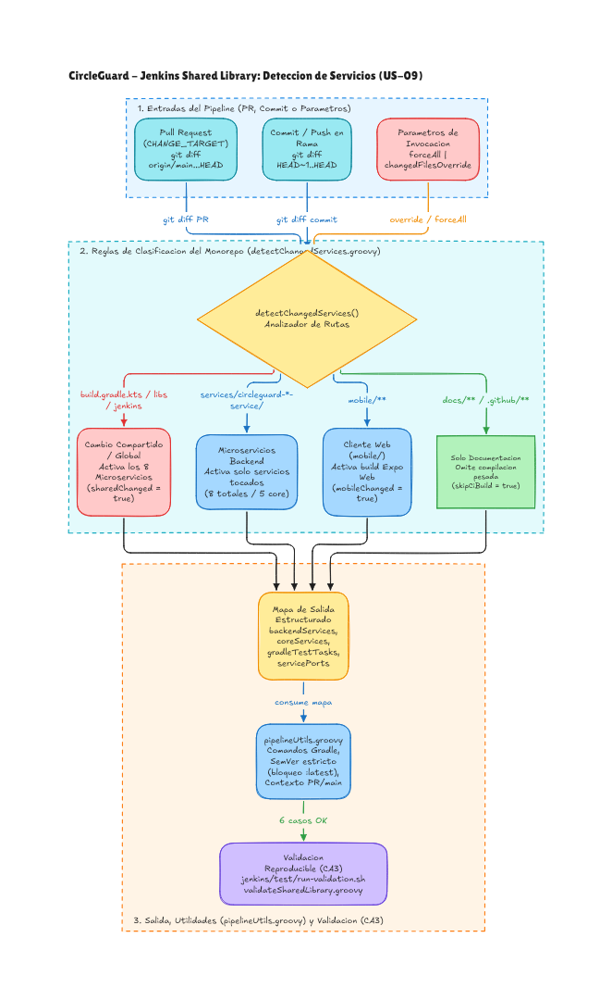

# Shared Library de Jenkins para Detección de Servicios Modificados (`US-09` / `SCRUM-21`)

> **Proyecto:** CircleGuard — Ingeniería de Software V (Universidad Icesi)  
> **Espacio en Jira:** `SuperPoderosos` (`circleguard777.atlassian.net`)  
> **Épica Asociada:** `EPIC-04` (`SCRUM-7`) — Integración Continua (CI) con Jenkins y SonarQube (`E1.4`)  
> **Historia de Usuario:** `US-09` (`SCRUM-21`) — Implementación de la Shared Library de Jenkins para detección de servicios modificados (`3 SP`)  
> **Subtarea Cubierta:** `SCRUM-55` (`3 SP`) — Implementar la detección de servicios modificados y utilidades comunes en la Shared Library Jenkins.

---

## 1. Propósito y Alcance

En el monorepo de **CircleGuard** conviven **8 microservicios backend** (Spring Boot 3 / Java 21), el **cliente web/móvil** (`mobile/` en Expo React Native) y archivos de configuración e infraestructura compartida. Compilar y ejecutar pruebas de los 9 componentes en cada *Pull Request* cuando solo se modificó un servicio incrementa innecesariamente los tiempos de retroalimentación del pipeline.

Esta librería compartida (**Jenkins Shared Library**) ubicada en `jenkins/vars/` resuelve ese problema mediante:
1. **`detectChangedServices.groovy` (`CA1`, `CA2`):** Detecta de forma determinística qué microservicios o componentes cambiaron en un *Pull Request* (`git diff origin/<CHANGE_TARGET>...HEAD`) o en un *commit* (`git diff HEAD~1..HEAD`), incluyendo la detección de **cambios compartidos/globales** (`build.gradle.kts`, `settings.gradle.kts`, `gradle/`, `libs/`, `Jenkinsfile`, `jenkins/`) que impactan automáticamente a todos los servicios.
2. **`pipelineUtils.groovy` (`CA1`, `CA3`):** Provee utilidades reutilizables para construir comandos `./gradlew` acotados a los servicios afectados, distinguir entre ejecuciones en *Pull Request* vs. `main` (`canDeployProd`), y validar que las etiquetas de imágenes Docker usen **SemVer estricto** prohibiendo `:latest`.
3. **Validación Reproducible (`CA3`):** Suite automatizada en `jenkins/test/validateSharedLibrary.groovy` y ejecutor `jenkins/test/run-validation.sh` (integrado además en la tarea Gradle `./gradlew validateJenkinsSharedLibrary`).

---

## 2. Arquitectura y Flujo de Detección (Excalidraw)

El siguiente diagrama fue construido y exportado utilizando **Excalidraw** (cumpliendo la prohibición de usar Mermaid):

- **Archivo fuente editable Excalidraw:** [`docs/agil/diagramas/jenkins-shared-library-detection.excalidraw`](diagramas/jenkins-shared-library-detection.excalidraw)
- **Imagen exportada PNG:**



---

## 3. Estructura de Archivos en `jenkins/`

| Ruta en el Repositorio | Rol en la Shared Library | Criterio de Aceptación |
| :--- | :--- | :---: |
| [`jenkins/vars/detectChangedServices.groovy`](../../jenkins/vars/detectChangedServices.groovy) | Paso global de Jenkins que inspecciona el `git diff` (en PR o commit) y clasifica los servicios modificados. | `CA1`, `CA2`, `CA3` |
| [`jenkins/vars/detectChangedServices.txt`](../../jenkins/vars/detectChangedServices.txt) | Documentación integrada de ayuda de Jenkins (*Global Variable Reference*) para `detectChangedServices`. | `CA1` |
| [`jenkins/vars/pipelineUtils.groovy`](../../jenkins/vars/pipelineUtils.groovy) | Utilidades comunes de construcción de comandos Gradle selectivos, evaluación de ramas PR/`main` y validación de tags SemVer. | `CA1`, `CA3` |
| [`jenkins/vars/pipelineUtils.txt`](../../jenkins/vars/pipelineUtils.txt) | Documentación integrada de ayuda de Jenkins para `pipelineUtils`. | `CA1` |
| [`jenkins/test/validateSharedLibrary.groovy`](../../jenkins/test/validateSharedLibrary.groovy) | Suite de pruebas automatizadas en Groovy que valida 6 escenarios de detección y utilidades simulando un pipeline de Jenkins. | `CA2`, `CA3` |
| [`jenkins/test/run-validation.sh`](../../jenkins/test/run-validation.sh) | Script Bash idempotente para ejecutar la validación de la Shared Library desde cualquier entorno local o agente CI. | `CA3` |

---

## 4. Reglas de Clasificación de Cambios (`CA2`)

La función `detectChangedServices` clasifica cada ruta obtenida del `git diff` aplicando las siguientes reglas de precedencia:

| Tipo de Ruta Modificada | Patrones Evaluados | Comportamiento en el Pipeline |
| :--- | :--- | :--- |
| **Cambio Compartido / Global** | `build.gradle.kts`, `settings.gradle.kts`, `gradle.properties`, `gradlew`, `gradle/**`, `libs/**`, `Jenkinsfile`, `jenkins/**` | Marca `sharedChanged = true` y `fullBuild = true`. **Activa automáticamente los 8 microservicios backend** para garantizar que ningún cambio transversal rompa servicios dependientes. |
| **Microservicio Backend Específico** | `services/circleguard-<nombre>-service/**` | Agrega únicamente el microservicio modificado a `backendServices` (y a `coreServices` si pertenece a los 5 servicios núcleo: `auth`, `identity`, `promotion`, `form`, `gateway`). |
| **Cliente Web / Móvil** | `mobile/**` | Marca `mobileChanged = true` e incluye `mobile` en `allComponents`. |
| **Infraestructura y Orquestación** | `infra/**`, `deploy/**`, `docker-compose*.yml`, `init-db.sql` | Marca `infraChanged = true` y desactiva `skipCiBuild`. |
| **Exclusivamente Documentación** | `docs/**`, `.github/**`, `*.md`, `*.excalidraw`, `*.svg`, `*.png` | Si no hay otros archivos de código o infraestructura en el commit/PR, marca `docsOnly = true` y `skipCiBuild = true` para ahorrar recursos de cómputo. |

---

## 5. Invocación desde un Pipeline (`CA3`)

En `US-30` ([`Jenkinsfile` Multibranch](JENKINS_MULTIBRANCH_US30.md)), la librería se consume desde el `Jenkinsfile` raíz:

```groovy
@Library('circleguard-shared-lib') _

pipeline {
    agent any
    stages {
        stage('Detect Changed Components') {
            steps {
                script {
                    def detection = detectChangedServices(forceAll: params.FORCE_FULL_BUILD as boolean)
                    echo pipelineUtils.formatDetectionSummary(detection)

                    String gradleCmd = pipelineUtils.buildGradleCommandForServices(
                        detection.backendServices,
                        [includeTests: true, includeJacoco: false]
                    )
                    // sh gradleCmd
                }
            }
        }
    }
}
```

`US-30` añade dos pasos reutilizables sobre esta base:

- [`multibranchFlow.groovy`](../../jenkins/vars/multibranchFlow.groovy): contexto PR/`main`, plan de etapas y bloqueo de despliegues desde PR.
- [`publishBuildStatus.groovy`](../../jenkins/vars/publishBuildStatus.groovy): publicación del estado del build en GitHub.

El detalle del pipeline, la configuración JCasC del job y el webhook están en [`docs/agil/JENKINS_MULTIBRANCH_US30.md`](JENKINS_MULTIBRANCH_US30.md).

---

## 6. Validación Reproducible (`CA3`)

Para verificar el comportamiento de la librería sin requerir una instancia activa de Jenkins, ejecuta desde la raíz del repositorio:

```bash
./jenkins/test/run-validation.sh
```
*(O mediante Gradle con `./gradlew validateJenkinsSharedLibrary`).*

### Resultado de Ejecución Verificado

```text
[US-09] Ejecutando validacion reproducible con Java + Groovy 4.0.21...
=== Iniciando validacion reproducible de la Shared Library (US-09) ===
[OK] Caso 1: Deteccion en PR con cambio en 1 microservicio + mobile validada.
[OK] Caso 2: Deteccion de multiples microservicios especificos y filtrado de coreServices validada.
[OK] Caso 3: Cambio compartido (build.gradle.kts) activa correctamente los 8 microservicios.
[OK] Caso 4: Cambios exclusivos de documentacion detectados con skipCiBuild=true.
[OK] Caso 5: Bandera forceAll=true incluye los 8 microservicios y mobile.
[OK] Caso 6: Utilidades de pipelineUtils (contexto PR/main, comandos Gradle y bloqueo de :latest) validadas.
=== CircleGuard Monorepo Change Detection Summary ===
Archivos modificados : 2
Cambio global/shared : false
Servicios backend    : circleguard-auth-service
Cliente web (mobile) : true
Infraestructura      : false
Omitir build pesado  : false
=====================================================
=== TODAS LAS PRUEBAS DE LA SHARED LIBRARY PASARON EXITOSAMENTE ===
```
