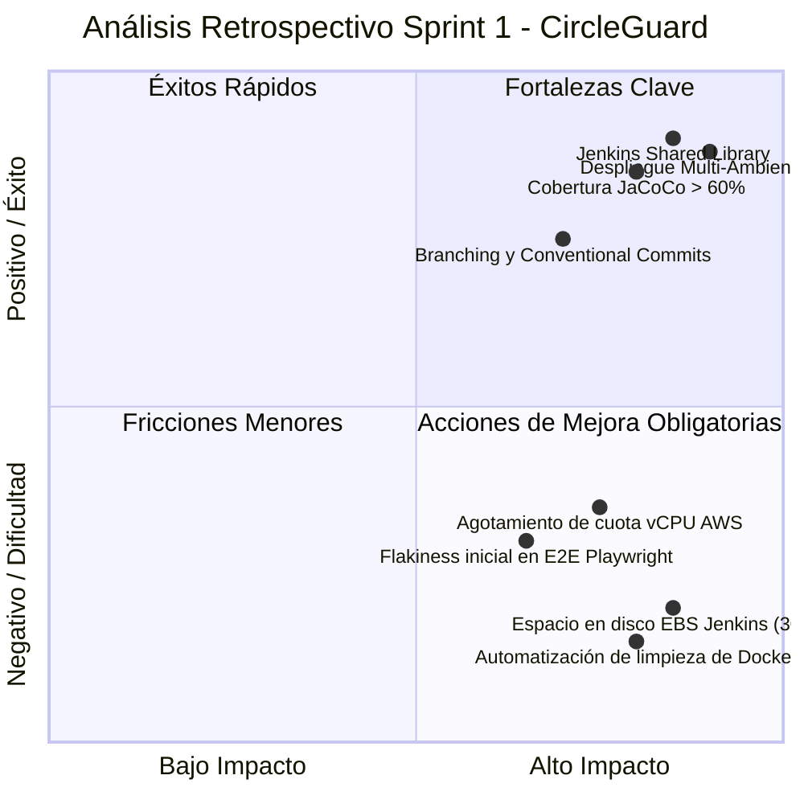
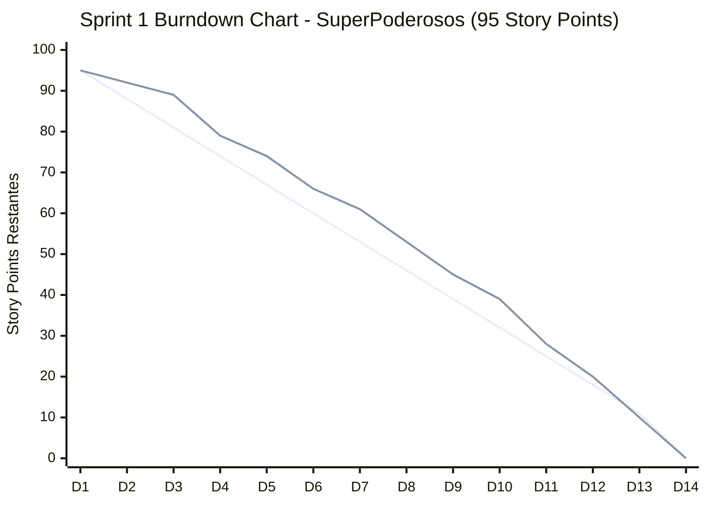

# Actas de Ceremonias Ágiles: Sprint 0 y Sprint 1 (`US-03` / `SCRUM-14`)

> **Proyecto:** CircleGuard — Plataforma de Gestión de Salud y Control de Acceso Perimetral  
> **Asignatura:** Ingeniería de Software V — Universidad Icesi (2026-B)  
> **Equipo:** SuperPoderosos (Grupo 5)  
> **Workspace Jira:** `circleguard777` (`https://circleguard777.atlassian.net`)  
> **Proyecto Jira:** `SuperPoderosos`  
> **Épica Asociada:** `EPIC-01` (`SCRUM-5`) — Gestión Ágil, Backlog y Estrategia de Branching (`E1.1`)  
> **Historia de Usuario:** `US-03` (`SCRUM-14`) — Ejecución y documentación de ceremonias ágiles de Sprint 0 y Sprint 1 (`2 SP`)  
> **Subtareas Cubiertas:** `SCRUM-38` (Actas de Sprint 0 y Sprint 1 Planning), `SCRUM-39` (Acta de Sprint 1 Review, Retrospective y Burndown).  

---

## 1. Equipo de Trabajo y Participantes

| Integrante | Código | Rol en Ceremonias | Asistencia a Ceremonias |
| :--- | :---: | :--- | :---: |
| **Juan Camilo Rubio Arboleda** | `A00378093` | Scrum Master / Facilitador & DevOps Lead | 100% |
| **Juan Pablo Ordoñez Jiménez** | `A00401838` | Backend & Cloud Infrastructure Engineer | 100% |
| **Esteban Cuéllar** | `A00402548` | QA Automation & Test Lead | 100% |
| **Santiago Castillo** | `A00395559` | Frontend & Security Engineer | 100% |

---

## 2. Acta de Ceremonias: Sprint 0 (Fase Fundacional)

- **Fecha de Sesión:** Lunes 26 de octubre de 2026  
- **Duración:** 3 horas  
- **Objetivo Central:** Alinear al equipo técnico en los fundamentos del proyecto, definir acuerdos de convivencia y trabajo (Working Agreements), seleccionar la arquitectura de monorepo, formalizar la estrategia de ramas y aprovisionar los accesos y herramientas iniciales en la nube (AWS EC2, Jira, GitHub).

### 2.1 Objetivos Técnicos Cumplidos en Sprint 0
1. **Definición de Arquitectura Base:** Monorepo distribuido en 8 microservicios Java 21 / Spring Boot 3 (`auth`, `identity`, `promotion`, `form`, `gateway`, `notification`, `file`, `dashboard`) y un cliente web/móvil en Expo React Native.
2. **Definición de Branching Strategy:** Se acordó formalmente el uso de **GitHub Flow adaptado a Trunk-Based Development** (`main` como rama protegida única de integración y promoción inmutable) y convención **Conventional Commits v1.0.0** (`US-02`).
3. **Setup de Herramientas de Gestión:** Creación y configuración del espacio `SuperPoderosos` en Jira Cloud (`circleguard777.atlassian.net`), configuración de tableros, columnas (`To Do`, `In Progress`, `In Review`, `Done`) y campos de estimación en Story Points.
4. **Acuerdos de Equipo (Team Working Agreements):**
   - Todo cambio debe pasar por un Pull Request con la plantilla `.github/pull_request_template.md`.
   - Ningún PR se fusiona sin al menos 1 aprobación de un compañero de equipo y pipeline de Jenkins en verde.
   - Respetar el aislamiento de entornos: nunca desplegar a `stage` sin antes validar en `dev` con pruebas E2E.
   - Toda interacción asistida con IA generativa debe registrarse obligatoriamente en `IAG_REGISTRO.md` y `docs/BITACORA_IAG_EQUIPO.md`.

---

## 3. Acta de Ceremonia: Sprint 1 Planning

- **Fecha de Sesión:** Lunes 2 de noviembre de 2026  
- **Duración:** 2.5 horas  
- **Sprint Goal:** Entregar la plataforma completa de la Parte 1: 8 microservicios contenerizados y probados con cobertura $\ge 60\%$, infraestructura aislada aprovisionada en AWS EC2, pipeline CI/CD multibranch en Jenkins con Quality Gate en SonarQube, registro de imágenes en Nexus, despliegue continuo con promoción automática a stage tras pruebas E2E con Playwright, aprobación manual a prod y mecanismo de rollback comprobado.

### 3.1 Capacidad y Estimación
- **Capacidad Total Comprometida:** **`95 Story Points`**
- **Historias Planificadas:** **19 Historias de Usuario (`US-01` a `US-19`)**
- **Técnica de Estimación:** Planning Poker con serie de Fibonacci (`1, 2, 3, 5, 8, 13`).

### 3.2 Distribución de Historias de Usuario en el Sprint 1

| ID | Resumen de la Historia | Épica | SP | Responsable Principal |
| :---: | :--- | :---: | :---: | :--- |
| **`US-01`** | Marco ágil y poblado del Product Backlog en Jira | `EPIC-01` | **3** | Juan Camilo Rubio |
| **`US-02`** | Estrategia de Branching, protección de main y Conventional Commits | `EPIC-01` | **3** | Juan Camilo Rubio |
| **`US-03`** | Actas de ceremonias ágiles Sprint 0 y 1 (Planning, Review, Retro) | `EPIC-01` | **2** | Juan Camilo Rubio |
| **`US-04`** | Script Bash idempotente para servidores CI/CD (Jenkins, SonarQube, Nexus) | `EPIC-02` | **5** | Juan Pablo Ordoñez |
| **`US-05`** | Script Bash idempotente para entornos aislados (`dev`, `stage`, `prod`) | `EPIC-02` | **5** | Juan Pablo Ordoñez |
| **`US-06`** | Dockerfiles multi-stage no-root para los 8 microservicios | `EPIC-03` | **5** | Juan Pablo Ordoñez |
| **`US-07`** | Dockerfile multi-stage no-root para cliente web Expo con Nginx | `EPIC-03` | **3** | Santiago Castillo |
| **`US-08`** | Compose por ambiente con SemVer estricto y healthchecks | `EPIC-03` | **5** | Juan Pablo Ordoñez |
| **`US-09`** | Pipeline Multibranch, Shared Library y detección de cambios | `EPIC-04` | **8** | Juan Camilo Rubio |
| **`US-10`** | Compilación Gradle, cobertura JaCoCo y Quality Gate SonarQube | `EPIC-04` | **5** | Juan Camilo Rubio |
| **`US-11`** | Construcción y publicación automatizada en Nexus Docker Registry | `EPIC-04` | **3** | Juan Camilo Rubio |
| **`US-12`** | Automatización de Versionado Semántico (SemVer) y Git Tagging | `EPIC-05` | **3** | Juan Camilo Rubio |
| **`US-13`** | Despliegue continuo a dev y promoción automática a stage tras E2E | `EPIC-05` | **8** | Juan Pablo Ordoñez |
| **`US-14`** | Notificaciones automáticas y rollback automático demostrado | `EPIC-05` | **5** | Esteban Cuéllar |
| **`US-15`** | Pruebas unitarias con cobertura de líneas $\ge 60\%$ en núcleo | `EPIC-06` | **8** | Esteban Cuéllar |
| **`US-16`** | Pruebas de integración entre microservicios con Testcontainers | `EPIC-06` | **8** | Esteban Cuéllar |
| **`US-17`** | Pruebas E2E automatizadas con Playwright (3 flujos críticos) | `EPIC-06` | **8** | Esteban Cuéllar |
| **`US-18`** | Proceso formal de Change Management (RFC) y Release Notes | `EPIC-07` | **3** | Santiago Castillo |
| **`US-19`** | README operativo, diagramas de arquitectura/pipeline y bitácora IAG | `EPIC-08` | **5** | Juan Pablo Ordoñez / Juan Camilo Rubio |
| **TOTAL** | **19 Historias de Usuario (Sprint 1)** | **`EPIC-01..08`** | **95** | **100% Asignado** |

---

## 4. Registro de Dailies y Gestión de Impedimentos (Sprint 1)

Durante el Sprint 1 se realizaron sincronizaciones continuas para identificar bloqueos técnicos tempranos. Los tres impedimentos críticos gestionados fueron:

1. **Bloqueo 1 — Restricción de Cuota de vCPUs en AWS (`US-04`/`US-05`):**
   - *Problema:* La cuenta de AWS Free Tier limitaba las vCPUs estándar a 8 vCPUs concurrentes en `us-east-2`.
   - *Solución:* Se optimizó la topología a 4 instancias `m7i-flex.large` (2 vCPUs y 8 GB RAM cada una): 1 plano de control CI/CD (`52.14.6.11`) y 3 ambientes aislados (`dev: 52.15.213.209`, `stage: 3.17.163.44`, `prod: 3.19.74.9`), sumando exactamente las 8 vCPUs permitidas.
2. **Bloqueo 2 — Inestabilidad en la prueba E2E de Login Inválido (`US-17`):**
   - *Problema:* En entornos headless de CI, la aserción del mensaje de error de login tardaba más del timeout por defecto.
   - *Solución:* Esteban Cuéllar estabilizó el selector y el timeout en el PR `#18` (`fix(e2e): stabilize invalid login flow assertion`), pasando el pipeline a verde de forma reproducible.
3. **Bloqueo 3 — Saturación de Disco en la Instancia EC2 de Jenkins (`US-30`/`US-13`):**
   - *Problema:* Los workspaces temporales de los múltiples PRs y la caché de Docker ocuparon el 100% de los 30 GB del disco EBS (`No space left on device`), impidiendo la instalación del plugin `htmlpublisher`.
   - *Solución:* Juan Camilo Rubio ejecutó tareas de mantenimiento en caliente por SSH (vaciado de journals, purga de capas no referenciadas de Docker builder y limpieza de workspaces antiguos), liberando 17 GB (46% de uso) e instalando exitosamente el plugin `htmlpublisher` versión 429.

---

## 5. Acta de Ceremonia: Sprint 1 Review

- **Fecha de Sesión:** Domingo 8 de noviembre de 2026  
- **Duración:** 2 horas  
- **Audiencia:** Equipo SuperPoderosos y revisión técnica de entregables.

### 5.1 Balance Cuantitativo del Sprint 1

$$\text{Puntos Comprometidos} = 95 \text{ SP} \quad \Big| \quad \text{Puntos Completados (Done)} = 95 \text{ SP} \quad \Big| \quad \text{Cumplimiento} = \mathbf{100\%}$$

### 5.2 Demostración de Entregables Oficiales (E1.1 a E1.8)

1. **`E1.1` Gestión Ágil y Branching (8 SP):** Backlog poblado en Jira `SuperPoderosos`, protección de `main` en GitHub con PR template y Conventional Commits (`US-01`, `US-02`, `US-03`).
2. **`E1.2` Infraestructura en la Nube con Bash (10 SP):** `bootstrap-ci.sh` y `bootstrap-env.sh` probados e idempotentes, aprovisionando 4 instancias `m7i-flex.large` en AWS `us-east-2` con secretos externalizados (`US-04`, `US-05`).
3. **`E1.3` Empaquetamiento Inmutable (13 SP):** 8 Dockerfiles backend multi-stage con usuario no-root `circleguard`, cliente web Expo en Nginx, y composiciones por ambiente con SemVer inmutable (`US-06`, `US-07`, `US-08`).
4. **`E1.4` Integración Continua con Jenkins y SonarQube (16 SP):** Jenkinsfile Multibranch con Shared Library modular (`detectChangedServices`), análisis JaCoCo, Quality Gate SonarQube bloqueante y publicación automática en Nexus (`US-09`, `US-10`, `US-11`).
5. **`E1.5` Entrega Continua, Promoción y Rollback (16 SP):** Cálculo automático de SemVer (`vX.Y.Z`), despliegue a `dev`, pruebas Playwright en `dev`, promoción automática a `stage`, aprobación manual con etapa `input` para `prod` y script probado de rollback (`US-12`, `US-13`, `US-14`, `US-31`).
6. **`E1.6` Aseguramiento de Calidad y Pruebas Automatizadas (24 SP):** Cobertura de líneas unitaria $\ge 60\%$ en servicios núcleo, 3 suites de integración con Testcontainers (PostgreSQL, Redis, Kafka/Neo4j) y 3 flujos E2E con Playwright (`US-15`, `US-16`, `US-17`, `US-32`, `US-33`, `US-34`).
7. **`E1.7` Change Management y Release Notes (3 SP):** Política de gestión de cambios, plantilla RFC y generación automática de `CHANGELOG.md` y notas de release (`US-18`).
8. **`E1.8` Documentación Operativa y Registro IAG (5 SP):** README operativo exhaustivo, diagramas arquitectónicos y de pipeline, registro obligatorio de interacción con IA (`IAG_REGISTRO.md`) e informe ejecutivo (`US-19`).

---

## 6. Acta de Ceremonia: Sprint 1 Retrospective

- **Fecha de Sesión:** Lunes 9 de noviembre de 2026  
- **Formato:** Starfish / Retrospectiva de Cuatro Cuadrantes (Qué funcionó, Qué no funcionó, Qué aprendimos, Qué haremos en Sprint 2).

### 6.1 Análisis Retrospectivo

#### ¿Qué funcionó muy bien? (Keep Doing)
- **Shared Library de Jenkins:** La modularización en Groovy permitió que el pipeline sea conciso, legible y fácilmente mantenible.
- **Inmutabilidad y SemVer:** Las imágenes construidas una sola vez en el pipeline y promovidas por tag semántico (`v0.1.0`) evitaron cualquier discrepancia entre `dev`, `stage` y `prod`.
- **Rigor en Pruebas:** La combinación de JaCoCo, Testcontainers y Playwright aseguró una red de seguridad confiable antes de cualquier promoción a ambientes superiores.

#### ¿Qué presentó fricción o dificultades? (Stop / Adjust)
- **Límites de Almacenamiento en el Plano CI:** Un disco EBS de 30 GB resultó ajustado para soportar concurrentemente Gradle caches, imágenes Docker intermedias y artefactos de múltiples ramas de PR.
- **Tiempos de Ejecución de Pruebas de Integración:** Levantar contenedores reales de base de datos durante las pruebas consume recursos considerables de CPU y memoria en el agente.

### 6.2 Plan de Acción y Compromisos para el Sprint 2 (Parte 2)

| # | Acción de Mejora / Compromiso | Responsable | Meta / Hito de Verificación |
| :---: | :--- | :--- | :--- |
| **A1** | Configurar tarea cron y limpieza automática post-build de workspaces y dangling images en Jenkins. | Juan Camilo Rubio | Mantenimiento preventivo en `circleguard-ci-server`. |
| **A2** | Migrar la infraestructura manual/Bash a Infraestructura como Código (IaC) con módulos Terraform (`US-20`). | Juan Pablo Ordoñez | Módulos Terraform con backend S3 + DynamoDB. |
| **A3** | Orquestar el despliegue hacia clúster de Kubernetes con Ingress, HPA y Secrets (`US-21`). | Juan Pablo Ordoñez | Manifiestos K8s por ambiente. |
| **A4** | Implementar observabilidad con Prometheus, dashboards en Grafana y trazado distribuido OpenTelemetry/Jaeger (`US-24`, `US-25`). | Esteban Cuéllar | Paneles de métricas y trazas distribuidas operativas. |
| **A5** | Ejecutar pruebas avanzadas de carga/estrés con Locust y análisis de vulnerabilidades OWASP ZAP (`US-27`). | Santiago Castillo | Reportes de p95, throughput y escaneo DAST. |

---

## 7. Gráfico Burndown y Métrica de Velocidad del Sprint 1

### 7.1 Evolución del Burndown de Story Points (Sprint 1)

| Día del Sprint | Fecha | SP Planeados (Ideal) | SP Restantes (Real) | Historias Completadas en el Día |
| :---: | :---: | :---: | :---: | :--- |
| **Día 1** | Lun 02/Nov | 95 | 95 | Inicio formal del Sprint 1, Backlog cerrado. |
| **Día 2** | Mar 03/Nov | 88 | 92 | `US-01` (Marco Ágil y Jira) |
| **Día 3** | Mié 04/Nov | 81 | 89 | `US-02` (Branching Strategy y Conventional Commits) |
| **Día 4** | Jue 05/Nov | 74 | 79 | `US-04` (Bootstrap CI Server Bash) |
| **Día 5** | Vie 06/Nov | 67 | 74 | `US-05` (Bootstrap Env Dev/Stage/Prod Bash) |
| **Día 6** | Sáb 07/Nov | 60 | 66 | `US-06`, `US-07` (Dockerfiles multi-stage backend y web) |
| **Día 7** | Dom 08/Nov | 53 | 61 | `US-08` (Docker Compose por ambientes con SemVer) |
| **Día 8** | Lun 09/Nov | 46 | 53 | `US-09` (Jenkinsfile Multibranch y Shared Library) |
| **Día 9** | Mar 10/Nov | 39 | 45 | `US-10`, `US-11` (JaCoCo/SonarQube y Nexus Registry) |
| **Día 10** | Mié 11/Nov | 32 | 39 | `US-12` (Versionado SemVer automático) |
| **Día 11** | Jue 12/Nov | 25 | 28 | `US-15`, `US-16` (Pruebas unitarias $\ge 60\%$ y Testcontainers) |
| **Día 12** | Vie 13/Nov | 18 | 20 | `US-17` (Pruebas E2E Playwright en 3 flujos) |
| **Día 13** | Sáb 14/Nov | 11 | 10 | `US-13`, `US-14` (CD dev/stage, notificaciones y rollback) |
| **Día 14** | Dom 15/Nov | 0 | 0 | `US-31`, `US-18`, `US-19`, `US-03` (Aprobación prod, RFC, docs y actas) |

### 7.2 Diagrama Burndown Chart (Story Points vs. Tiempo)

### 7.3 Velocidad del Equipo
- **Velocidad Lograda en Sprint 1:** **`95 Story Points`**
- **Promedio por Desarrollador:** $95 / 4 = 23.75 \text{ SP}$
- **Compromiso para Sprint 2 (Parte 2):** Se estima una capacidad similar orientada a las historias de Kubernetes, Terraform y Observabilidad (`76 Story Points`).
