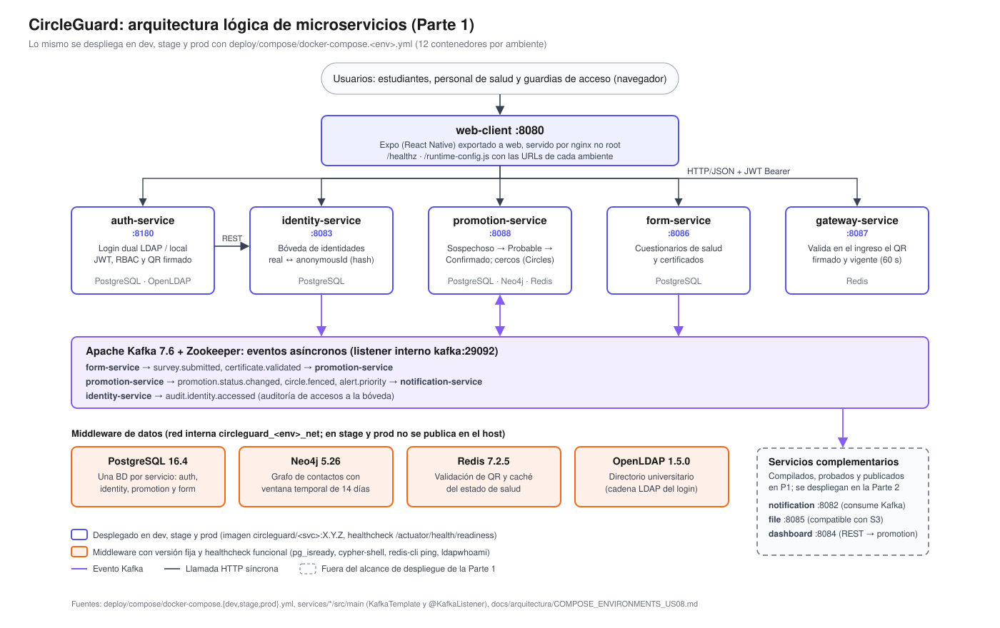
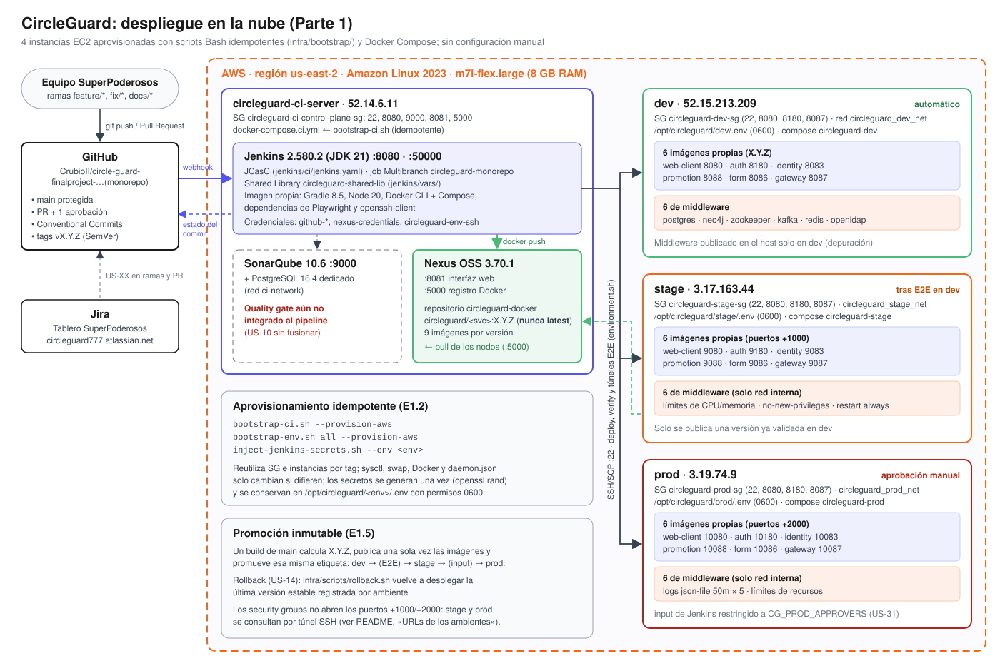

# Arquitectura de CircleGuard: microservicios y despliegue en la nube (Parte 1)

> Historia de usuario: `US-19` (entregable `E1.8`). Este documento reúne las dos vistas de arquitectura de la Parte 1. El flujo del pipeline está en [`PIPELINE_CICD.md`](PIPELINE_CICD.md).
>
> Los diagramas son SVG versionados en [`diagramas/`](diagramas/). Se pueden editar como texto y GitHub los muestra directamente.

## 1. Vista lógica: microservicios y middleware

El cliente web llama por HTTP a los cinco servicios núcleo. Las URLs de cada ambiente las inyecta `/runtime-config.js`, que genera el contenedor `web-client` al arrancar (US-07). Los servicios se comunican de forma asíncrona por Kafka. La única llamada síncrona entre servicios es `auth-service → identity-service`, que obtiene el `anonymousId` durante el login.

| Servicio | Puerto (dev) | Responsabilidad | Datos | Kafka |
|---|---|---|---|---|
| `auth-service` | 8180 | Login dual LDAP/local, JWT, RBAC y emisión del QR firmado | PostgreSQL, OpenLDAP | — |
| `identity-service` | 8083 | Bóveda que mapea identidad real ↔ `anonymousId` | PostgreSQL | produce `audit.identity.accessed` |
| `promotion-service` | 8088 | Máquina de estados Sospechoso → Probable → Confirmado y cercos | PostgreSQL, Neo4j, Redis | consume `survey.submitted` y `certificate.validated`; produce `promotion.status.changed`, `circle.fenced` y `alert.priority` |
| `form-service` | 8086 | Cuestionarios de salud y certificados | PostgreSQL | produce `survey.submitted` y `certificate.validated` |
| `gateway-service` | 8087 | Valida en el ingreso el QR firmado y vigente (60 s) | Redis | — |
| `web-client` | 8080 | Expo exportado a web, servido por nginx sin root | — | — |
| `notification-service` | 8082 | Despacho multicanal | — | consume `promotion.status.changed`, `circle.fenced` y `alert.priority` |
| `file-service` | 8085 | Certificados y documentos (compatible con S3) | — | — |
| `dashboard-service` | 8084 | Analítica de focos; consulta `promotion-service` por REST | — | — |

**Alcance de despliegue de la Parte 1.** En los tres ambientes se despliegan los cinco servicios núcleo, el cliente web y el middleware (12 contenedores por ambiente). `notification`, `file` y `dashboard` se compilan, se prueban y se publican en Nexus en cada build de `main`, pero se despliegan en la Parte 2.

**Salud.** Cada servicio núcleo expone `/actuator/health/readiness` con un grupo que incluye sus dependencias. Por ejemplo, `promotion` solo queda `UP` si alcanza PostgreSQL, Neo4j y Redis. `docker compose` arranca cada contenedor solo cuando sus dependencias están `service_healthy`. El detalle está en [`COMPOSE_ENVIRONMENTS_US08.md`](COMPOSE_ENVIRONMENTS_US08.md).

## 2. Vista de despliegue: AWS us-east-2

| Rol | Instancia (tag `Name`) | IP pública | Security group (puertos de entrada) | Aprovisionado con |
|---|---|---|---|---|
| Plano de control CI/CD: Jenkins, SonarQube y Nexus | `circleguard-ci-server` (`i-061a73505a3aa1baa`) | `18.117.90.15` | `circleguard-ci-control-plane-sg`: 22, 8080, 9000, 8081, 5000 | `infra/bootstrap/bootstrap-ci.sh` + `docker-compose.ci.yml` |
| Ambiente `dev` | `i-018eeb2ef96a6d94d` | `52.15.165.116` | `circleguard-dev-sg`: 22, 8080, 8180, 8087 | `infra/bootstrap/bootstrap-env.sh dev` |
| Ambiente `stage` | `i-05022e77d42dfafe5` | `52.14.89.125` | `circleguard-stage-sg`: 22, 8080, 8180, 8087 | `infra/bootstrap/bootstrap-env.sh stage` |
| Ambiente `prod` | `i-00e21144a1c89b8a5` | `77.113.211.62` | `circleguard-prod-sg`: 22, 8080, 8180, 8087 | `infra/bootstrap/bootstrap-env.sh prod` |

Decisiones y *trade-offs*:

- **Un nodo por ambiente.** El aislamiento es por instancia, security group, red Docker (`circleguard_<env>_net`) y secretos (`/opt/circleguard/<env>/.env`, `0600`). Si un despliegue de dev falla, stage y prod no se ven afectados.
  - Los puertos de stage (+1000) y prod (+2000) están desplazados. Así los tres ambientes pueden convivir en un solo nodo si la cuota de AWS no alcanza (el *fallback* de US-05).
- **Jenkins despliega por SSH, no por agentes en cada nodo.** El agente copia el compose y los scripts por SCP y ejecuta `docker compose` en el nodo (`deploy/scripts/environment.sh`).
  - Con esto no hay que instalar ni mantener un agente por ambiente, y el único puerto que necesita Jenkins es el 22.
  - La verificación de salud se ejecuta dentro del nodo, y los E2E contra dev usan túneles `ssh -L`.
- **El registro Docker vive en Nexus, en el mismo nodo de CI** (`18.117.90.15:5000`, HTTP con `insecure-registries` en cada nodo). Es más barato que un servicio administrado y basta para la Parte 1. En la Parte 2 se reemplaza por la IaC de Terraform (E2.1).
- **Las imágenes son inmutables.** Un build de `main` publica `circleguard/<svc>:X.Y.Z` una sola vez y esa etiqueta se promueve sin recompilar. Ningún compose acepta `latest`: `${IMAGE_TAG:?}` falla si la etiqueta falta.
- **El plano de control exige sesión.** Jenkins usa cuentas locales y una matriz de permisos declaradas en JCasC (US-31): solo `admin` administra y el usuario anónimo no tiene permisos. Es importante porque Jenkins monta el socket de Docker del nodo, así que administrarlo equivale a administrar el servidor. SonarQube recibe el análisis de cada build y avisa el veredicto del Quality Gate a Jenkins por la red interna `ci-network` (`http://jenkins:8080/sonarqube-webhook/`).
- **Los secretos nunca están en el repositorio.** `inject-jenkins-secrets.sh` los recibe de las credenciales de Jenkins, o los genera con `openssl rand` en el primer aprovisionamiento. La contraseña del registro viaja por stdin hasta `docker login --password-stdin`.

**Acceso a los ambientes.** Los security groups solo abren 8080, 8180 y 8087. En dev, eso cubre el cliente web, auth y gateway. Stage y prod publican en +1000 y +2000, así que solo se alcanzan por túnel SSH. Los comandos están en la sección «URLs de los ambientes» del [README](../../README.md#urls-de-los-ambientes-y-herramientas).
