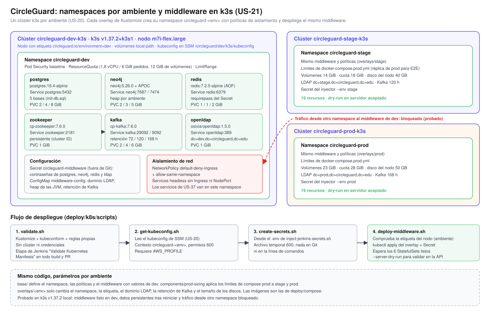

# US-21 — Plataforma Kubernetes con namespaces por ambiente y middleware

| | |
|---|---|
| Historia | US-21 (5 SP) |
| Alcance | Clúster k3s, un namespace por ambiente y el middleware de CircleGuard desplegado con Kustomize |
| Relación | El clúster lo declara [US-20](TERRAFORM_RED_COMPUTO_US20.md). Los secretos salen del inyector de US-05. Las imágenes y versiones son las de compose (US-08). Los servicios, el autoscaling y la salud son US-37 y US-38. |
| Código | [`deploy/k8s/`](../../deploy/k8s/README.md) y la etapa `Validate Kubernetes Manifests` del [`Jenkinsfile`](../../Jenkinsfile) |



## 1. Decisiones de diseño

| Decisión | Motivo |
|---|---|
| **k3s, no EKS** | Ya lo declara US-20: un clúster de un nodo `m7i-flex.large` por ambiente, dentro de la cuota de 8 vCPU de la cuenta y sin los unos 73 USD al mes por clúster del plano de control de EKS. |
| **Kustomize: una base y un overlay por ambiente** | Viene incluido en `kubectl` y en k3s, así que no hay que instalar nada. Es el mismo patrón de US-20: el código es uno solo y cada ambiente cambia sus parámetros. |
| **Manifiestos propios, no charts de Helm** | Los charts de Bitnami usan sus propias imágenes, que desde 2025 son "legacy" en la versión gratuita. Con manifiestos propios, Kubernetes usa exactamente las imágenes y versiones de `deploy/compose`, y `validate.sh` exige que sigan iguales. |
| **Namespace `circleguard-<env>` en el clúster de cada ambiente** | Se mantiene el aislamiento de US-20 (una falla en dev no toca prod). Como los nombres no chocan, los tres overlays también pueden convivir en un clúster compartido o local, y así se probó (§4). |
| **`StatefulSet` y volumen persistente para cada componente** | Los datos sobreviven a reinicios. Kafka y Zookeeper también persisten: si solo Kafka lo hiciera, no volvería a arrancar (`InconsistentClusterIdException`). Los volúmenes usan `local-path`, la clase de almacenamiento de k3s, que guarda en el disco del nodo. |
| **`Service` con el mismo nombre que en compose** | Los servicios de US-37 usarán las mismas URL: `postgres:5432`, `neo4j:7687`, `kafka:29092`, `redis:6379` y `openldap:389`. |
| **Los secretos no van en Git** | Los pods leen el Secret `circleguard-middleware`, que crea `create-secrets.sh` a partir del `.env` de `inject-jenkins-secrets.sh`. Por eso la validación corre sin secretos. |

## 2. Estructura

```
deploy/k8s/
├── base/
│   ├── kustomization.yaml          # recursos, etiquetas y ConfigMaps (valores de dev)
│   ├── namespace/                  # Namespace, LimitRange, ResourceQuota, NetworkPolicy
│   └── middleware/                 # postgres, neo4j, zookeeper, kafka, redis, openldap + init-db.sql
├── components/prod-sizing/         # límites de compose prod y memoria de las JVM (stage y prod)
├── overlays/{dev,stage,prod}/      # namespace, etiqueta, parámetros y discos del ambiente
└── scripts/
    ├── validate.sh                 # CA2 y CA3 sin clúster; lo corre Jenkins
    ├── get-kubeconfig.sh           # kubeconfig desde SSM (US-20)
    ├── create-secrets.sh           # Secret circleguard-middleware
    ├── deploy-middleware.sh        # aplica el overlay y espera a que todo esté listo
    └── lib.sh                      # funciones comunes y herramientas con versión fija
```

## 3. Criterios de aceptación

### CA1 — Se documenta y aprovisiona un clúster ligero (k3s)

**Aprovisionamiento.** El clúster lo crea Terraform, con el módulo `compute` de US-20:

| Elemento | Valor |
|---|---|
| Distribución | k3s `v1.37.2+k3s1`, versión fija |
| Nodos | un server por ambiente (`circleguard-<env>-k3s`) en `m7i-flex.large`, con IP elástica. Se pueden agregar agents con `compute_agent_count` |
| Incluye | containerd, CoreDNS, Traefik (Ingress), `local-path` (volúmenes) y controlador de NetworkPolicy |
| Seguridad | IMDSv2, disco cifrado, `--secrets-encryption`, API 6443 solo desde la VPC y sin SSH (SSM Session Manager) |
| Etiqueta del nodo | `circleguard.io/environment=<env>`, que `deploy-middleware.sh` usa para no aplicar un ambiente en el clúster de otro |
| Acceso | el server publica su kubeconfig, ya apuntando a la IP elástica, en `/circleguard/<env>/k3s/kubeconfig` (SSM SecureString) |

```bash
# 1. Crear el clúster (US-20; necesita credenciales y el backend de US-36)
cd infra/terraform/envs/dev && terraform init -backend-config=backend.hcl && terraform apply

# 2. Conectarse
export AWS_PROFILE=<perfil>
bash deploy/k8s/scripts/get-kubeconfig.sh --env dev      # ~/.kube/circleguard-dev.yaml, permisos 600
export KUBECONFIG=~/.kube/circleguard-dev.yaml
kubectl get nodes -L circleguard.io/environment
```

Para acceder a la API desde fuera de la VPC, pasa tu IP con `TF_VAR_compute_api_allowed_cidrs='["<ip>/32"]'` o abre un túnel con SSM.

### CA2 — Namespaces separados para dev, stage y prod

Cada overlay crea su namespace, y todos sus recursos quedan dentro de él:

| | dev | stage | prod |
|---|---|---|---|
| Namespace | `circleguard-dev` | `circleguard-stage` | `circleguard-prod` |
| Clúster | `circleguard-dev-k3s` | `circleguard-stage-k3s` | `circleguard-prod-k3s` |
| Etiqueta | `circleguard.io/environment=dev` | `…=stage` | `…=prod` |
| Pod Security | `enforce=baseline` y `audit=restricted` | igual | igual |
| Cuota de CPU y memoria pedidas | 1,8 vCPU y 6 GiB | igual | igual |
| Cuota de volúmenes | 12 GiB | 18 GiB | 28 GiB |

Controles de aislamiento en cada namespace:

- **`NetworkPolicy default-deny-ingress` y `allow-same-namespace`:** un pod de otro namespace (otro ambiente) no llega al middleware.
- **`ResourceQuota`:** limita CPU, memoria, volúmenes y la cantidad de PVC, y prohíbe Services `LoadBalancer` y `NodePort`.
- **`LimitRange`:** da recursos por defecto a los contenedores que no los declaren y fija máximos.
- **Pod Security `baseline`:** rechaza pods privilegiados, `hostPath`, `hostNetwork` y capacidades peligrosas.

### CA3 — El middleware se despliega con Kustomize

```bash
kubectl apply -k deploy/k8s/overlays/<env>                                   # directo
bash deploy/k8s/scripts/deploy-middleware.sh --env <env> --env-file <.env>   # recomendado
```

`deploy-middleware.sh` hace cinco pasos:
1. Valida el overlay.
2. Comprueba que el clúster es el del ambiente.
3. Aplica los manifiestos.
4. Crea el Secret.
5. Espera a que los 6 StatefulSets estén listos.

Con `--server-dry-run` valida contra la API sin cambiar nada.

| Componente | Imagen (= compose) | Service | Probes | Volumen dev / stage / prod |
|---|---|---|---|---|
| PostgreSQL | `postgres:16.4-alpine` | `postgres:5432` | `pg_isready` + `SELECT 1` en `circleguard_auth` | 2 / 4 / 8 GiB |
| Neo4j + APOC | `neo4j:5.26.0` | `neo4j:7687`, `7474` | HTTP 7474 y TCP Bolt | 2 / 3 / 5 GiB |
| Zookeeper | `confluentinc/cp-zookeeper:7.6.0` | `zookeeper:2181` | `srvr` (Mode) y TCP | 1 / 1 / 1 GiB |
| Kafka | `confluentinc/cp-kafka:7.6.0` | `kafka:29092`, `9092` | TCP del listener interno | 2 / 4 / 6 GiB |
| Redis (AOF) | `redis:7.2.5-alpine` | `redis:6379` | `redis-cli ping` con clave | 1 / 1 / 2 GiB |
| OpenLDAP | `osixia/openldap:1.5.0` | `openldap:389` | `ldapwhoami` del administrador y TCP | 1 / 1 / 1 GiB |

Recursos por contenedor (requests / limits). Stage y prod usan los límites de `docker-compose.prod.yml`:

| Componente | dev | stage y prod |
|---|---|---|
| PostgreSQL | 100m, 256Mi / 500m, 512Mi | 250m, 512Mi / 1, 1Gi |
| Neo4j | 200m, 768Mi / 1, 1Gi (heap 512m) | 250m, 1Gi / 1, 1536Mi (heap 640m) |
| Zookeeper | 50m, 256Mi / 250m, 384Mi | 50m, 320Mi / 500m, 512Mi |
| Kafka | 100m, 512Mi / 500m, 768Mi (heap 384m) | 150m, 768Mi / 1, 1Gi (heap 640m) |
| Redis | 25m, 64Mi / 250m, 128Mi | 50m, 128Mi / 500m, 256Mi |
| OpenLDAP | 25m, 64Mi / 250m, 128Mi | 50m, 128Mi / 500m, 256Mi |

**Validación sin clúster (Jenkins y local):** `bash deploy/k8s/scripts/validate.sh`

```
[k8s][OK]    init-db.sql de Kubernetes es igual al de la raíz.
[k8s][OK]    Sin credenciales en texto plano: manifiestos (19 archivos).
[k8s][OK]    dev: esquema válido (Summary: 19 resources found in 1 file - Valid: 19, Invalid: 0, Errors: 0, Skipped: 0).
[k8s][OK]    Ambiente dev: 19 recursos en circleguard-dev; middleware completo; volúmenes 9 Gi de 12Gi.
[k8s][OK]    stage: esquema válido (Summary: 19 resources found in 1 file - Valid: 19, Invalid: 0, Errors: 0, Skipped: 0).
[k8s][OK]    Ambiente stage: 19 recursos en circleguard-stage; middleware completo; volúmenes 14 Gi de 18Gi.
[k8s][OK]    prod: esquema válido (Summary: 19 resources found in 1 file - Valid: 19, Invalid: 0, Errors: 0, Skipped: 0).
[k8s][OK]    Ambiente prod: 19 recursos en circleguard-prod; middleware completo; volúmenes 23 Gi de 28Gi.
[k8s][OK]    Validación de Kubernetes completada para: dev stage prod.
```

Por cada ambiente, el script comprueba:
- que todo esté en su namespace, con Pod Security, cuota, LimitRange y las dos NetworkPolicy;
- que estén los 6 StatefulSets y los 6 Services;
- que no haya Ingress, `LoadBalancer`, `NodePort`, `hostNetwork`, `hostPath` ni contenedores privilegiados;
- que cada imagen tenga versión fija y sea igual a la de compose;
- que cada contenedor tenga probes de readiness y liveness, y requests y limits;
- que `enableServiceLinks` y `automountServiceAccountToken` estén en `false`;
- que no haya Secrets en el render y que las contraseñas salgan solo de `circleguard-middleware`;
- que los volúmenes quepan en la cuota;
- que el esquema sea válido con `kubeconform -strict`;
- que no haya credenciales en texto plano.

Se probó con una copia alterada a propósito (imagen `latest`, Service `NodePort`, una probe faltante, `enableServiceLinks: true`, una contraseña literal, un disco mayor que la cuota y `init-db.sql` distinto): el script detectó los 20 errores.

En Jenkins, la etapa `Validate Kubernetes Manifests` corre en todo build, también en los PR, y archiva `reports/k8s/`. Si al agente le faltan `kubectl`, `yq` o `kubeconform`, `lib.sh` descarga versiones fijas y verifica su SHA-256.

## 4. Prueba en un clúster k3s real

Se levantó k3s `v1.37.2+k3s1`, la misma versión de US-20, como contenedor de Docker (`rancher/k3s`) en la máquina de un integrante. Con Docker limitado a 4 GiB, el middleware completo se desplegó en dev; en stage y prod se crearon los namespaces con sus políticas y se validó el resto con `--server-dry-run`.

| Prueba | Resultado |
|---|---|
| `deploy-middleware.sh --env dev --env-file <.env del inyector>` | Los 6 StatefulSets quedaron listos y los 6 PVC `Bound` |
| PostgreSQL | Existen `circleguard_auth`, `_identity`, `_promotion`, `_form`, `_dashboard` y `circleguard_dev` |
| Neo4j | `RETURN 1` autenticado; APOC 5.26.0 cargado |
| Kafka | Se creó y listó el topic `us21.smoke` en `kafka:29092` |
| Redis | `PONG` con la clave; `WRONGPASS` sin ella o con una clave errónea |
| OpenLDAP | `ldapwhoami` → `dn:cn=admin,dc=dev,dc=circleguard,dc=edu` |
| Persistencia | Tras borrar los pods de Zookeeper, Kafka, Redis y PostgreSQL, se conservaron el topic, la clave de Redis y las bases |
| Aislamiento (CA2) | Desde `circleguard-dev`, se llega a los 5 puertos del middleware; desde `circleguard-stage`, los 5 aparecen como **BLOQUEADO** por la NetworkPolicy |
| Pod Security | Un pod `privileged` en `circleguard-prod` fue rechazado: `violates PodSecurity "baseline:latest"` |
| stage y prod | `--server-dry-run --allow-shared-cluster`: la API aceptó los 19 recursos de cada uno |
| Clúster equivocado | `--env prod` contra el clúster de dev se detuvo: `Los nodos del clúster son de 'dev', no de prod` |
| Cuota de dev en uso | 550m de 1800m de CPU pedida, 1984Mi de 6Gi de memoria y 9Gi de 12Gi de volúmenes |

**Cambios a partir de la prueba.** La primera versión copiaba las probes de compose para Kafka (`kafka-broker-api-versions`) y Neo4j (`cypher-shell`). Ambas herramientas levantan otra JVM en cada chequeo. Con el límite de CPU tardaban más que el `timeoutSeconds`, containerd no las terminaba y se acumulaban hasta que Kafka moría por memoria (`OOMKilled`, 805 MB de 805 MB). Ahora se usan:
- para Kafka, el puerto del listener, que se abre al final del arranque;
- para Neo4j, la API HTTP.

Además, Zookeeper publica su dirección antes de estar listo (`publishNotReadyAddresses`), para que Kafka lo resuelva mientras arranca.

**Comportamiento esperado.** Si Kafka y Zookeeper se reinician juntos, Kafka puede fallar una vez con `node already exists ... /brokers/ids/1`, mientras expira la sesión anterior en Zookeeper (unos 18 s), y se recupera solo.

## 5. Operación

| Tarea | Cómo |
|---|---|
| Rotar una contraseña | Regenerar el `.env` (`--force-rotate` en el inyector), ejecutar `create-secrets.sh` y reiniciar el StatefulSet. PostgreSQL, Neo4j y OpenLDAP solo toman la clave inicial en el primer arranque: después hay que cambiarla también dentro de la base. |
| Agrandar un volumen | `volumeClaimTemplates` no se puede cambiar en un StatefulSet existente y `local-path` no amplía volúmenes. Hay que respaldar los datos, borrar el StatefulSet y el PVC y aplicar de nuevo. |
| Un pod no arranca tras un cambio | Si el pod anterior nunca estuvo listo, el StatefulSet no lo reemplaza. Hay que borrarlo (`kubectl -n circleguard-<env> delete pod <sts>-0`) para que arranque con la versión nueva. |
| Ver el estado | `kubectl -n circleguard-<env> get pods,pvc` y `kubectl -n circleguard-<env> describe resourcequota` |
| Borrar el ambiente | `kubectl delete -k deploy/k8s/overlays/<env>`. Borra el namespace, pero los PV de `local-path` se borran con sus PVC (`reclaimPolicy: Delete`), así que antes hay que respaldar. |

## 6. Pendiente

- **Desplegar en los clústeres de AWS.** Requiere:
  1. credenciales;
  2. el backend remoto (US-36);
  3. el `apply` de US-20;
  4. luego, `get-kubeconfig.sh` y `deploy-middleware.sh` en cada ambiente.

  La versión de k3s y los manifiestos ya se probaron en local (§4).
- **Antes del `apply`:** detener los nodos de la Parte 1 para liberar la cuota de vCPU (ver US-20, §6).
- **Fuera del alcance:** los servicios de CircleGuard, su Ingress y su configuración (US-37), y el autoscaling y las sondas de los servicios (US-38).
