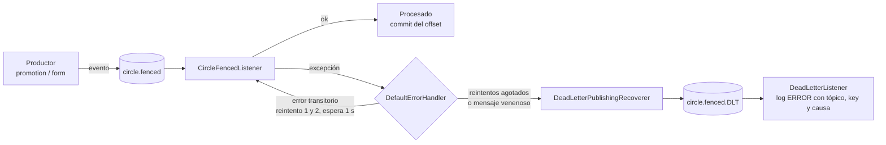

# US-40 — Tercer patrón arquitectónico: consumidor por eventos con reintentos y Dead Letter Topic

| | |
|---|---|
| Historia | US-40, tercer patrón arquitectónico |
| Servicio | `circleguard-notification-service` (consume `promotion.status.changed`, `circle.fenced` y `alert.priority`) |
| Código | [`config/KafkaErrorHandlingConfig.java`](../../services/circleguard-notification-service/src/main/java/com/circleguard/notification/config/KafkaErrorHandlingConfig.java), [`service/DeadLetterListener.java`](../../services/circleguard-notification-service/src/main/java/com/circleguard/notification/service/DeadLetterListener.java) |
| Pruebas | `KafkaErrorHandlingConfigTest`, `DeadLetterListenerTest`, `DeadLetterTopicIntegrationTest` (Kafka embebido) |

## 1. Qué es el patrón

En una arquitectura dirigida por eventos, los servicios no se llaman entre sí: publican eventos en Kafka y otros servicios los consumen. El problema aparece cuando un consumidor **no puede procesar** un mensaje:

- **Error transitorio**: el SMTP, Twilio o un servicio vecino no responde por unos segundos. Reintentar tiene sentido.
- **Mensaje venenoso** (*poison message*): el mensaje está mal formado (no es JSON, le falta estructura). Reintentar nunca va a funcionar.

El patrón **Retry + Dead Letter Queue** (en Kafka se llama *Dead Letter Topic*, DLT) resuelve los dos casos:

1. El consumidor reintenta el mensaje unas pocas veces, con una espera entre intentos.
2. Si sigue fallando, o si el error es de los que nunca se arreglan solos, el mensaje se **aparta** a un tópico especial `<tópico-original>.DLT`, con cabeceras que dicen de dónde vino y por qué falló.
3. El consumidor **sigue** con el siguiente mensaje. Otro consumidor revisa la DLT para alertar y, si se corrige la causa, reprocesar.

La analogía: en una oficina de correos, una carta con la dirección ilegible no detiene toda la fila; se pone en la bandeja de "cartas muertas" y alguien la revisa después.

## 2. Por qué lo elegimos

- CircleGuard ya usa Kafka entre servicios (promoción de estados, cercos de círculos, alertas prioritarias), así que el patrón aprovecha la infraestructura que ya existe.
- Sin él había dos problemas:
  - Los listeners atrapaban **todas** las excepciones y solo escribían un log: un mensaje mal formado se **perdía en silencio**, sin forma de recuperarlo.
  - Si se dejaba propagar la excepción sin un manejador, Spring Kafka reintenta el mismo registro una y otra vez y **bloquea la partición**: los mensajes válidos que vienen detrás no se procesan.
- Es un patrón de **resiliencia en la mensajería**, distinto (y complementario) al circuit breaker de las llamadas HTTP (ver §7).

## 3. Cómo funciona



| Pieza | Qué hace |
|---|---|
| `KafkaErrorHandlingConfig` | Declara un `DefaultErrorHandler` con `FixedBackOff` (1 s, 2 reintentos) y un `DeadLetterPublishingRecoverer`. Spring Boot conecta este único `CommonErrorHandler` a la fábrica de contenedores que usan todos los `@KafkaListener` |
| `DeadLetterPublishingRecoverer` | Publica el mensaje fallido en `<tópico>.DLT`, en la misma partición (o en cualquiera si la DLT tiene menos), con cabeceras `kafka_dlt-original-topic`, `-original-partition`, `-original-offset`, `-exception-fqcn` y `-exception-message` |
| Clasificación de errores | `IllegalArgumentException` y `JsonProcessingException` son **no reintentables**: van directo a la DLT en el primer fallo. El resto se reintenta |
| Listeners | Si el payload no es JSON válido (o no es un objeto JSON), lanzan `IllegalArgumentException("Malformed <tópico> event…")` en lugar de solo escribir un log. Los mensajes válidos se procesan igual que antes |
| `DeadLetterListener` | Consume `promotion.status.changed.DLT`, `circle.fenced.DLT` y `alert.priority.DLT` con su propio grupo (`notification-dlt-group`) y deja un log `ERROR` con el tópico original, partición, offset, key, excepción y payload. Nunca lanza excepciones, para no crear una DLT de la DLT |

## 4. Configuración

```yaml
circleguard:
  kafka:
    dlq:
      retry-interval-ms: ${KAFKA_DLQ_RETRY_INTERVAL_MS:1000}
      max-retries: ${KAFKA_DLQ_MAX_RETRIES:2}
```

Con los valores por defecto un mensaje se intenta 3 veces (1 + 2 reintentos) durante unos 2 segundos antes de ir a la DLT. Los tópicos `.DLT` se crean solos si el broker tiene `auto.create.topics.enable=true` (el valor por defecto de Kafka); en un clúster que lo desactive hay que crearlos con el mismo número de particiones que el tópico original.

## 5. Ventajas y costos

| Ventaja | Costo / cuidado |
|---|---|
| Un mensaje malo no bloquea la partición | Hay un tópico más por cada tópico consumido |
| Nada se pierde en silencio: queda en la DLT con la causa | Alguien tiene que **monitorear** la DLT (alerta sobre el log `Dead letter received` o sobre el lag del grupo `notification-dlt-group`) y decidir si reprocesa |
| Los errores transitorios se recuperan solos con los reintentos | Mientras se reintenta, la partición espera (aquí ~2 s como máximo) |
| Configurable por ambiente sin cambiar código | **Orden**: un mensaje apartado a la DLT y reprocesado después llega fuera de orden |
| | **Duplicados**: un reintento puede repetir efectos parciales (p. ej. cancelar dos veces una reserva). Los consumidores deben ser **idempotentes** |

## 6. Cómo reproducir la evidencia

Prueba automática (levanta un Kafka embebido, sin Docker):

```bash
JAVA_HOME=$(/usr/libexec/java_home -v 17) ./gradlew :services:circleguard-notification-service:test \
  --tests '*DeadLetterTopicIntegrationTest' --tests '*KafkaErrorHandlingConfigTest' --tests '*DeadLetterListenerTest'
```

`DeadLetterTopicIntegrationTest` envía a `circle.fenced` un mensaje válido y uno venenoso (`not-json`). Comprueba que el válido cancela la reserva y **no** llega a la DLT, y que el venenoso aparece en `circle.fenced.DLT` con las cabeceras del tópico original y del mensaje de error.

Prueba manual con el stack levantado (Docker Compose):

```bash
# 1. Enviar un mensaje venenoso
docker compose exec kafka kafka-console-producer --bootstrap-server localhost:9092 --topic circle.fenced
> esto-no-es-json

# 2. Ver que llegó a la DLT con sus cabeceras
docker compose exec kafka kafka-console-consumer --bootstrap-server localhost:9092 \
  --topic circle.fenced.DLT --from-beginning --property print.headers=true --property print.key=true

# 3. Ver el log del DeadLetterListener
docker compose logs notification-service | grep "Dead letter received"
```

(El nombre del contenedor y la ruta de los scripts de Kafka dependen de la imagen; en Bitnami los scripts terminan en `.sh`.)

## 7. Diferencia con Resilience4j / circuit breaker

| | Retry + DLT (este patrón) | Circuit breaker (Resilience4j) |
|---|---|---|
| Dónde actúa | Al **consumir mensajes** de Kafka | En **llamadas síncronas** (HTTP) a otro servicio |
| Qué protege | Que un mensaje malo no bloquee ni se pierda | Que un servicio caído no tumbe a quien lo llama |
| Qué pasa al fallar | El mensaje se aparta y se guarda para revisarlo | Se corta el circuito y se responde con un *fallback* |
| Estado | Por mensaje | Por dependencia (cerrado / abierto / semiabierto) |

Los dos se complementan: el circuit breaker evita insistir sobre un servicio caído y la DLT garantiza que el evento que no se pudo procesar no se pierda.
