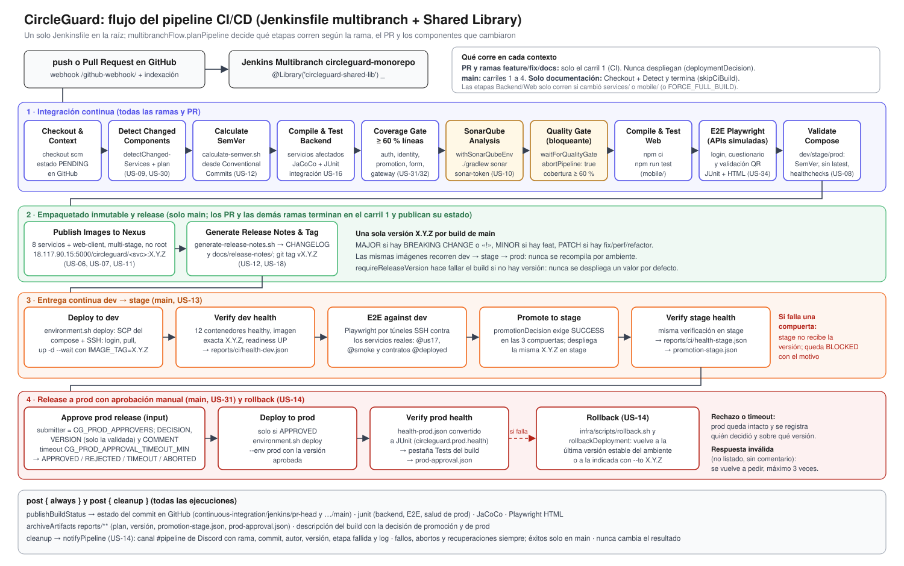

# Flujo del pipeline CI/CD de CircleGuard

> Historia de usuario: `US-19` (entregable `E1.8`). Describe el [`Jenkinsfile`](../../Jenkinsfile) tal como está en `main` (commit `ab2aa2a`), con US-31 (aprobación de prod) y US-14 (notificaciones en Discord) incluidas. La fuente del diagrama es [`diagramas/pipeline-cicd.svg`](diagramas/pipeline-cicd.svg).

## 1. Disparo y plan

1. Un `push` o un Pull Request en GitHub llama al webhook `http://<jenkins>/github-webhook/`. El webhook se registra con [`jenkins/ci/setup-github-webhook.sh`](../../jenkins/ci/setup-github-webhook.sh).
2. El job Multibranch `circleguard-monorepo` descubre la rama o el PR y ejecuta el `Jenkinsfile` de la raíz. El job se declara con JCasC en [`jenkins/ci/jenkins.yaml`](../../jenkins/ci/jenkins.yaml).
3. `Detect Changed Components` ejecuta `detectChangedServices` y `multibranchFlow.planPipeline` (Shared Library, [`jenkins/vars/`](../../jenkins/vars/)). El plan decide qué etapas corren:

| Contexto | Etapas |
|---|---|
| Pull Request, `feature/*`, `fix/*`, `docs/*` | Carril 1 (CI). **Nunca despliegan**: `deploymentDecision` bloquea cualquier `TARGET_ENV` |
| `main` | Carriles 1 a 4 |
| Solo cambios de documentación | `Checkout & Context` y `Detect Changed Components`; no compila (`skipCiBuild`) |
| Cambio en un servicio | `Compile & Test Backend` solo de los servicios afectados. Si cambia un archivo compartido, como `build.gradle.kts`, se construyen los 8 |
| Cambio en `mobile/` o `e2e/` | `Compile & Test Web` y `E2E Playwright` |

## 2. Etapas

| # | Etapa | Qué hace | Evidencia que deja |
|---|---|---|---|
| 1 | `Checkout & Context` | `checkout scm` y contexto de rama o PR. Publica el estado `PENDING` en GitHub | Estado del commit |
| 2 | `Detect Changed Components` | Detecta los componentes que cambiaron y calcula el plan | `reports/ci/*.json` |
| 3 | `Calculate SemVer` | `infra/scripts/calculate-semver.sh` calcula `X.Y.Z` a partir de los Conventional Commits desde el último tag | `reports/ci/version.env` |
| 4 | `Compile & Test Backend` | `./gradlew :services:<svc>:assemble test jacocoTestReport` | JUnit y JaCoCo en Jenkins |
| 5 | `Coverage Gate (núcleo + gateway)` | `jacocoTestCoverageVerification`: al menos 60 % de líneas en auth, identity, promotion, form y gateway | El build falla si no se cumple |
| 6 | `Compile & Test Web` | `npm ci` y `npm run test` en `mobile/` | — |
| 7 | `E2E Playwright` | Flujos de login, cuestionario y validación QR, con las APIs simuladas | JUnit y reporte HTML |
| 8 | `Validate Compose Environments` | `deploy/compose/validate-compose.sh` revisa SemVer, que no haya `latest` y los healthchecks de dev, stage y prod | Log |
| 9 | `Publish Images to Nexus` | `infra/scripts/publish-docker-images.sh` publica 8 servicios y el cliente web en `52.14.6.11:5000/circleguard/<svc>:X.Y.Z` | Imágenes en Nexus |
| 10 | `Generate Release Notes & Tag` | `generate-release-notes.sh` (CHANGELOG y `docs/release-notes/`) y `git-tag-release.sh` (`vX.Y.Z`) | Tag en Git |
| 11 | `Deploy to dev` | `deploy/scripts/environment.sh deploy --env dev`: SCP y SSH, luego `docker compose pull` y `up -d --wait` | — |
| 12 | `Verify dev health` | Los 12 contenedores `healthy`, la imagen exacta `X.Y.Z` y readiness `UP` | `reports/ci/health-dev.json` |
| 13 | `E2E against dev` | `deploy/scripts/run-e2e.sh` corre por túneles SSH los flujos `@us17` y `@smoke` y los contratos `@deployed` | `e2e/reports/dev/` |
| 14 | `Promote to stage` | `promotionDecision` exige `SUCCESS` en 11, 12 y 13, y despliega la misma versión en stage | — |
| 15 | `Verify stage health` | La misma verificación de salud, en stage | `health-stage.json` y `promotion-stage.json` |
| 16 | `Approve prod release` | `input` restringido a `CG_PROD_APPROVERS`. Solo ofrece la versión validada y exige un comentario o RFC | `prod-approval.json` |
| 17 | `Deploy to prod` | Solo corre con `APPROVED` | — |
| 18 | `Verify prod health` | Salud de prod publicada como JUnit (`circleguard.prod.health`) | Pestaña **Tests** del build |
| — | `Release Gate` | Revalida el contexto cuando se pide `TARGET_ENV` manualmente | Descripción del build |
| — | `post { always }` | Estado final en GitHub, `junit`, JaCoCo, `archiveArtifacts reports/**` y descripción del build | — |
| — | `post { cleanup }` | `notifyPipeline` (US-14) publica el resultado en el canal `#pipeline` de Discord: rama, commit, autor, versión, etapa fallida y enlace al log. Un error al notificar nunca cambia el resultado del build | `reports/ci/discord-notification.json` |

## 3. Reglas de las compuertas

- **Fallar detiene la cadena.** Cada etapa de entrega marca su compuerta en `FAILURE` al empezar y en `SUCCESS` solo al terminar bien. Si dev, su salud o los E2E fallan, stage no recibe la versión. Si nadie aprueba, prod no cambia.
- **Se promueve siempre la misma versión.** `requireReleaseVersion` hace fallar el build si `APP_VERSION` no existe. El `input` de prod solo ofrece la versión que la ejecución validó en dev y en stage.
- **Los fallos se avisan solos.** Cada etapa guarda su nombre al empezar (`pipelineTrack.stage`). Al terminar, `notifyPipeline` notifica siempre `FAILURE`, `ABORTED`, `UNSTABLE` y las recuperaciones, y los éxitos solo en `main`. Se desactiva con el parámetro `NOTIFY_DISCORD=false`.
- **Toda decisión queda registrada.** `promotion-stage.json` (PROMOTED o BLOCKED, con el motivo) y `prod-approval.json` (quién aprobó o rechazó, la versión y el comentario) se archivan en cada build y se resumen en la descripción del build.

Detalle de cada parte:

- **Multibranch, Shared Library y webhook:** [`docs/agil/JENKINS_MULTIBRANCH_US30.md`](../agil/JENKINS_MULTIBRANCH_US30.md) y [`docs/agil/JENKINS_SHARED_LIBRARY_US09.md`](../agil/JENKINS_SHARED_LIBRARY_US09.md).
- **Despliegue a dev y promoción a stage:** [`DEPLOY_PROMOTION_US13.md`](DEPLOY_PROMOTION_US13.md).
- **Aprobación de prod:** [`PROD_APPROVAL_US31.md`](PROD_APPROVAL_US31.md).
- **Rollback:** [`docs/operaciones/ROLLBACK_US14.md`](../operaciones/ROLLBACK_US14.md).
- **Notificaciones:** [`docs/operaciones/NOTIFICACIONES_US14.md`](../operaciones/NOTIFICACIONES_US14.md).

## 4. Ejecución verificada en `main`

El build **#18** de `main` (10 de noviembre de 2026, commit `ab2aa2a`, 6 min 5 s) terminó en `SUCCESS`:

| Etapa | Resultado |
|---|---|
| `Calculate SemVer` | `0.2.0` (tag `v0.2.0`) |
| `Compile & Test Backend` y `Coverage Gate` | 236 pruebas, 0 fallos, 3 omitidas; cobertura mínima cumplida |
| `Publish Images to Nexus` | 8 servicios y el cliente web con el tag `0.2.0` |
| `Deploy to dev` → `E2E against dev` | Desplegado, 12 contenedores sanos y E2E contra dev en verde |
| `Promote to stage` → `Verify stage health` | `PROMOTED`: `0.2.0` corre en stage y pasa los healthchecks |
| `Approve prod release` | `NOT_CONFIGURED`: `CG_PROD_APPROVERS` está vacía, así que el release a prod se omitió |
| `post { cleanup }` | Notificación **RECUPERADO** enviada a Discord (HTTP 204) |

`Compile & Test Web` y `E2E Playwright` no corrieron porque el *merge* no cambió `mobile/` ni `e2e/`. Los builds #15 a #17 fallaron en `Deploy to dev` y bloquearon la promoción a stage, que es el comportamiento esperado de la compuerta.

## 5. Brechas conocidas frente a la rúbrica (10 de noviembre de 2026)

Las brechas se declaran para que el informe no afirme más de lo que el pipeline hace:

| Requisito | Estado en `main` | Qué falta |
|---|---|---|
| Análisis SonarQube con *quality gate* bloqueante (E1.4) | El servidor está aprovisionado (`52.14.6.11:9000`) y el plugin `withSonarQubeEnv`/`waitForQualityGate` está instalado en Jenkins. La rama `feature/US-10-jacoco-sonarqube-quality-gate` no se fusionó | Etapa `SonarQube Analysis` con `waitForQualityGate abortPipeline: true` |
| 3 pruebas de integración entre servicios (E1.6) | 3 pruebas con Testcontainers dentro de un servicio cada una: auth↔PostgreSQL, identity↔PostgreSQL y gateway↔Redis | Una prueba que cruce servicios, como `form → Kafka → promotion` |
| Rollback desde el pipeline (E1.5) | `infra/scripts/rollback.sh` y `rollbackDeployment` existen y tienen pruebas | Etapa `Rollback` y parámetro `ROLLBACK_TARGET_VERSION` en el Jenkinsfile |
| Tag `vX.Y.Z` en GitHub (E1.5) | `git-tag-release.sh` crea `v0.2.0` en el workspace de Jenkins, pero GitHub no tiene ningún tag: el script no hace `git push` | Empujar el tag con la credencial `github-credentials` (`git push origin vX.Y.Z`) |
| Release a prod (E1.5) | La etapa existe y está probada, pero el build #18 la omitió (`NOT_CONFIGURED`) | Definir `CG_PROD_APPROVERS` con los IDs de los aprobadores |
| Autenticación en Jenkins | `useSecurity: false`: cualquiera que alcance el puerto 8080 administra Jenkins y puede aprobar prod | `securityRealm` y `authorizationStrategy` en `jenkins/ci/jenkins.yaml` (README §4.3, paso 5) |
