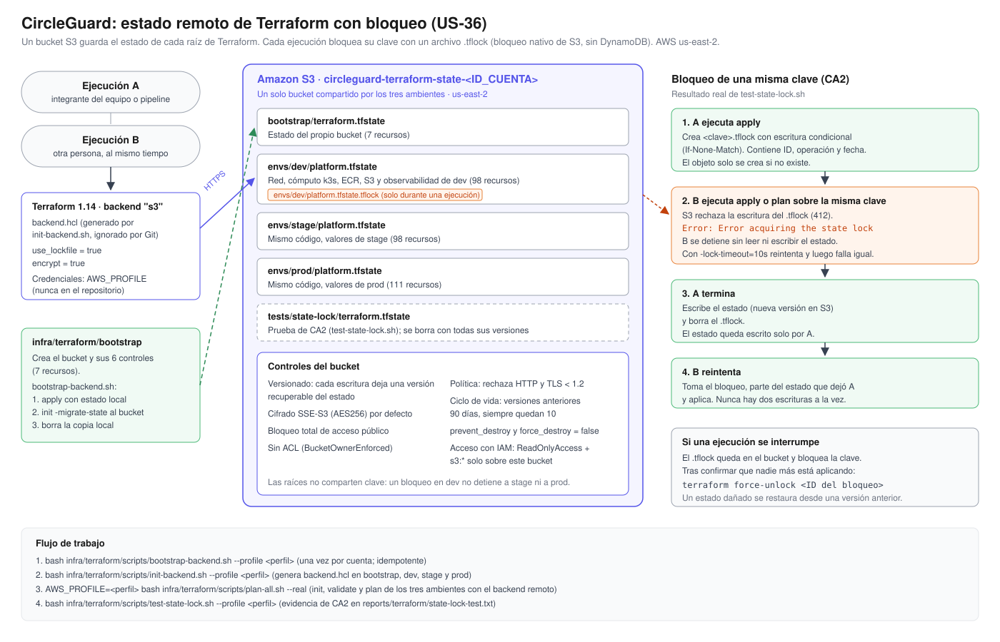
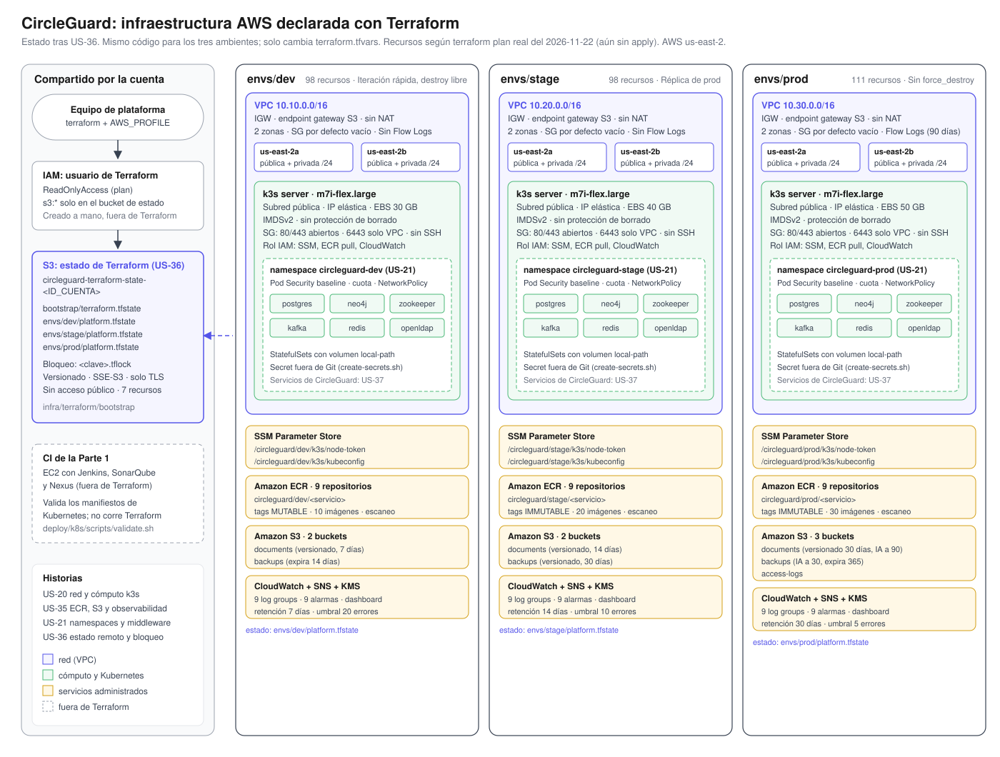

# US-36 — Backend remoto de Terraform con bloqueo y diagramas de infraestructura

| | |
|---|---|
| Historia | US-36 (3 SP), épico E2.1 — IaC con Terraform. Jira [SCRUM-118](https://circleguard777.atlassian.net/browse/SCRUM-118) |
| Alcance | Bucket S3 para el estado de Terraform, bloqueo del estado, conexión de dev, stage y prod al backend, prueba de concurrencia y diagramas de la infraestructura |
| Fuera de alcance | `apply` de la red, el cómputo y los servicios de US-20 y US-35 |
| Relación | Completa el backend parcial que dejaron [US-20](TERRAFORM_RED_COMPUTO_US20.md) y [US-35](TERRAFORM_PLATAFORMA_US35.md). El `plan` y el `apply` desde Jenkins son de [US-22](PIPELINE_PLATAFORMA_US22_US38_US39.md) y usan este mismo backend. |
| Código | [`infra/terraform/bootstrap`](../../infra/terraform/bootstrap/), [`infra/terraform/scripts`](../../infra/terraform/scripts/), [`infra/terraform/tests/state-lock`](../../infra/terraform/tests/state-lock/main.tf) |



La historia entra en tres PR:

| Parte | Contenido |
|---|---|
| 1 | Stack `bootstrap`: el bucket de estado y sus controles |
| 2 | Scripts del backend, ambientes con `use_lockfile`, `tf-pipeline.sh` de US-22 con el mismo bloqueo y prueba de concurrencia (CA1 y CA2) |
| 3 | Etapa `Validate Terraform` de Jenkins, evidencia de `init`, `validate` y `plan`, y diagramas (CA3) |

## 1. Decisiones

| Decisión | Motivo |
|---|---|
| Un bucket S3 por cuenta (`circleguard-terraform-state-<ID_CUENTA>`) con una clave por raíz | Cada ambiente tiene su estado y su bloqueo: un `apply` en dev no detiene a prod. El ID de cuenta hace el nombre único sin escribirlo en Git. |
| Bloqueo nativo de S3 (`use_lockfile = true`) y no DynamoDB | Terraform 1.10 agregó el bloqueo con escritura condicional en S3 y marcó `dynamodb_table` como obsoleto. Cumple CA1 sin una segunda tabla que mantener ni pagar. El CA menciona DynamoDB solo como ejemplo. |
| Stack `bootstrap` separado de los ambientes | El bucket debe existir antes de que un ambiente pueda usarlo y no debe borrarse con `terraform destroy` de un ambiente. |
| El estado del bootstrap vive en el mismo bucket | Se crea con estado local y luego se migra (`init -migrate-state`). Así ningún estado queda solo en un computador. |
| SSE-S3 (AES256) en vez de SSE-KMS | Quien lee el estado no necesita permisos sobre una clave KMS, y la clave de US-35 es por ambiente, no compartida. |
| `backend.hcl` generado por `init-backend.sh` | Los archivos `backend.tf` siguen siendo parciales. El ID de la cuenta sale de `sts get-caller-identity` y no se versiona. |
| El pipeline de US-22 usa el mismo bloqueo | `tf-pipeline.sh` pasa `use_lockfile=true` al `init`. La tabla `circleguard-terraform-locks` que esperaba antes no existe en la cuenta. |
| Jenkins también valida sin credenciales | La etapa `Validate Terraform` corre `plan-all.sh` con proveedor simulado. Cubre módulos, `bootstrap` y ambientes aunque no exista la credencial `aws-terraform`, que es la que necesita el plan real de US-22. |

## 2. Estructura

```
infra/terraform/
├── bootstrap/                     # backend remoto (US-36)
│   ├── main.tf                    # bucket y sus 6 controles
│   ├── backend.tf                 # backend "s3" {} parcial: bootstrap/terraform.tfstate
│   ├── backend.hcl.example
│   ├── variables.tf · outputs.tf · providers.tf · versions.tf
│   ├── .terraform.lock.hcl        # proveedor AWS 6.73.0, igual que los ambientes
│   └── tests/bootstrap.tftest.hcl # plan simulado, sin credenciales
├── envs/{dev,stage,prod}/
│   ├── backend.tf                 # backend "s3" {} parcial: envs/<env>/platform.tfstate
│   └── backend.hcl.example        # use_lockfile = true (sin dynamodb_table)
├── tests/state-lock/main.tf       # configuración de la prueba de concurrencia (no crea nada en AWS)
└── scripts/
    ├── backend-lib.sh             # funciones comunes
    ├── bootstrap-backend.sh       # crea o actualiza el bucket y migra su estado
    ├── init-backend.sh            # genera backend.hcl en cada raíz
    ├── test-state-lock.sh         # prueba de CA2
    ├── ensure-terraform.sh        # Terraform 1.14.6 con SHA-256 si el agente no lo tiene
    ├── plan-all.sh                # ahora también valida bootstrap y tests/state-lock
    └── tf-pipeline.sh             # US-22: init con use_lockfile=true
```

### Bucket de estado

| Control | Recurso | Valor |
|---|---|---|
| Versionado | `aws_s3_bucket_versioning` | `Enabled`: cada escritura del estado deja una versión recuperable |
| Cifrado | `aws_s3_bucket_server_side_encryption_configuration` | SSE-S3 (`AES256`) con bucket key |
| Sin acceso público | `aws_s3_bucket_public_access_block` | Los cuatro bloqueos activos |
| Sin ACL | `aws_s3_bucket_ownership_controls` | `BucketOwnerEnforced` |
| Solo TLS | `aws_s3_bucket_policy` | Rechaza `aws:SecureTransport = false` y TLS menor a 1.2; rechaza subidas con otro cifrado |
| Ciclo de vida | `aws_s3_bucket_lifecycle_configuration` | Versiones anteriores: 90 días, siempre se conservan las 10 más nuevas; marcadores de borrado sueltos se limpian; multipart incompleto a 7 días |
| Protección | `lifecycle.prevent_destroy` y `force_destroy = false` | Terraform se niega a destruir el bucket y S3 no lo borra con objetos |

### Permisos de quien ejecuta Terraform

El usuario IAM `circleguard-terraform` se creó a mano en la consola, fuera de Terraform, y sus llaves quedan en `~/.aws` con el perfil del mismo nombre.

- `ReadOnlyAccess` (política administrada): `terraform plan` de los tres ambientes.
- Política inline `CircleGuardTerraformState`: `s3:*` solo sobre `arn:aws:s3:::circleguard-terraform-state-*` y sus objetos.

Con estos permisos el usuario no puede crear VPC, instancias ni roles. Para el `apply` de los ambientes hace falta otro perfil con más permisos.

## 3. Criterios de aceptación

### CA1 — Estado en backend remoto con bloqueo

Creación del backend en la cuenta del proyecto (2026-11-22, `us-east-2`):

```
$ bash infra/terraform/scripts/bootstrap-backend.sh --profile circleguard-terraform --plan-only
[backend][INFO]  El bucket no existe: primera creación con estado local temporal.
Plan: 7 to add, 0 to change, 0 to destroy.

$ bash infra/terraform/scripts/bootstrap-backend.sh --profile circleguard-terraform --auto-approve
aws_s3_bucket.state: Creation complete after 3s [id=circleguard-terraform-state-<ID_CUENTA>]
...
Apply complete! Resources: 7 added, 0 changed, 0 destroyed.
[backend][INFO]  Migrando el estado local a s3://circleguard-terraform-state-<ID_CUENTA>/bootstrap/terraform.tfstate...
[backend][OK]    Estado del bootstrap migrado al bucket; se borró la copia local.
[backend][OK]    dev: infra/terraform/envs/dev/backend.hcl -> s3://circleguard-terraform-state-<ID_CUENTA>/envs/dev/platform.tfstate
[backend][OK]    stage: infra/terraform/envs/stage/backend.hcl -> s3://circleguard-terraform-state-<ID_CUENTA>/envs/stage/platform.tfstate
[backend][OK]    prod: infra/terraform/envs/prod/backend.hcl -> s3://circleguard-terraform-state-<ID_CUENTA>/envs/prod/platform.tfstate
[backend][OK]    Backend remoto listo: s3://circleguard-terraform-state-<ID_CUENTA> con bloqueo nativo (use_lockfile).
```

Comprobaciones posteriores:

| Comprobación | Resultado |
|---|---|
| Segundo `bootstrap-backend.sh --plan-only` (ya con estado remoto) | `No changes. Your infrastructure matches the configuration.` |
| `get-bucket-versioning` | `Enabled` |
| `get-bucket-encryption` | `AES256` |
| `get-public-access-block` | `True True True True` |
| Objetos del bucket | `bootstrap/terraform.tfstate` |
| Petición por HTTP sin TLS | `403` |
| `envs/<env>/.terraform/terraform.tfstate` tras `init` | `"type": "s3"` y la clave `envs/<env>/platform.tfstate` de cada ambiente |
| Tabla DynamoDB `circleguard-terraform-locks` | No existe; no hace falta |

Mientras una ejecución trabaja, el bucket contiene `<clave>.tflock`. Terraform lo crea con escritura condicional (`If-None-Match: *`): S3 solo lo acepta si no existe, así que dos ejecuciones no pueden tomar el mismo bloqueo.

En Jenkins, `tf-pipeline.sh` hace el `init` con `-backend-config="use_lockfile=true"`. `infra/scripts/test-platform-scripts.sh` verifica que lo pase y que ya no use `dynamodb_table`.

### CA2 — Dos ejecuciones concurrentes no aplican el mismo estado a la vez

`test-state-lock.sh` copia [`tests/state-lock/main.tf`](../../infra/terraform/tests/state-lock/main.tf) en dos carpetas separadas, A y B, como dos personas con su propio clon. Las dos apuntan a `tests/state-lock/terraform.tfstate`. La configuración solo tiene un `time_sleep` y un `terraform_data`, así que no crea nada en AWS. A ejecuta `apply` y mantiene el bloqueo 45 segundos; mientras tanto B intenta `apply` y `plan`.

```
$ bash infra/terraform/scripts/test-state-lock.sh --profile circleguard-terraform
[backend][OK]    Dos copias independientes (A y B) inicializadas contra el mismo estado.
[backend][INFO]  A: terraform apply (mantiene el bloqueo 45 s)...
[backend][OK]    Mientras A aplica existe el bloqueo s3://circleguard-terraform-state-<ID_CUENTA>/tests/state-lock/terraform.tfstate.tflock.
        Contenido del bloqueo: {"ID":"a3edccfd-fd78-51cd-8e69-12406d5b57d4","Operation":"OperationTypeApply","Info":"","Who":"<omitido>","Version":"1.14.6","Created":"2026-11-22T04:11:33.3090427Z","Path":"circleguard-terraform-state-<ID_CUENTA>/tests/state-lock/terraform.tfstate"}
[backend][INFO]  B: terraform apply sobre el mismo estado mientras A trabaja...
[backend][OK]    El apply de B falla (código 1).
[backend][OK]    El apply de B informa 'Error acquiring the state lock'.
[backend][OK]    El plan de B espera 10 s y también falla por el bloqueo (código 1).
        Mensaje que recibe B:
          Error: Error acquiring the state lock
          Path:      circleguard-terraform-state-<ID_CUENTA>/tests/state-lock/terraform.tfstate
          Operation: OperationTypeApply
          Created:   2026-11-22 04:11:33.3090427 +0000 UTC
[backend][OK]    El apply de A termina bien (código 0).
[backend][OK]    Al terminar A, el bloqueo ya no existe.
[backend][OK]    El estado lo escribió A; B no lo modificó mientras estaba bloqueado (last_writer=A).
[backend][OK]    El apply de B termina bien (código 0) y A ve el estado de B (last_writer=B).
[backend][INFO]  Versiones del estado de prueba en el bucket: 3 (una por cada escritura).
[backend][OK]    Se borraron el estado de prueba y todas sus versiones (quedan 0).
[backend][OK]    CA2 verificado: dos ejecuciones concurrentes no aplican el mismo estado a la vez.
```

El script falla si alguna comprobación no se cumple y deja el reporte en `reports/terraform/state-lock-test.txt`. Del contenido del bloqueo omite el campo `Who` (usuario y equipo de quien ejecuta).

### CA3 — `init`, `validate` y `plan` funcionan, con diagramas actualizados

**Sin credenciales** (etapa `Validate Terraform` de Jenkins y cualquier integrante sin perfil de AWS):

```
$ bash infra/terraform/scripts/plan-all.sh
[terraform][OK]    Formato correcto.
[terraform][OK]    Módulo network: Success! ...
...
[terraform][OK]    Stack bootstrap: Success! 2 passed, 0 failed.
[terraform][OK]    Configuración de la prueba de bloqueo válida (tests/state-lock).
[terraform][OK]    Ambiente dev: 98 recursos planeados.
[terraform][OK]    Ambiente stage: 98 recursos planeados.
[terraform][OK]    Ambiente prod: 111 recursos planeados.
[terraform][OK]    Verificación de Terraform completada para: dev stage prod.
```

**Etapa `Validate Terraform` de Jenkins.** Corre `plan-all.sh` después de `Validate Kubernetes Manifests` y archiva `reports/terraform/offline/`, aparte de los planes de `Terraform Plan` (US-22). Se activa cuando el cambio toca `infra/terraform/` o el `Jenkinsfile`, en `main`, con `FORCE_FULL_BUILD` o si no se pudo calcular qué archivos cambiaron.

- Si el agente no tiene Terraform 1.11 o superior, `ensure-terraform.sh` descarga la 1.14.6 de `releases.hashicorp.com`, compara su SHA-256 con el valor fijo del script y la guarda en `~/.cache/circleguard/tools`.
- Los proveedores se guardan en `~/.cache/circleguard/terraform-plugins` (unos 790 MB, sobre todo el proveedor AWS) y se reutilizan entre builds. Los módulos no versionan su `.terraform.lock.hcl`, por eso la etapa activa `TF_PLUGIN_CACHE_MAY_BREAK_DEPENDENCY_LOCK_FILE`; los ambientes y `bootstrap` sí verifican contra su lock file.

Se probó el 2026-11-23 en un contenedor `jenkins/jenkins:lts` sin Terraform, solo con los archivos versionados y las mismas variables de la etapa:

```
[terraform][INFO]  Descargando Terraform 1.14.6 para linux_amd64 en /var/jenkins_home/.cache/circleguard/tools...
[terraform][INFO]  Usando Terraform v1.14.6 (/var/jenkins_home/.cache/circleguard/tools/terraform-1.14.6/terraform).
[terraform][OK]    Formato correcto.
[terraform][OK]    Sin credenciales en texto plano: código Terraform (61 archivos).
[terraform][OK]    Módulo network: Success! 5 passed, 0 failed.
[terraform][OK]    Módulo compute: Success! 6 passed, 0 failed.
[terraform][OK]    Módulo registry: Success! 5 passed, 0 failed.
[terraform][OK]    Módulo storage: Success! 4 passed, 0 failed.
[terraform][OK]    Módulo observability: Success! 4 passed, 0 failed.
[terraform][OK]    Stack bootstrap: Success! 2 passed, 0 failed.
[terraform][OK]    Configuración de la prueba de bloqueo válida (tests/state-lock).
[terraform][OK]    Ambiente dev: 98 recursos planeados. Resumen en reports/terraform/offline/dev-resources.txt
[terraform][OK]    Ambiente stage: 98 recursos planeados. Resumen en reports/terraform/offline/stage-resources.txt
[terraform][OK]    Ambiente prod: 111 recursos planeados. Resumen en reports/terraform/offline/prod-resources.txt
[terraform][OK]    Verificación de Terraform completada para: dev stage prod.
```

La primera ejecución, que descarga Terraform y el proveedor AWS, tardó 154 s.

**Contra AWS con el backend remoto** (`init -backend-config=backend.hcl`, `validate` y `plan` de cada ambiente, 2026-11-22):

```
$ AWS_PROFILE=circleguard-terraform bash infra/terraform/scripts/plan-all.sh --real
[terraform][INFO]  Ambiente dev: plan real contra AWS...
[terraform][OK]    Ambiente dev: 98 recursos planeados. Resumen en reports/terraform/dev-resources.txt
[terraform][INFO]  Ambiente stage: plan real contra AWS...
[terraform][OK]    Ambiente stage: 98 recursos planeados. Resumen en reports/terraform/stage-resources.txt
[terraform][INFO]  Ambiente prod: plan real contra AWS...
[terraform][OK]    Ambiente prod: 111 recursos planeados. Resumen en reports/terraform/prod-resources.txt
[terraform][OK]    Verificación de Terraform completada para: dev stage prod.
```

| Ambiente | `init` | `validate` | `plan` real |
|---|---|---|---|
| dev | backend `s3`, `envs/dev/platform.tfstate` | OK | `Plan: 98 to add, 0 to change, 0 to destroy.` |
| stage | backend `s3`, `envs/stage/platform.tfstate` | OK | `Plan: 98 to add, 0 to change, 0 to destroy.` |
| prod | backend `s3`, `envs/prod/platform.tfstate` | OK | `Plan: 111 to add, 0 to change, 0 to destroy.` |

El plan real coincide con el simulado de US-20 y US-35. `plan` toma el bloqueo pero no escribe estado, por eso los objetos `envs/<env>/platform.tfstate` aparecerán con el primer `apply`.

**Diagramas:**

| Diagrama | Contenido |
|---|---|
| [`terraform-estado-remoto-us36.svg`](diagramas/terraform-estado-remoto-us36.svg) | Bucket de estado, claves por raíz, controles, secuencia del bloqueo y flujo de trabajo |
| [`infraestructura-aws-us36.svg`](diagramas/infraestructura-aws-us36.svg) | Infraestructura completa de los tres ambientes según el plan real: VPC, nodo k3s, namespace y middleware (US-21), SSM, ECR, S3 y observabilidad, más los recursos compartidos |
| [`terraform-red-computo-us20.svg`](diagramas/terraform-red-computo-us20.svg) y [`terraform-plataforma-us35.svg`](diagramas/terraform-plataforma-us35.svg) | Detalle de red y cómputo, y de registro, almacenamiento y observabilidad (sin cambios) |



## 4. Operación

```bash
export AWS_PROFILE=circleguard-terraform

# Una vez por cuenta (idempotente: si el bucket existe, solo hace plan o apply del stack)
bash infra/terraform/scripts/bootstrap-backend.sh --plan-only
bash infra/terraform/scripts/bootstrap-backend.sh

# En cada clon del repositorio: genera backend.hcl en bootstrap, dev, stage y prod
bash infra/terraform/scripts/init-backend.sh

# Trabajo normal en un ambiente
cd infra/terraform/envs/dev
terraform init -backend-config=backend.hcl
terraform plan
```

**Bloqueo colgado.** Si una ejecución se interrumpe (Ctrl+C dos veces, corte de red, equipo apagado), el `.tflock` queda en el bucket y las demás ejecuciones fallan con `Error acquiring the state lock`. El mensaje trae el `ID` del bloqueo. Primero hay que confirmar con el equipo que nadie está aplicando; después:

```bash
terraform force-unlock <ID>
```

**Recuperar un estado.** Cada escritura deja una versión. Para volver a una anterior:

```bash
aws s3api list-object-versions --bucket circleguard-terraform-state-<ID_CUENTA> --prefix envs/dev/platform.tfstate
aws s3api get-object --bucket circleguard-terraform-state-<ID_CUENTA> --key envs/dev/platform.tfstate --version-id <versión> estado.tfstate
terraform state push estado.tfstate   # solo si se revisó el contenido; push compara el serial
```

**Pasar un estado local al backend.** Si alguien aplicó con estado local, `terraform init -backend-config=backend.hcl -migrate-state` lo copia al bucket.

**Borrar el backend.** El bucket está protegido a propósito. Solo debe borrarse cuando ya no quede infraestructura: quitar `prevent_destroy`, vaciar todas las versiones y ejecutar `terraform destroy` en `bootstrap`.

## 5. Costo

El bucket guarda unos pocos archivos de menos de 1 MB. El costo esperado es menor a 0,10 USD al mes, sumando almacenamiento y peticiones. No hay tabla DynamoDB.
