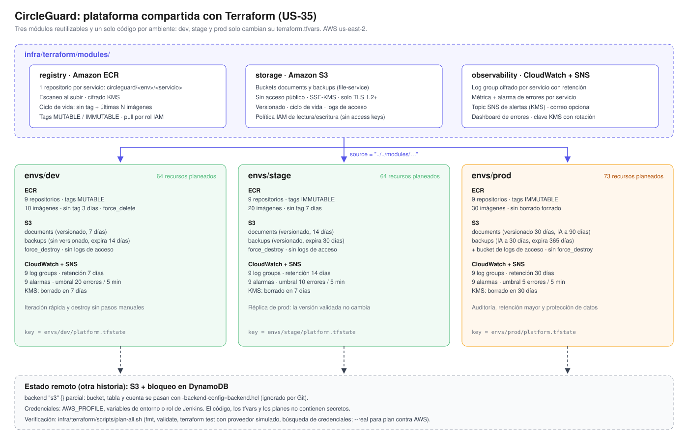

# US-35 — Módulos Terraform de registro, almacenamiento y observabilidad

| | |
|---|---|
| Historia | US-35 (5 SP), épico E2.1 — IaC con Terraform |
| Alcance | Servicios compartidos de cada ambiente: registro de imágenes (ECR), almacenamiento de objetos (S3) y observabilidad base (CloudWatch + SNS) |
| Fuera de alcance | Red y cómputo/clúster (otra historia), creación del bucket de estado y su bloqueo ([US-36](TERRAFORM_BACKEND_US36.md)), Prometheus/Grafana/Jaeger/Loki en Kubernetes (E2.5) y migración del pipeline de Nexus a ECR (E2.3) |
| Código | [`infra/terraform/`](../../infra/terraform/) |



## 1. Estructura

```
infra/terraform/
├── modules/
│   ├── registry/        # Amazon ECR       README.md · tests/registry.tftest.hcl
│   ├── storage/         # Amazon S3        README.md · tests/storage.tftest.hcl
│   └── observability/   # CloudWatch + SNS README.md · tests/observability.tftest.hcl
├── envs/
│   ├── dev/  stage/  prod/
│   │   ├── main.tf               # llama a los tres módulos (idéntico en los tres ambientes)
│   │   ├── variables.tf          # entradas del ambiente, con validaciones
│   │   ├── outputs.tf            # salidas para otras historias (clúster, pipeline)
│   │   ├── providers.tf          # región y default_tags, sin credenciales
│   │   ├── backend.tf            # backend "s3" {} parcial
│   │   ├── backend.hcl.example   # plantilla del estado remoto (backend.hcl está ignorado)
│   │   ├── terraform.tfvars      # ÚNICA diferencia entre ambientes
│   │   ├── .terraform.lock.hcl   # versión fija del proveedor AWS (6.73.0)
│   │   └── tests/plan.tftest.hcl # plan simulado del ambiente
└── scripts/plan-all.sh           # verificación completa (CA1, CA2 y CA3)
```

Los ambientes no duplican lógica. `main.tf`, `variables.tf` y `outputs.tf` son iguales en los tres, y toda la variación está en `terraform.tfvars`. Para cambiar un ambiente se edita su `tfvars`; para cambiar el comportamiento se edita un módulo.

## 2. Por qué ECR y no Nexus

En la Parte 1 el registro es Nexus, que corre en la EC2 de CI por HTTP con `insecure-registries`. Para la Parte 2 el registro se declara con Terraform:

| | Nexus (Parte 1) | ECR (US-35) |
|---|---|---|
| Operación | Contenedor que el equipo mantiene | Servicio administrado por AWS |
| Transporte y acceso | HTTP, usuario y contraseña | HTTPS y permisos IAM, sin contraseñas fijas |
| Vulnerabilidades | Sin escaneo | Escaneo al subir cada imagen |
| Disponibilidad | Depende de la EC2 de CI | Independiente |
| IaC | Hay que levantarlo antes de configurarlo | Recurso nativo de Terraform |

Los dos conviven: Nexus sigue disponible para la Parte 1 y para artefactos Maven. Que el pipeline publique en ECR es parte de E2.3.

## 3. Criterios de aceptación

### CA1 — Módulos reutilizables con entradas y salidas documentadas

| Módulo | Qué crea | Documentación |
|---|---|---|
| `registry` | Repositorio ECR por servicio (`circleguard/<env>/<servicio>`), escaneo al subir, cifrado KMS, ciclo de vida, mutabilidad de tags y política de *pull* opcional | [`modules/registry/README.md`](../../infra/terraform/modules/registry/README.md) |
| `storage` | Buckets S3 por propósito (`documents`, `backups`), sin acceso público, SSE-KMS, solo TLS 1.2+, versionado, ciclo de vida, logs de acceso opcionales y política IAM de lectura/escritura | [`modules/storage/README.md`](../../infra/terraform/modules/storage/README.md) |
| `observability` | Log group cifrado por servicio, métrica y alarma de errores, topic SNS de alertas cifrado, suscripción por correo y dashboard | [`modules/observability/README.md`](../../infra/terraform/modules/observability/README.md) |

Los módulos son reutilizables porque:

- no conocen el ambiente ni la cuenta: todo llega por variables, y el nombre de los buckets se calcula con la cuenta y la región;
- cada variable tiene tipo, descripción y validación, por ejemplo `environment ∈ {dev, stage, prod}`, retenciones permitidas por CloudWatch, transición a IA de 30 días o más y nombres sin repetir;
- cada salida tiene descripción y está pensada para otra historia: `repository_arns` y `registry_url` para el pipeline, `read_write_policy_json` para el rol de `file-service`, `alerts_topic_arn` para Alertmanager;
- cada módulo tiene sus propias pruebas (13 casos en total), que incluyen entradas inválidas.

### CA2 — Parámetros de dev, stage y prod

| Parámetro | dev | stage | prod |
|---|---|---|---|
| Tags de imagen | `MUTABLE` | `IMMUTABLE` | `IMMUTABLE` |
| Imágenes conservadas / sin tag | 10 / 3 días | 20 / 7 días | 30 / 7 días |
| Borrar repositorios con imágenes | Sí | Sí | **No** |
| Versiones anteriores en `documents` | 7 días | 14 días | 30 días y paso a IA a 90 días |
| `backups` | Sin versionado, expira 14 días | Versionado, expira 30 días | IA a 30 días, expira 365 días |
| Borrar buckets con objetos | Sí | Sí | **No** |
| Logs de acceso S3 | No | No | **Sí** |
| Retención de logs | 7 días | 14 días | 30 días |
| Umbral de alarma | 20 errores / 5 min | 10 / 5 min | 5 / 5 min |
| Espera para borrar la clave KMS | 7 días | 7 días | 30 días |
| Archivo de estado | `envs/dev/platform.tfstate` | `envs/stage/platform.tfstate` | `envs/prod/platform.tfstate` |

dev está pensado para iterar y destruir sin pasos manuales. stage replica prod con tags inmutables, para que la versión validada sea la misma que se promueve. prod protege los datos y deja auditoría.

### CA3 — Planes coherentes y sin credenciales en texto plano

**Planes por ambiente.** `terraform test` genera el plan de cada ambiente con los valores reales de su `terraform.tfvars` y un proveedor AWS simulado, así que no necesita credenciales. Las aserciones comprueban que los nombres, prefijos, mutabilidad, retenciones y buckets corresponden al ambiente.

| Recurso | dev | stage | prod |
|---|---|---|---|
| `aws_ecr_repository` + `aws_ecr_lifecycle_policy` | 9 + 9 | 9 + 9 | 9 + 9 |
| `aws_s3_bucket` (y su bloqueo público, cifrado, versionado, ciclo de vida, política y ownership) | 2 × 7 | 2 × 7 | 3 × 7 |
| `aws_s3_bucket_logging` | 0 | 0 | 2 |
| `aws_cloudwatch_log_group` + `log_metric_filter` + `metric_alarm` | 9 + 9 + 9 | 9 + 9 + 9 | 9 + 9 + 9 |
| `aws_sns_topic` + `aws_sns_topic_policy` | 1 + 1 | 1 + 1 | 1 + 1 |
| `aws_kms_key` + `aws_kms_alias` + `aws_cloudwatch_dashboard` | 1 + 1 + 1 | 1 + 1 + 1 | 1 + 1 + 1 |
| **Total** | **64** | **64** | **73** |

**Sin credenciales en texto plano:**

- El proveedor no declara `access_key`, `secret_key` ni `token`. Las credenciales salen de la cadena estándar de AWS: `AWS_PROFILE` (o la variable `aws_profile`), las variables de entorno de la sesión o el rol que asuma Jenkins.
- El backend es parcial. El bucket, la tabla y el ID de cuenta van en `backend.hcl`, que está en `.gitignore`.
- Los `terraform.tfvars` solo tienen parámetros no sensibles. Los correos de alertas se pasan con `TF_VAR_observability_alarm_email_endpoints`.
- Los servicios acceden a S3 con la política IAM que entrega el módulo, no con *access keys*. El placeholder `minioadmin` de `file-service` no se usa.
- `plan-all.sh` busca patrones de credenciales (`AKIA…`, `ASIA…`, `aws_secret_access_key`, llaves privadas y `access_key|secret_key|password|token = "…"`) en todo el código Terraform y en cada plan generado. Si encuentra algo, falla y muestra solo el archivo y la línea, nunca el valor.
- `.gitignore` excluye `*.tfstate`, `tfplan`, `.terraform/`, `backend.hcl` y `*.auto.tfvars`.

## 4. Cómo ejecutarlo

### Sin credenciales (validación y planes simulados)

```bash
bash infra/terraform/scripts/plan-all.sh
```

Salida esperada:

```
[terraform][OK]    Formato correcto.
[terraform][OK]    Sin credenciales en texto plano: código Terraform (42 archivos).
[terraform][OK]    Módulo registry: Success! 5 passed, 0 failed.
[terraform][OK]    Módulo storage: Success! 4 passed, 0 failed.
[terraform][OK]    Módulo observability: Success! 4 passed, 0 failed.
[terraform][OK]    Sin credenciales en texto plano: plan de dev.
[terraform][OK]    Ambiente dev: 64 recursos planeados. Resumen en reports/terraform/dev-resources.txt
[terraform][OK]    Sin credenciales en texto plano: plan de stage.
[terraform][OK]    Ambiente stage: 64 recursos planeados. Resumen en reports/terraform/stage-resources.txt
[terraform][OK]    Sin credenciales en texto plano: plan de prod.
[terraform][OK]    Ambiente prod: 73 recursos planeados. Resumen en reports/terraform/prod-resources.txt
[terraform][OK]    Verificación de Terraform completada para: dev stage prod.
```

Los planes completos quedan en `reports/terraform/<env>-plan.txt`, y el conteo por tipo de recurso en `<env>-resources.txt`.

> Desde US-20 los ambientes también incluyen red y cómputo, así que el total de cada plan es mayor (dev 98, stage 98, prod 111). Los recursos de esta historia siguen siendo 64, 64 y 73. Ver [`TERRAFORM_RED_COMPUTO_US20.md`](TERRAFORM_RED_COMPUTO_US20.md).

### Plan real contra AWS

**Estado:** ejecutado el 2026-11-22 con el backend remoto de [US-36](TERRAFORM_BACKEND_US36.md). `init`, `validate` y `plan` funcionan en los tres ambientes: dev 98, stage 98 y prod 111 recursos, igual que los planes simulados.

Requiere un perfil con `ReadOnlyAccess` y acceso al bucket de estado (ver US-36, §2). `plan` no crea recursos ni genera costo. Las llaves quedan en `~/.aws`, nunca en el repositorio.

```bash
export AWS_PROFILE=circleguard-terraform
bash infra/terraform/scripts/init-backend.sh                       # genera backend.hcl en cada ambiente
bash infra/terraform/scripts/plan-all.sh --real                    # los tres ambientes
bash infra/terraform/scripts/plan-all.sh --real --env dev          # uno solo
```

Con `--real` el script guarda `reports/terraform/<env>-plan.txt` y `<env>-plan.json` y busca credenciales en los dos. Desde US-20 el plan incluye también la red y el cómputo.

`--local-backend` sigue disponible como respaldo: crea un `backend_override.tf` temporal con estado local (ignorado por Git) y lo borra al terminar. No sirve para `apply`.

### Aplicar y destruir

El `apply` se hace siempre con el backend remoto de US-36 (`backend.hcl`), para que el estado quede compartido y bloqueado durante la ejecución.

```bash
cd infra/terraform/envs/dev
terraform init -backend-config=backend.hcl
terraform apply
terraform destroy   # al terminar la evaluación
```

En prod, los repositorios y buckets con datos no se borran (`force_delete = false` y `force_destroy = false`). Hay que vaciarlos antes o cambiar esas variables de forma explícita.

## 5. Costo estimado

Con poco tráfico, por ambiente y por mes en `us-east-2`:

| Recurso | Costo |
|---|---|
| Clave KMS de observabilidad | ≈ 1 USD |
| ECR | 0,10 USD por GB (500 MB gratis el primer año) |
| S3 | 0,023 USD por GB en Standard |
| CloudWatch Logs | 0,50 USD por GB ingerido |
| Alarmas | 0,10 USD cada una (9 por ambiente ≈ 0,90 USD; 10 gratis por cuenta) |
| Dashboard | Los 3 primeros por cuenta son gratis |

## 6. Decisiones

| Decisión | Motivo |
|---|---|
| Un prefijo de ECR por ambiente | Cada ambiente tiene sus propias reglas (mutabilidad, retención, borrado) y no puede tocar las imágenes de otro. La promoción entre ambientes copia la imagen ya validada. |
| Clave KMS propia en observabilidad | CloudWatch Alarms no puede publicar en un topic SNS cifrado con `alias/aws/sns`. Con la clave propia también se cifran los logs. |
| Claves administradas por AWS en ECR y S3 | Cifran sin costo extra. Si se necesita una clave propia, se pasa `kms_key_arn`. |
| SSE-S3 en el bucket de logs | La entrega de logs de acceso de S3 no admite SSE-KMS. |
| Backend S3 parcial | Los datos de la cuenta no quedan en Git, y la historia del backend define el bucket y la tabla sin tocar este código. |
| Pruebas con `mock_provider` | El CA3 se verifica en cualquier máquina o en Jenkins sin credenciales ni costo. Requiere Terraform 1.11 o superior por `override_during = plan`. |
| Proveedor AWS `>= 6.0, < 7.0`, bloqueado en 6.73.0 | Usa `data.aws_region.region` (API vigente). El lock file incluye hashes para Linux (Jenkins), Windows y macOS. |
