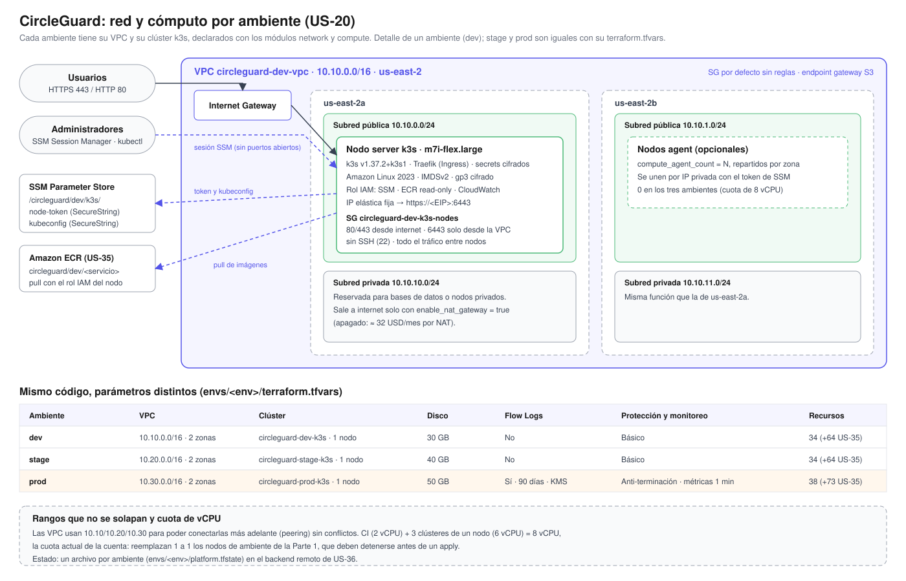

# US-20 — Módulos Terraform reutilizables de red y cómputo para dev, stage y prod

| | |
|---|---|
| Historia | US-20 (5 SP), épico E2.1 — IaC con Terraform |
| Alcance | Red propia por ambiente (VPC) y cómputo (clúster Kubernetes ligero k3s sobre EC2) |
| Relación | Usa la clave KMS y ECR de [US-35](TERRAFORM_PLATAFORMA_US35.md). El backend remoto es [US-36](TERRAFORM_BACKEND_US36.md). Los namespaces y el middleware sobre este clúster son US-21. |
| Código | [`infra/terraform/modules/network`](../../infra/terraform/modules/network/README.md), [`infra/terraform/modules/compute`](../../infra/terraform/modules/compute/README.md), [`infra/terraform/envs/`](../../infra/terraform/envs/) |



## 1. Decisiones de diseño

| Decisión | Motivo |
|---|---|
| **k3s sobre EC2, no EKS** | EKS cobra unos 73 USD al mes por clúster solo por el plano de control. k3s corre en el mismo `m7i-flex.large` que ya usa el proyecto y el enunciado lo admite (E2.2). |
| **Un clúster de un nodo por ambiente** | Reemplaza 1 a 1 los nodos de ambiente de la Parte 1 y ocupa la misma cuota: CI (2 vCPU) + 3 × 2 vCPU = 8 vCPU, el límite de la cuenta. Una falla en dev no afecta a prod. Para crecer basta con subir `compute_agent_count`. |
| **VPC propia por ambiente con rangos que no se solapan** (`10.10`, `10.20`, `10.30`) | Aísla los ambientes en la red y permite conectarlos más adelante (peering) sin conflictos. La Parte 1 usa la VPC por defecto. |
| **Nodos en subredes públicas, sin NAT** | Un NAT Gateway cuesta unos 32 USD al mes por ambiente. Los nodos salen por su IP. Solo se exponen 80/443 (Ingress), y la API solo a la VPC. Con `network_enable_nat_gateway = true` las subredes privadas quedan listas para otros usos. |
| **IP elástica en el server** | La IP no cambia al reiniciar. En la Parte 1, el cambio de IP del servidor de CI dejó sin webhook a Jenkins. |
| **Sin SSH ni llaves `.pem`** | La administración es por SSM Session Manager con IAM. La Parte 1 abría el 22 a `0.0.0.0/0`. |
| **El token y el kubeconfig los genera k3s** y se guardan en SSM SecureString | El secreto no queda en el código, los `tfvars`, el plan ni el estado (ver §3, CA3). |
| **Versión fija de k3s** (`v1.37.2+k3s1`, canal stable) y AMI tomada del parámetro SSM público | Cada ambiente se construye igual. La instancia ignora cambios de AMI para que un `plan` cualquiera no reemplace el nodo. |

## 2. Estructura

```
infra/terraform/
├── modules/
│   ├── network/   main.tf · variables.tf · outputs.tf · README.md · tests/network.tftest.hcl
│   ├── compute/   main.tf · variables.tf · outputs.tf · README.md · tests/compute.tftest.hcl
│   │   └── templates/   server.sh.tftpl · agent.sh.tftpl   (arranque de k3s)
│   └── registry/ storage/ observability/   (US-35)
├── envs/{dev,stage,prod}/
│   ├── main.tf            # network → compute → registry, storage, observability (idéntico en los 3)
│   ├── variables.tf       # network_* y compute_* con su descripción (idéntico en los 3)
│   ├── outputs.tf         # network_* y compute_* (idéntico en los 3)
│   ├── terraform.tfvars   # ÚNICA diferencia entre ambientes
│   └── tests/plan.tftest.hcl
└── scripts/plan-all.sh    # fmt, validate, test y plan de los 5 módulos y 3 ambientes
```

## 3. Criterios de aceptación

### CA1 — Módulos de red y cómputo con entradas y salidas documentadas

| Módulo | Qué crea | Documentación |
|---|---|---|
| `network` | VPC, subredes pública y privada por zona, IGW, tablas de rutas, NAT opcional, endpoint gateway de S3, Flow Logs opcionales y SG por defecto sin reglas | [`modules/network/README.md`](../../infra/terraform/modules/network/README.md): 12 entradas, 12 salidas |
| `compute` | Clúster k3s: server con IP elástica, agents opcionales, launch templates (IMDSv2, gp3 cifrado), rol IAM (SSM, ECR, CloudWatch), SG sin SSH y parámetros SSM del token y el kubeconfig | [`modules/compute/README.md`](../../infra/terraform/modules/compute/README.md): 22 entradas, 14 salidas |

Cada variable tiene tipo, descripción y validación. Algunas de las validaciones:

- el CIDR debe estar entre `/16` y `/20`, y las subredes no pueden quedar menores que `/28`;
- se aceptan de 1 a 3 zonas y de 0 a 10 agents;
- la versión de k3s debe tener el formato `v1.X.Y+k3sN`;
- la API **no se puede abrir a `0.0.0.0/0`**.

Las salidas alimentan a otras historias: `api_endpoint` y `kubeconfig_parameter_name` para US-21, `node_role_name` para adjuntar la política de S3 de US-35, y `node_security_group_id` para el pipeline.

### CA2 — Parametrización para dev, stage y prod sin duplicar la implementación

Los tres ambientes llaman a los mismos módulos con el mismo `main.tf`, `variables.tf` y `outputs.tf`. Solo cambia `terraform.tfvars`:

| Parámetro | dev | stage | prod |
|---|---|---|---|
| `network_vpc_cidr` | `10.10.0.0/16` | `10.20.0.0/16` | `10.30.0.0/16` |
| `network_az_count` | 2 | 2 | 2 |
| `network_enable_flow_logs` | No | No | **Sí, 90 días, cifrados con la KMS de US-35** |
| `compute_server_instance_type` | `m7i-flex.large` | `m7i-flex.large` | `m7i-flex.large` |
| `compute_agent_count` | 0 | 0 | 0 (se sube sin tocar código) |
| `compute_root_volume_size_gb` | 30 | 40 | 50 |
| `compute_enable_detailed_monitoring` | No | No | **Sí** |
| `compute_enable_termination_protection` | No | No | **Sí** |

Los rangos con acceso externo a la API (`compute_api_allowed_cidrs`) y los correos de alertas se pasan con `TF_VAR_…`, no se versionan.

### CA3 — `terraform validate` y `terraform plan` correctos en los tres ambientes

`bash infra/terraform/scripts/plan-all.sh` ejecuta, para los 5 módulos y los 3 ambientes, `fmt -check`, `init -backend=false`, `validate` y `terraform test`. El test de cada ambiente es un `plan` con sus `terraform.tfvars` reales y un proveedor AWS simulado:

```
[terraform][OK]    Formato correcto.
[terraform][OK]    Sin credenciales en texto plano: código Terraform (52 archivos).
[terraform][OK]    Módulo network: Success! 5 passed, 0 failed.
[terraform][OK]    Módulo compute: Success! 6 passed, 0 failed.
[terraform][OK]    Módulo registry: Success! 5 passed, 0 failed.
[terraform][OK]    Módulo storage: Success! 4 passed, 0 failed.
[terraform][OK]    Módulo observability: Success! 4 passed, 0 failed.
[terraform][OK]    Ambiente dev: 98 recursos planeados.
[terraform][OK]    Ambiente stage: 98 recursos planeados.
[terraform][OK]    Ambiente prod: 111 recursos planeados.
[terraform][OK]    Verificación de Terraform completada para: dev stage prod.
```

Recursos de red y cómputo en cada plan:

| Recurso | dev | stage | prod |
|---|---|---|---|
| `aws_vpc`, `aws_internet_gateway`, `aws_default_security_group`, `aws_vpc_endpoint` (S3) | 1 + 1 + 1 + 1 | 1 + 1 + 1 + 1 | 1 + 1 + 1 + 1 |
| `aws_subnet` (2 públicas + 2 privadas) | 4 | 4 | 4 |
| `aws_route_table` + `aws_route_table_association` + `aws_route` | 3 + 4 + 1 | 3 + 4 + 1 | 3 + 4 + 1 |
| Flow Logs (`aws_flow_log`, log group, rol y política) | 0 | 0 | 4 |
| `aws_instance` + `aws_launch_template` + `aws_eip` + `aws_eip_association` | 1 + 1 + 1 + 1 | 1 + 1 + 1 + 1 | 1 + 1 + 1 + 1 |
| IAM (rol, perfil, política y 3 adjuntos) | 6 | 6 | 6 |
| `aws_security_group` + 4 reglas de entrada + 1 de salida | 6 | 6 | 6 |
| `aws_ssm_parameter` (token y kubeconfig) | 2 | 2 | 2 |
| **Red y cómputo (US-20)** | **34** | **34** | **38** |
| Registro, almacenamiento y observabilidad (US-35) | 64 | 64 | 73 |
| **Total del ambiente** | **98** | **98** | **111** |

**Plan real contra AWS.** Todavía no se ejecutó, porque el equipo aún no tiene las credenciales de la cuenta. Cuando estén disponibles, se corre sin esperar el backend remoto de US-36:

```bash
export AWS_PROFILE=circleguard-plan      # usuario IAM con ReadOnlyAccess; las llaves quedan en ~/.aws
bash infra/terraform/scripts/plan-all.sh --real --local-backend
```

`--local-backend` crea un `backend_override.tf` temporal con estado local (ignorado por Git) y lo borra al terminar, aunque el plan falle. Guarda `reports/terraform/<env>-plan.txt` y `<env>-plan.json` y busca credenciales en ambos. Sin credenciales, el script falla con `No valid credential sources found` y no deja archivos temporales. Así se verificó.

## 4. Seguridad

| Control | Dónde |
|---|---|
| Sin credenciales en el código: el proveedor usa la cadena estándar de AWS | `envs/*/providers.tf` |
| Token de k3s y kubeconfig solo en SSM SecureString, escritos por el nodo; Terraform conoce solo el valor inicial `pendiente-de-arranque` | `modules/compute/main.tf`, `templates/server.sh.tftpl` |
| El rol de los nodos solo accede a `/circleguard/<env>/k3s/*` | `aws_iam_role_policy.k3s_parameters` |
| Sin SSH: administración por SSM Session Manager | `aws_security_group.node` |
| API 6443 solo desde la VPC; no acepta `0.0.0.0/0` | `var.api_allowed_cidrs` |
| IMDSv2 obligatorio, discos cifrados y `secrets-encryption` de k3s | Launch templates y arranque |
| SG por defecto de la VPC sin reglas | `aws_default_security_group.this` |
| Flow Logs cifrados en prod | `module.network` con la KMS de `module.observability` |

## 5. Costo estimado por ambiente (us-east-2, 24/7)

| Recurso | Costo mensual |
|---|---|
| `m7i-flex.large` (server) | ≈ 58 USD (cubierto por el free tier en cuentas elegibles) |
| EBS gp3 de 30, 40 o 50 GB | ≈ 2,4, 3,2 o 4 USD |
| IP elástica asociada | ≈ 3,6 USD (las IPv4 públicas se cobran desde 2024) |
| VPC, subredes, IGW y endpoint de S3 | 0 |
| NAT Gateway (apagado) | 0 (≈ 32 USD si se activa) |
| Flow Logs (solo prod) | 0,50 USD por GB ingerido |

Hay que apagar o destruir (`terraform destroy`) al terminar la evaluación. En prod, primero se desactiva `compute_enable_termination_protection`.

## 6. Antes del primer `apply`

1. **Cuota de vCPU:** la cuenta tiene 8 vCPU y las usan las 4 instancias de la Parte 1. Hay que detener los 3 nodos de ambiente de la Parte 1 (`dev`, `stage`, `prod`) o pedir más cuota. El nodo de CI se mantiene.
2. **Backend remoto (US-36):** ya existe. En cada clon basta con `bash infra/terraform/scripts/init-backend.sh` para generar `backend.hcl`.
3. **Acceso a la API:** pasar la IP del administrador con `TF_VAR_compute_api_allowed_cidrs='["<ip>/32"]'`, o usar un túnel SSM.
