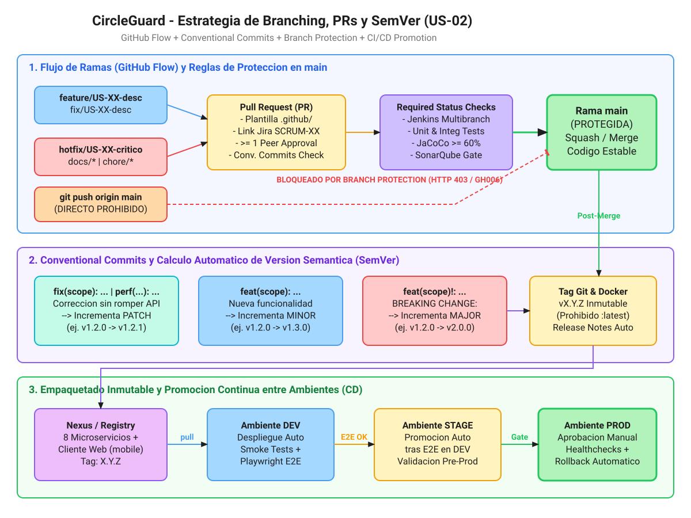
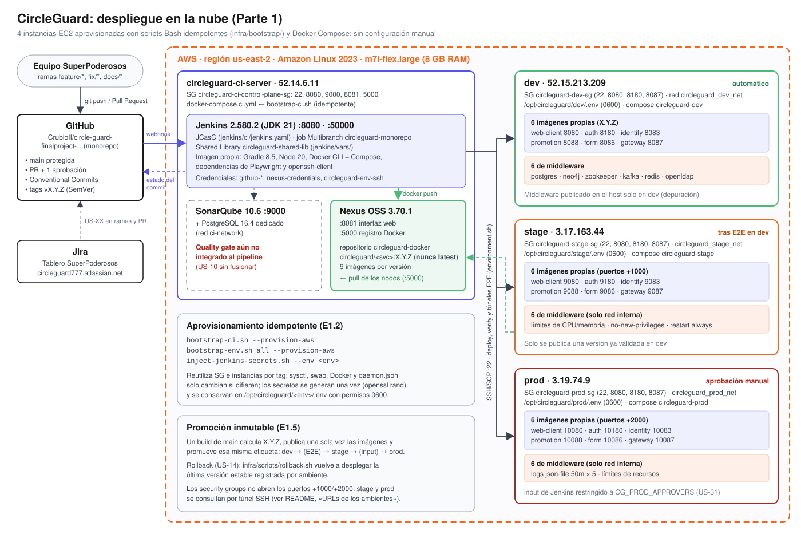
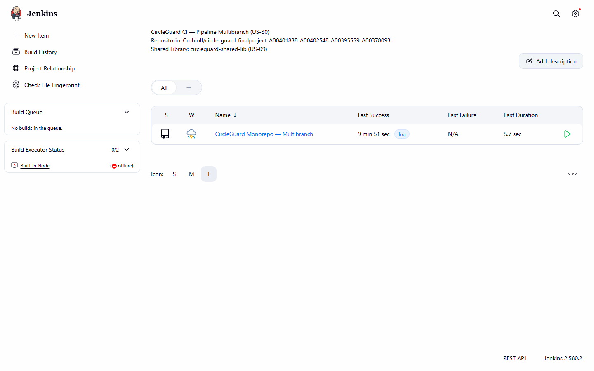
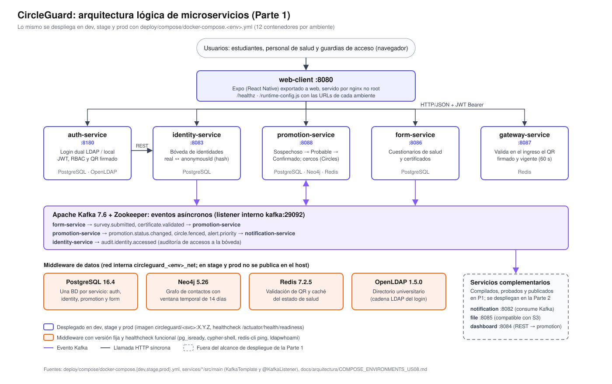
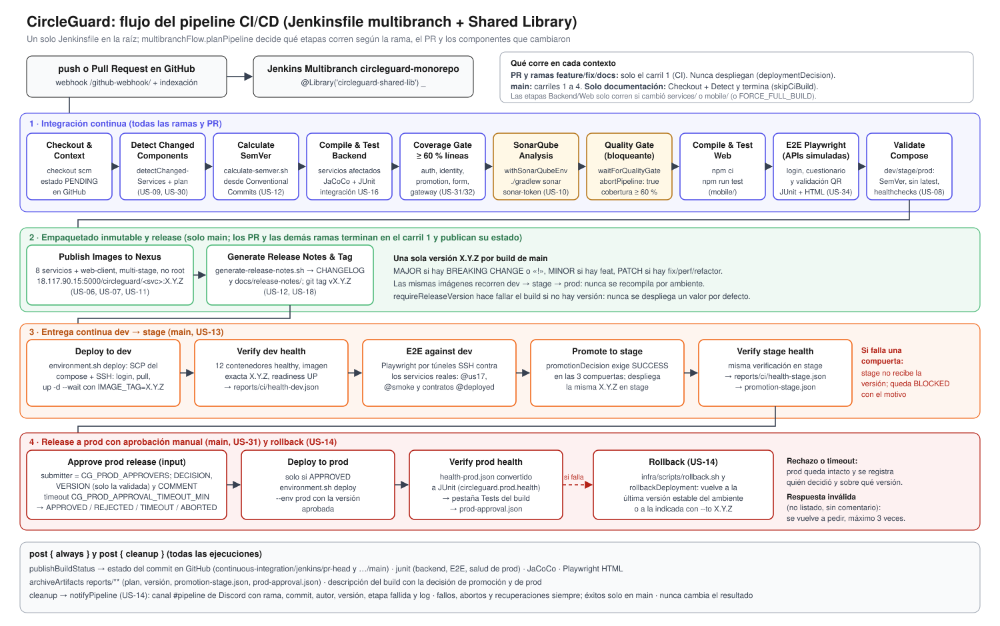
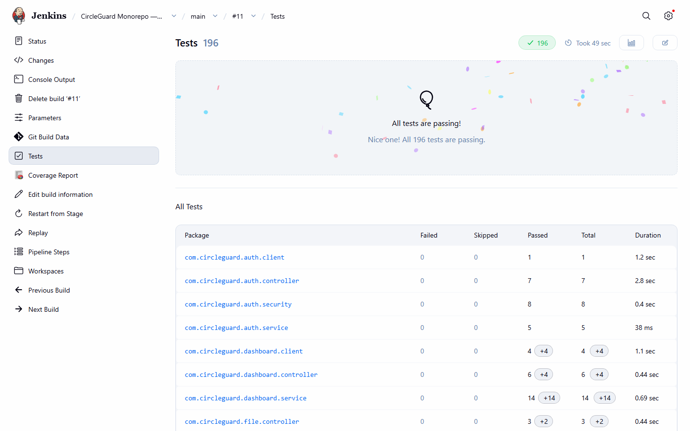
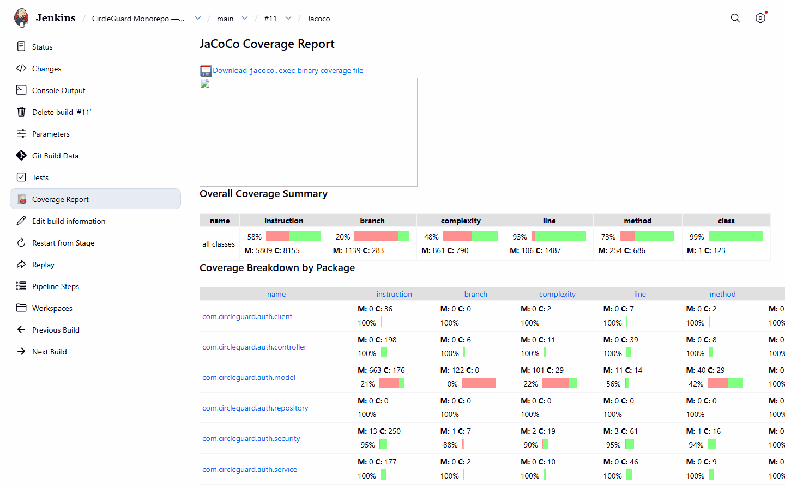

<!-- Generado desde informe-parte1.html con docs/informe/scripts/build-md.py. Edita el HTML y vuelve a generar. -->

# CircleGuard: pipeline DevOps de extremo a extremo

**Informe de la Parte 1 (Spin-off, pipeline CI/CD inicial) · Sprint 1**

Universidad Icesi · Ingeniería de Software V (09776) · Período 2026-2

| | |
|---|---|
| **Equipo** | **SuperPoderosos**: Juan Camilo Rubio Arboleda, Esteban Cuéllar, Santiago Castillo y Juan Pablo Ordóñez |
| **Códigos** | A00401838 · A00402548 · A00395559 · A00378093 |
| **Repositorio** | [github.com/CrubioII/circle-guard-finalproject-A00401838-A00402548-A00395559-A00378093](https://github.com/CrubioII/circle-guard-finalproject-A00401838-A00402548-A00395559-A00378093) |
| **Tablero ágil (Jira)** | Proyecto **SuperPoderosos** (clave `SCRUM`) en [circleguard777.atlassian.net](https://circleguard777.atlassian.net) |
| **Jenkins (pipeline)** | <http://52.14.6.11:8080/job/circleguard-monorepo/> |
| **Nexus / registro** | <http://52.14.6.11:8081/> · `52.14.6.11:5000` |
| **SonarQube** | <http://52.14.6.11:9000/> |
| **Ambientes** | dev `52.15.213.209` · stage `3.17.163.44` · prod `3.19.74.9` (puertos en la sección 1) |
| **Uso de IA generativa** | Nivel 3: Colaboración con IAG. Anexo en `IAG_REGISTRO.md` y resumen en el anexo B |
| **Fecha de corte de la evidencia** | 10 de noviembre de 2026 |

## Contenido

1. Enlaces, ambientes y estado por entregable
2. E1.1 Gestión ágil y branching
3. E1.2 Infraestructura en la nube con Bash
4. E1.3 Empaquetamiento inmutable
5. E1.4 Pipeline Jenkins (CI)
6. E1.5 Entrega continua y promoción
7. E1.6 Pruebas automatizadas
8. E1.7 Change management y release notes
9. E1.8 Documentación
10. Brechas y plan de acción
11. Anexo A: resultados de las validaciones · Anexo B: resumen de IAG · Anexo C: lista de capturas

## 1. Enlaces, ambientes y estado por entregable

### 1.1 URLs de los ambientes y herramientas

| Componente | URL o host | Healthcheck |
|---|---|---|
| Jenkins 2.580.2 | <http://52.14.6.11:8080/> | `GET /login` → 200 |
| SonarQube 10.6 | <http://52.14.6.11:9000/> | `GET /api/system/status` |
| Nexus 3.70.1 y registro Docker | <http://52.14.6.11:8081/> · `52.14.6.11:5000` | `GET /service/rest/v1/status` → 200 |
| dev | web [:8080](http://52.15.213.209:8080/) · auth :8180 · identity :8083 · promotion :8088 · form :8086 · gateway :8087 | `/healthz` y `/actuator/health/readiness` |
| stage | `3.17.163.44`: web 9080 · auth 9180 · identity 9083 · promotion 9088 · form 9086 · gateway 9087 | igual; acceso por túnel SSH |
| prod | `3.19.74.9`: web 10080 · auth 10180 · identity 10083 · promotion 10088 · form 10086 · gateway 10087 | igual; acceso por túnel SSH |

*Los security groups de los ambientes abren solo 22, 8080, 8180 y 8087. Stage y prod se consultan con `ssh -L`, como indica el README (sección «URLs de los ambientes»). Las instancias se apagan fuera de las ventanas de evaluación.*

### 1.2 Estado por entregable

| Cód. | Entregable | Estado | Evidencia principal |
|---|---|---|---|
| E1.1 | Gestión ágil y branching | **Parcial** | Tablero Jira con historias y criterios de aceptación; estrategia GitHub Flow y Conventional Commits; PR revisados. Falta versionar la planeación, la *review* y la retrospectiva de los sprints 0 y 1 |
| E1.2 | Infraestructura en la nube con Bash | **Cumplido** | 4 EC2, `bootstrap-ci.sh` y `bootstrap-env.sh` idempotentes (39 y 38 pruebas), Docker Compose y secretos externalizados |
| E1.3 | Empaquetamiento inmutable | **Cumplido** | Dockerfile multi-stage sin root para 8 servicios y para el web; imágenes 0.1.0 a 0.2.0 en Nexus; compose por ambiente con healthchecks (53 verificaciones) |
| E1.4 | Pipeline Jenkins (CI) | **Parcial** | Multibranch con webhook, Shared Library, ejecución selectiva, JaCoCo, publicación y build #18 de `main` en verde. **Falta** la etapa SonarQube con quality gate bloqueante (US-10) |
| E1.5 | Entrega continua y promoción | **Parcial** | Build #18 de `main`: SemVer 0.2.0, despliegue a dev, E2E contra dev y promoción a stage en verde. Aprobación manual a prod implementada y validada (casos 20 a 22). Notificaciones en Discord (US-14) en ejecución. Rollback con pruebas. **Falta** configurar los aprobadores de prod, empujar el tag a GitHub y la etapa de rollback en el pipeline |
| E1.6 | Pruebas automatizadas | **Parcial** | 236 pruebas en el build #18 (0 fallos), 94 % de líneas en el agregado y ≥ 60 % en los 5 servicios núcleo, 3 flujos E2E Playwright corridos contra dev y 3 integraciones con Testcontainers. **Falta** una integración entre servicios |
| E1.7 | Change management y release notes | **Cumplido** | Plantilla de RFC, política por tipo de cambio, release notes y CHANGELOG automáticos, tags `vX.Y.Z` |
| E1.8 | Documentación | **Cumplido** | README operativo, diagramas de arquitectura y del pipeline, anexo IAG y este informe |

> [!WARNING]
> **Estado operativo al corte.** Se liberó espacio en el servidor de CI y el nodo de Jenkins volvió a estar en línea, con `htmlpublisher` instalado. El build #18 de `main` (commit `ab2aa2a`, que incluye US-13, US-14, US-17 y US-31) terminó en **SUCCESS**: publicó 0.2.0, la desplegó en dev y en stage y avisó en Discord. Los builds #15 a #17 fallaron en `Deploy to dev` y la compuerta bloqueó la promoción, como se espera. Siguen abiertos dos riesgos: Jenkins no tiene autenticación y `CG_PROD_APPROVERS` está vacía, así que el release a prod se omitió (`NOT_CONFIGURED`).

## 2. E1.1 Gestión ágil y branching

El backlog está en Jira (proyecto **SuperPoderosos**, `circleguard777`), con épicas por entregable: EPIC-01 a EPIC-05. Cada historia tiene ficha de valoración, criterios de aceptación medibles y subtareas en puntos de historia. La estrategia es **GitHub Flow orientado a trunk-based**, con promoción inmutable entre ambientes:

- `main` es la única rama de integración y está protegida: no admite *push* directo y exige un PR con 1 aprobación y el estado de Jenkins.
- El trabajo se hace en ramas `feature/US-XX-*`, `fix/*`, `hotfix/*` y `docs/*`.
- Los commits siguen Conventional Commits, validados con la expresión regular de `BRANCHING_STRATEGY.md`.



*Figura 1. Estrategia de branching, protección de `main`, SemVer y promoción (docs/agil/diagramas/branching-strategy-flow.svg).*

> **Captura pendiente:** `capturas/e1-1-jira-board.png`. Jira → SuperPoderosos → Backlog o tablero, con historias, puntos y épicas visibles.
>
> *Figura 2. Tablero y backlog en Jira.*

> **Captura pendiente:** `capturas/e1-1-jira-sprints.png`. Jira → Sprints 0 y 1: objetivo, historias cerradas, review y retrospectiva.
>
> *Figura 3. Sprint 0 y Sprint 1 (planeación, review y retrospectiva).*

> **Captura pendiente:** `capturas/e1-1-github-branch-protection.png`. GitHub → Settings → Branches → regla de main (PR obligatorio, 1 aprobación, status checks).
>
> *Figura 4. Regla de protección de `main`.*

> **Captura pendiente:** `capturas/e1-1-github-pull-requests.png`. GitHub → Pull requests → Closed, con revisores y checks de Jenkins.
>
> *Figura 5. Pull Requests revisados por pares (#1 a #24).*

Trazabilidad: al corte, todo cambio entró a `main` por Pull Request, hasta el #24. Cada PR referencia su historia en el nombre de la rama, en el título y en la plantilla (`.github/pull_request_template.md`). Lo fusionó un integrante distinto del autor. Documento: `docs/agil/BRANCHING_STRATEGY.md`.

## 3. E1.2 Infraestructura en la nube con Bash



*Figura 6. Despliegue en AWS us-east-2: plano de control CI/CD y tres ambientes aislados (docs/arquitectura/diagramas/arquitectura-despliegue-p1.svg).*

| Rol | Instancia | IP | Script |
|---|---|---|---|
| Jenkins, SonarQube y Nexus | `i-0f933271f06cf571d` (m7i-flex.large) | 52.14.6.11 | `bootstrap-ci.sh --provision-aws` |
| dev | `i-0afac282e0fa495ce` | 52.15.213.209 | `bootstrap-env.sh all --provision-aws` |
| stage | `i-0856938aef6905ddc` | 3.17.163.44 | `bootstrap-env.sh all --provision-aws` |
| prod | `i-087a647cdd67fb57a` | 3.19.74.9 | `bootstrap-env.sh all --provision-aws` |

**Idempotencia.** Los scripts reutilizan los security groups y las instancias por tag, y comparan antes de escribir: `sysctl`, `limits`, swap, `/etc/fstab` y `daemon.json`. No sobrescriben `.env.ci` ni `/opt/circleguard/<env>/.env` (`0600`), y reconcilian los contenedores con `docker compose up -d`. Las suites `test-bootstrap-ci-idempotency.sh` (39 pruebas) y `test-bootstrap-env-idempotency.sh` (38 pruebas) ejecutan los scripts dos veces y verifican que la segunda corrida no cambie nada.



*Figura 7. Jenkins en 52.14.6.11:8080 con el job Multibranch.*


*Figura 8. Nexus Repository OSS 3.70.1 en 52.14.6.11:8081.*

> **Captura pendiente:** `capturas/e1-2-aws-ec2-instances.png`. Consola AWS → EC2 → Instances (us-east-2): las 4 instancias con su tag Name y su estado.
>
> *Figura 9. Las cuatro instancias EC2 en us-east-2.*

> **Captura pendiente:** `capturas/e1-2-bootstrap-second-run.png`. Terminal: segunda corrida de bootstrap-env.sh o bootstrap-ci.sh mostrando solo líneas [OK] ... ya existe (idempotente).
>
> *Figura 10. Segunda ejecución idempotente del bootstrap.*

Extracto de `bash infra/bootstrap/test-bootstrap-env-idempotency.sh`, ejecutado el 9 de noviembre de 2026 (38 pruebas, 0 fallidas):

```text
[3/4] Validando CA3 e idempotencia en los 3 ambientes (dev, stage, prod)...
  [PASS] [dev] Ejecución #1 crea directorio aislado y archivo .env
  [PASS] [dev] Define red aislada circleguard_dev_net
  [PASS] [dev] Define base de datos aislada circleguard_dev
  [PASS] [dev] Ejecución #2 detecta sysctl ya actualizado
  [PASS] [dev] Ejecución #2 preserva secretos generados sin sobrescribirlos
  [PASS] [stage] Ejecución #2 preserva secretos generados sin sobrescribirlos
  [PASS] [prod] Ejecución #2 preserva secretos generados sin sobrescribirlos
  [PASS] Secretos JWT son únicos y aislados entre dev y stage
  [PASS] Secretos JWT son únicos y aislados entre stage y prod
  [PASS] Inyección desde Jenkins actualiza POSTGRES_PASSWORD en prod/.env
  [PASS] Rechaza correctamente un ambiente inválido con código != 0
```

El registro de la segunda ejecución sobre AWS, con las líneas «ya existe; reutilizando de forma idempotente», está en `docs/arquitectura/BOOTSTRAP_CI_US04.md` §4. Documentos: `BOOTSTRAP_CI_US04.md` y `BOOTSTRAP_ENV_US05.md`.

## 4. E1.3 Empaquetamiento inmutable

- **Dockerfile multi-stage** por microservicio: compilación con Gradle y ejecución sobre JRE, con usuario no root (US-06). El cliente web también es multi-stage: `expo export` y luego nginx sin root con `/runtime-config.js` generado al arrancar (US-07).
- **Versión semántica** en cada imagen: `52.14.6.11:5000/circleguard/<svc>:X.Y.Z`. Ni los scripts ni los compose aceptan `latest`, y `pipelineUtils` bloquea `:latest`.
- **Un compose por ambiente** (`deploy/compose/docker-compose.{dev,stage,prod}.yml`) con 12 contenedores, healthchecks funcionales y `depends_on: service_healthy`. `validate-compose.sh` pasa 53 verificaciones.


*Figura 11. Imágenes publicadas en el repositorio `circleguard-docker`.*


*Figura 12. Tags SemVer de `auth-service` (0.1.0, 0.1.1, 0.1.2 y 0.2.0).*



*Figura 13. Contenedores de cada ambiente y sus dependencias (docs/arquitectura/diagramas/arquitectura-microservicios.svg).*

## 5. E1.4 Pipeline Jenkins (CI)



*Figura 14. Flujo del pipeline CI/CD por carriles y contexto (docs/arquitectura/diagramas/pipeline-cicd.svg).*

- **Multibranch y webhook.** El job `circleguard-monorepo` se declara con JCasC y descubre 20 ramas y 16 PR. El webhook `/github-webhook/` lo registra `setup-github-webhook.sh`, y el estado se publica en GitHub.
- **Shared Library.** `jenkins/vars/` incluye `detectChangedServices`, `multibranchFlow`, `pipelineUtils`, `publishBuildStatus`, `rollbackDeployment` y `notifyPipeline`, con validadores de 6, 22 y 8 casos.
- **Ejecución por servicio.** Solo se compilan y prueban los servicios modificados. Un cambio compartido o `FORCE_FULL_BUILD` construye los 8.
- **Etapas:** checkout, Gradle, pruebas unitarias con JaCoCo y compuerta de cobertura ≥ 60 %, pruebas de integración (Testcontainers dentro de `test`), E2E, empaquetado y publicación.
- **Brecha**: El análisis **SonarQube con quality gate bloqueante** no está en `main`. El servidor y el plugin `sonar` existen, pero la rama de US-10 no se fusionó.


*Figura 15. Ramas descubiertas por el job Multibranch.*


*Figura 16. Pull Requests construidos por Jenkins.*


*Figura 17. Job `main`: tendencia de pruebas y Stage View.*


*Figura 18. Build #18 de `main` (SUCCESS).*

> **Captura pendiente:** `capturas/e1-4-github-webhook.png`. GitHub → Settings → Webhooks → /github-webhook/ → Recent Deliveries con respuesta 200.
>
> *Figura 19. Webhook de GitHub con entregas recientes.*

> **Captura pendiente:** `capturas/e1-4-sonarqube-quality-gate.png`. SonarQube → proyecto circleguard → Quality Gate (cuando US-10 esté fusionada).
>
> *Figura 20. Quality gate de SonarQube.*

## 6. E1.5 Entrega continua y promoción

| Capacidad | Implementación | Estado |
|---|---|---|
| Versionado semántico automático y tag | `calculate-semver.sh` (Conventional Commits) y `git-tag-release.sh` | **En ejecución** build #18 → `0.2.0`; el tag `v0.2.0` se crea en el workspace de Jenkins pero no se empuja a GitHub |
| Despliegue automático a dev | `Deploy to dev` y `Verify dev health` (US-13) | **En ejecución** build #18: 12 contenedores sanos en dev |
| Promoción a stage tras E2E | `E2E against dev`, `promotionDecision` y `Promote to stage` | **En ejecución** build #18: E2E contra dev en verde y 0.2.0 `PROMOTED` a stage |
| Aprobación manual a prod | `input` restringido a `CG_PROD_APPROVERS`, con versión y comentario (US-31) | **Validado** casos 20 a 22 y en un Jenkins 2.580.2 real. En el build #18 se omitió (`NOT_CONFIGURED`) porque no hay aprobadores |
| Rollback básico | `infra/scripts/rollback.sh` y `rollbackDeployment` (US-14) | **Probado** 10 casos; falta la etapa en el Jenkinsfile |
| Notificaciones del pipeline | `notifyPipeline` en `post { cleanup }`: canal `#pipeline` de Discord con rama, commit, autor, versión, etapa fallida y enlace al log (US-14) | **En ejecución** build #18 → «RECUPERADO» (HTTP 204); 8 casos de validación |


*Figura 21. Cálculo SemVer en el build #18: 0.2.0.*

> **Captura pendiente:** `capturas/e1-5-git-tags.png`. GitHub → Tags (v0.1.0 … v0.2.0), cuando el pipeline empuje los tags.
>
> *Figura 22. Tags de release en Git.*

> **Captura pendiente:** `capturas/e1-5-jenkins-main-cd-stages.png`. Stage View del build #18 de main con Deploy to dev → Verify stage health en verde.
>
> *Figura 23. Etapas de entrega continua dev → stage en `main`.*

> **Captura pendiente:** `capturas/e1-5-discord-notification.png`. Discord → servidor CircleGuard CI → canal #pipeline: mensaje del build #18 (RECUPERADO) o de un build fallido con la etapa.
>
> *Figura 23b. Notificación del pipeline en el canal `#pipeline` de Discord.*

> **Captura pendiente:** `capturas/e1-5-jenkins-prod-approval-input.png`. Build de main detenido en Approve prod release → 'Input requested' con DECISION, VERSION y COMMENT.
>
> *Figura 24. Aprobación manual del release a prod.*

Las decisiones quedan registradas en `reports/ci/promotion-stage.json` (PROMOTED o BLOCKED, con el motivo) y en `reports/ci/prod-approval.json` (quién aprobó o rechazó, la versión y el comentario). Documentos: `DEPLOY_PROMOTION_US13.md`, `PROD_APPROVAL_US31.md`, `ROLLBACK_US14.md` y `NOTIFICACIONES_US14.md`.

## 7. E1.6 Pruebas automatizadas

| Nivel | Qué hay | Evidencia |
|---|---|---|
| Unitarias y cobertura | Pruebas en los 8 servicios. Compuerta `jacocoTestCoverageVerification` ≥ 60 % de líneas en auth, identity, promotion, form y gateway | Build #18: 236 pruebas, 0 fallos y 3 omitidas; JaCoCo con 94 % de líneas en el agregado |
| Integración (Testcontainers) | `LocalUserRepositoryPostgresIntegrationTest` (auth↔PostgreSQL), `IdentityMappingRepositoryPostgresIntegrationTest` (identity↔PostgreSQL) y `QrValidationRedisIntegrationTest` (gateway↔Redis) | Se ejecutan dentro de `test` cuando hay Docker. Falta una que cruce servicios, como form → Kafka → promotion |
| E2E (Playwright) | Flujos de login, cuestionario de salud y validación de acceso con QR, más smoke. Contra dev: contratos `@deployed` | Build #18: los flujos `flows_*`, `smoke` y los contratos `deployed_*` corrieron contra dev y pasaron (pestaña Tests) |



*Figura 25. Resultados JUnit del build #18 (236 pruebas).*



*Figura 26. Reporte JaCoCo del build #18.*


*Figura 27. Último build de `main` al corte.*

> **Captura pendiente:** `capturas/e1-6-playwright-report.png`. Artefacto e2e/reports/html/index.html de un build verde, mostrando los 3 flujos.
>
> *Figura 28. Reporte HTML de Playwright.*

## 8. E1.7 Change management y release notes

- **Plantilla de solicitud de cambio:** `docs/release-notes/PLANTILLA_RFC.md` y `.github/ISSUE_TEMPLATE/change_request.md`.
- **Política de aprobación por tipo de cambio** (estándar, normal y emergencia), con su matriz de responsables: `POLITICA_GESTION_CAMBIOS.md`. Los cambios normales y de emergencia exigen la aprobación manual de Jenkins para prod, que US-31 implementa con comentario o RFC obligatorio.
- **Release notes automáticas** desde commits y PR: `generate-release-notes.sh` genera `CHANGELOG.md` y `docs/release-notes/RELEASE_NOTES_vX.Y.Z.md`, agrupadas por tipo de Conventional Commit y con la lista de imágenes del release.
- **Etiquetado:** `vX.Y.Z` en Git (`git-tag-release.sh`) y `X.Y.Z` en las imágenes. MAJOR, MINOR o PATCH según `BREAKING CHANGE`/`!`, `feat` o `fix`/`perf`/`refactor`.

## 9. E1.8 Documentación

- **README operativo** (`README.md`): estructura del repositorio, URLs de ambientes y herramientas, matriz de puertos, reproducción paso a paso (bootstrap de CI y ambientes, configuración de Jenkins y primera ejecución), operación del pipeline, aprobación, rollback, pruebas e índice de documentos.
- **Diagramas** en `docs/arquitectura/`: arquitectura de microservicios y de despliegue en la nube (`ARQUITECTURA_P1.md`) y flujo del pipeline (`PIPELINE_CICD.md`). Son SVG versionados, editables como texto y renderizados por GitHub.
- **Bitácora de IAG** (`IAG_REGISTRO.md`): declaración de Nivel 3, prompts con su contenido propio y la verificación hecha, y reflexión crítica.
- **Este informe**: `docs/informe/informe-parte1.html`, compilado a PDF con `node docs/informe/scripts/build-pdf.mjs` y a Markdown (`INFORME_PARTE1.md`) con `python docs/informe/scripts/build-md.py`. Las capturas de Jenkins y Nexus se regeneran con `capture-evidence.mjs`.

## 10. Brechas y plan de acción

| Brecha | Acción | Entregable |
|---|---|---|
| Espacio en disco del servidor de CI (ya se llenó una vez) | Limpieza periódica (`docker builder prune` por cron, `cleanWs()`, tarea *cleanup* de Nexus) o ampliar el volumen EBS | E1.2, E1.4 |
| Jenkins sin autenticación | Declarar `securityRealm` y `authorizationStrategy` (`matrix-auth`) en JCasC y definir `CG_PROD_APPROVERS` | E1.2, E1.5 |
| SonarQube con quality gate bloqueante | Fusionar US-10: `withSonarQubeEnv` y `waitForQualityGate abortPipeline: true` | E1.4 |
| Tag de release en GitHub | `git push origin vX.Y.Z` desde `git-tag-release.sh` con la credencial `github-credentials` | E1.5, E1.7 |
| Rollback desde el pipeline | Etapa `Rollback` con `ROLLBACK_TARGET_VERSION` (US-14 §3.2) | E1.5 |
| Integración entre servicios | Prueba form → Kafka → promotion con Testcontainers (Kafka y PostgreSQL) | E1.6 |
| Sprints 0 y 1 documentados | Agregar planeación, *review* y retrospectiva en `docs/agil/` y las capturas de Jira | E1.1 |

## Anexo A. Resultados de las validaciones (10 de noviembre de 2026)

Se ejecutaron en una estación del equipo (Windows 11 con Git Bash) sobre la rama de US-19. Cualquier integrante o el docente puede repetirlas con los comandos del README, sección 7.

| Comando | Resultado |
|---|---|
| `./gradlew validateJenkinsSharedLibrary` | 6/6 casos OK |
| `./gradlew validateJenkinsMultibranchPipeline` | 22/22 casos OK (plan, compuertas, promoción y aprobación de prod) |
| `./gradlew validateJenkinsNotifications` | 8/8 casos OK (mensaje, política, recuperación, errores de Discord, dry-run y firmas CPS) |
| `bash deploy/compose/validate-compose.sh` | 53 verificaciones OK en dev, stage y prod |
| `bash deploy/scripts/test-deploy-scripts.sh` | 40 pruebas OK |
| `bash infra/bootstrap/test-bootstrap-ci-idempotency.sh` | 39 pruebas OK, 0 fallidas |
| `bash infra/bootstrap/test-bootstrap-env-idempotency.sh` | 38 pruebas OK, 0 fallidas |
| `bash infra/scripts/test-calculate-semver.sh` | 5/5 casos OK |
| `bash infra/scripts/test-rollback.sh` | 10/10 casos OK |

Jenkins real, build #18 de `main` (`ab2aa2a`, 6 min 5 s): SUCCESS. SemVer 0.2.0, 236 pruebas, JaCoCo 94 %, publicación de las 9 imágenes en Nexus, despliegue y healthchecks en dev, E2E contra dev, promoción y healthchecks en stage (`PROMOTED`), prod omitido (`NOT_CONFIGURED`) y notificación en Discord (HTTP 204). Las imágenes 0.1.0, 0.1.1, 0.1.2 y 0.2.0 están en `circleguard-docker` (consultado por la API de Nexus).

## Anexo B. Resumen del uso de IA generativa

El equipo declara **Nivel 3: Colaboración con IAG**. El anexo completo es `IAG_REGISTRO.md`, en la raíz del repositorio. Contiene:

1. La declaración y las reglas de uso: nunca compartimos secretos, y cada commit, *push* y PR lo hace un integrante.
2. El registro de prompts por historia (US-08, US-13, US-14, US-19, US-31 y US-33), con el contenido propio entregado a la IA, el prompt, el resultado y la verificación.
3. La reflexión crítica. Ejemplos: una restricción de aprobación que no protegía contra administradores y que solo apareció al probar en un Jenkins real, las limitaciones del *sandbox*, un análisis hecho sobre un estado desactualizado, y la decisión de declarar las brechas en lugar de ocultarlas.

## Anexo C. Lista de capturas

Las capturas sin sesión las genera `node docs/informe/scripts/capture-evidence.mjs`. Las que requieren sesión (Jira, GitHub, AWS, SonarQube) se guardan a mano en `docs/informe/capturas/` con el nombre indicado. Después se recompila el PDF. Detalle: `docs/informe/capturas/README.md`.

| Archivo | Figura | Estado |
|---|---|---|
| `e1-1-github-branch-protection.png` | Regla de protección de `main`. | **Pendiente** |
| `e1-1-github-pull-requests.png` | Pull Requests revisados por pares (#1 a #24). | **Pendiente** |
| `e1-1-jira-board.png` | Tablero y backlog en Jira. | **Pendiente** |
| `e1-1-jira-sprints.png` | Sprint 0 y Sprint 1 (planeación, review y retrospectiva). | **Pendiente** |
| `e1-2-aws-ec2-instances.png` | Las cuatro instancias EC2 en us-east-2. | **Pendiente** |
| `e1-2-bootstrap-second-run.png` | Segunda ejecución idempotente del bootstrap. | **Pendiente** |
| `e1-2-jenkins-dashboard.png` | Jenkins en 52.14.6.11:8080 con el job Multibranch. | Incluida |
| `e1-2-nexus-home.png` | Nexus Repository OSS 3.70.1 en 52.14.6.11:8081. | Incluida |
| `e1-3-nexus-auth-service-tags.png` | Tags SemVer de `auth-service` (0.1.0, 0.1.1, 0.1.2 y 0.2.0). | Incluida |
| `e1-3-nexus-docker-images.png` | Imágenes publicadas en el repositorio `circleguard-docker`. | Incluida |
| `e1-4-github-webhook.png` | Webhook de GitHub con entregas recientes. | **Pendiente** |
| `e1-4-jenkins-main-build.png` | Build #18 de `main` (SUCCESS). | Incluida |
| `e1-4-jenkins-main-job.png` | Job `main`: tendencia de pruebas y Stage View. | Incluida |
| `e1-4-jenkins-multibranch-branches.png` | Ramas descubiertas por el job Multibranch. | Incluida |
| `e1-4-jenkins-multibranch-prs.png` | Pull Requests construidos por Jenkins. | Incluida |
| `e1-4-sonarqube-quality-gate.png` | Quality gate de SonarQube. | **Pendiente** |
| `e1-5-discord-notification.png` | Notificación del pipeline en el canal `#pipeline` de Discord. | **Pendiente** |
| `e1-5-git-tags.png` | Tags de release en Git. | **Pendiente** |
| `e1-5-jenkins-main-cd-stages.png` | Etapas de entrega continua dev → stage en `main`. | **Pendiente** |
| `e1-5-jenkins-main-console-semver.png` | Cálculo SemVer en el build #18: 0.2.0. | Incluida |
| `e1-5-jenkins-prod-approval-input.png` | Aprobación manual del release a prod. | **Pendiente** |
| `e1-6-jenkins-main-jacoco.png` | Reporte JaCoCo del build #18. | Incluida |
| `e1-6-jenkins-main-last-build.png` | Último build de `main` al corte. | Incluida |
| `e1-6-jenkins-main-tests.png` | Resultados JUnit del build #18 (236 pruebas). | Incluida |
| `e1-6-playwright-report.png` | Reporte HTML de Playwright. | **Pendiente** |
