# CircleGuard: pipeline DevOps de extremo a extremo

**Informe de la Parte 1 (Spin-off, pipeline CI/CD inicial) · Sprint 1**

Universidad Icesi · Ingeniería de Software V (09776) · Período 2026-2

| | |
|---|---|
| **Equipo** | **SuperPoderosos**: Juan Camilo Rubio Arboleda, Esteban Cuéllar, Santiago Castillo y Juan Pablo Ordóñez |
| **Códigos** | A00401838 · A00402548 · A00395559 · A00378093 |
| **Repositorio** | [github.com/CrubioII/circle-guard-finalproject-A00401838-A00402548-A00395559-A00378093](https://github.com/CrubioII/circle-guard-finalproject-A00401838-A00402548-A00395559-A00378093) |
| **Tablero ágil (Jira)** | Proyecto **SuperPoderosos** (clave `SCRUM`) en [circleguard777.atlassian.net](https://circleguard777.atlassian.net) |
| **Jenkins (pipeline)** | <http://52.14.6.11:8080/job/circleguard-monorepo/> |
| **Nexus / registro** | <http://52.14.6.11:8081/> · `52.14.6.11:5000` |
| **SonarQube** | <http://52.14.6.11:9000/> |
| **Ambientes** | dev `52.15.213.209` · stage `3.17.163.44` · prod `3.19.74.9` (puertos en la sección 1) |
| **Uso de IA generativa** | Nivel 3: Colaboración con IAG. Bitácora en [`docs/BITACORA_IAG_EQUIPO.md`](../BITACORA_IAG_EQUIPO.md) y resumen en el anexo B |

> **Nota (migración de cuenta AWS):** las IPs de este informe corresponden a la cuenta AWS de la Parte 1. La infraestructura se migró a una cuenta nueva: CI/Jenkins, SonarQube, Nexus y registro en `18.117.90.15`, dev `52.15.165.116`, stage `52.14.89.125` y prod `77.113.211.62`. Las direcciones vigentes están en el [`README`](../../README.md).


## Contenido

1. Enlaces, ambientes y estado por entregable
2. E1.1 Gestión ágil y branching
3. E1.2 Infraestructura en la nube con Bash
4. E1.3 Empaquetamiento inmutable
5. E1.4 Pipeline Jenkins (CI)
6. E1.5 Entrega continua y promoción
7. E1.6 Pruebas automatizadas
8. E1.7 Change management y release notes
9. E1.8 Documentación
11. Anexo A: resultados de las validaciones

## 1. Enlaces, ambientes y estado por entregable

### 1.1 URLs de los ambientes y herramientas

| Componente | URL o host | Healthcheck |
|---|---|---|
| Jenkins 2.580.2 | <http://52.14.6.11:8080/> (requiere sesión; cuenta `docente` de solo lectura) | `GET /login` → 200 |
| SonarQube 10.6 | <http://52.14.6.11:9000/> · proyecto `circleguard-monorepo` | `GET /api/system/status` → `UP` |
| Nexus 3.70.1 y registro Docker | <http://52.14.6.11:8081/> · `52.14.6.11:5000` | `GET /service/rest/v1/status` → 200 |
| dev | web [:8080](http://52.15.213.209:8080/) · auth :8180 · identity :8083 · promotion :8088 · form :8086 · gateway :8087 | `/healthz` y `/actuator/health/readiness` |
| stage | `3.17.163.44`: web 9080 · auth 9180 · identity 9083 · promotion 9088 · form 9086 · gateway 9087 | igual; acceso por túnel SSH |
| prod | `3.19.74.9`: web 10080 · auth 10180 · identity 10083 · promotion 10088 · form 10086 · gateway 10087 | igual; acceso por túnel SSH |

*Los security groups de los ambientes abren solo 22, 8080, 8180 y 8087. Stage y prod se consultan con `ssh -L`, como indica el README (sección «URLs de los ambientes»). Las instancias se apagan fuera de las ventanas de evaluación.*

### 1.2 Estado por entregable

| Cód. | Entregable | Estado | Evidencia principal |
|---|---|---|---|
| E1.1 | Gestión ágil y branching | **Cumplido** | Marco Scrum, roles, estimación y backlog en Jira (US-01); actas de Sprint 0 y Sprint 1 con planning, dailies, review, retrospectiva y burndown (US-03); GitHub Flow, Conventional Commits y PR revisados (US-02) |
| E1.2 | Infraestructura en la nube con Bash | **Cumplido** | 4 EC2, `bootstrap-ci.sh` y `bootstrap-env.sh` idempotentes (65 y 38 pruebas), Docker Compose, secretos externalizados y Jenkins con cuentas y matriz de permisos declaradas en JCasC (US-31) |
| E1.3 | Empaquetamiento inmutable | **Cumplido** | Dockerfile multi-stage sin root para 8 servicios y para el web; imágenes 0.1.0 a 0.3.0 en Nexus; compose por ambiente con healthchecks (53 verificaciones) |
| E1.4 | Pipeline Jenkins (CI) | **Cumplido** | Multibranch con webhook, Shared Library, ejecución selectiva, JaCoCo con compuerta ≥ 60 %, análisis SonarQube y Quality Gate bloqueante antes de publicar (US-10), y publicación en Nexus |
| E1.5 | Entrega continua y promoción | **Cumplido** | Build #18 de `main`: SemVer 0.2.0, despliegue a dev, E2E contra dev y promoción a stage en verde. Aprobación manual a prod con aprobadores configurados (`jrubio`, `jpordonez`) y Jenkins con sesión obligatoria (US-31). Notificaciones en Discord (US-14). Rollback con pruebas.|
| E1.6 | Pruebas automatizadas | **Cumplido** | 236 pruebas en el build #18 (0 fallos), 94 % de líneas en el agregado y ≥ 60 % en los 5 servicios núcleo; 3 flujos E2E Playwright corridos contra dev; integraciones con Testcontainers, incluida la de servicios `form → Kafka → promotion` con un broker real (US-16) |
| E1.7 | Change management y release notes | **Cumplido** | Plantilla de RFC, política por tipo de cambio, release notes y CHANGELOG automáticos, tags `vX.Y.Z` |
| E1.8 | Documentación | **Cumplido** | README operativo, diagramas de arquitectura y del pipeline, bitácora de IAG y este informe |


## 2. E1.1 Gestión ágil y branching

El backlog está en Jira (proyecto **SuperPoderosos**, `circleguard777`), con épicas por entregable: EPIC-01 a EPIC-05. Cada historia tiene ficha de valoración, criterios de aceptación medibles y subtareas en puntos de historia. La estrategia es **GitHub Flow orientado a trunk-based**, con promoción inmutable entre ambientes:

- `main` es la única rama de integración y está protegida: no admite *push* directo y exige un PR con 1 aprobación y el estado de Jenkins.
- El trabajo se hace en ramas `feature/US-XX-*`, `fix/*`, `hotfix/*` y `docs/*`.
- Los commits siguen Conventional Commits, validados con la expresión regular de `BRANCHING_STRATEGY.md`.


*Figura 1. Estrategia de branching, protección de `main`, SemVer y promoción (`docs/agil/diagramas/branching-strategy-flow.svg`).*

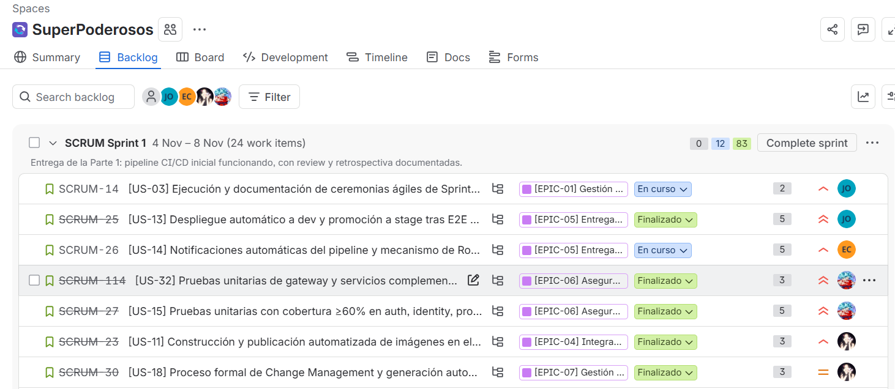

*Figura 2. Tablero y backlog en Jira.*


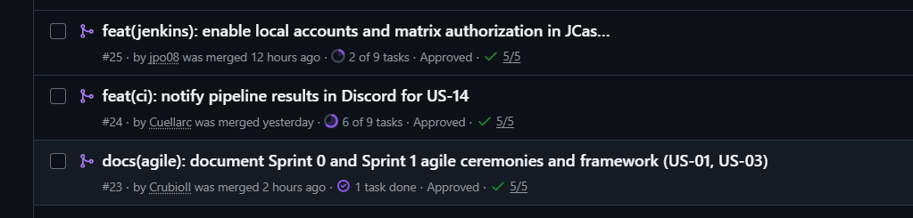

*Figura 3. Pull Requests fusionados, cada uno con aprobación y los checks de Jenkins en verde.*

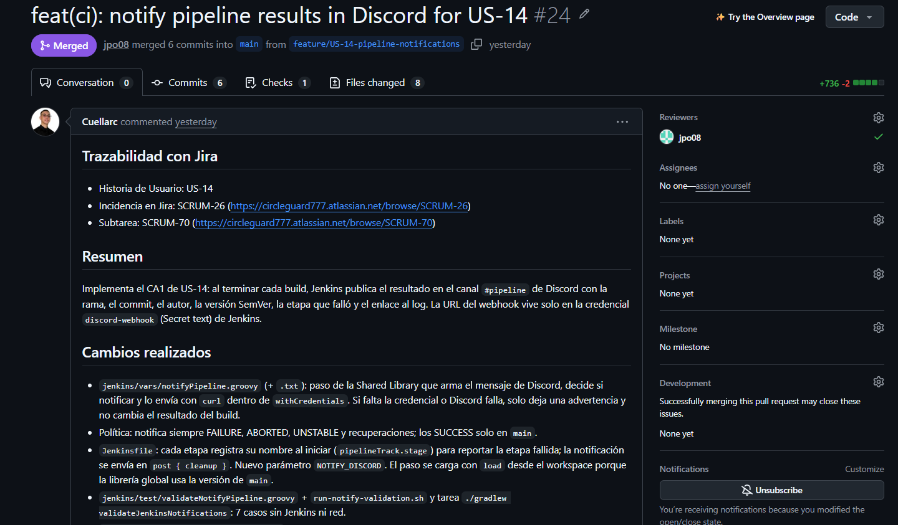

*Figura 4. Detalle de un PR (#24, US-14): trazabilidad con Jira, resumen de cambios y revisor distinto del autor.*

**Ceremonias.** `docs/agil/MARCO_AGIL.md` justifica Scrum, define roles, capacidad, escala de estimación (Fibonacci) y la definición de hecho (US-01). `docs/agil/SPRINT_0_Y_1_CEREMONIAS.md` contiene las actas de Sprint 0 y Sprint 1: planning con el objetivo y la distribución de las 19 historias (95 puntos), dailies con los impedimentos, review, retrospectiva y burndown (US-03).

Trazabilidad: al corte, todo cambio entró a `main` por Pull Request. Cada PR referencia su historia en el nombre de la rama, en el título y en la plantilla (`.github/pull_request_template.md`). Lo fusionó un integrante distinto del autor. Documento: `docs/agil/BRANCHING_STRATEGY.md`.

## 3. E1.2 Infraestructura en la nube con Bash


*Figura 6. Despliegue en AWS us-east-2: plano de control CI/CD y tres ambientes aislados (`docs/arquitectura/diagramas/arquitectura-despliegue-p1.svg`).*

| Rol | Instancia | IP | Script |
|---|---|---|---|
| Jenkins, SonarQube y Nexus | `i-0f933271f06cf571d` (m7i-flex.large) | 52.14.6.11 | `bootstrap-ci.sh --provision-aws` |
| dev | `i-0afac282e0fa495ce` | 52.15.213.209 | `bootstrap-env.sh all --provision-aws` |
| stage | `i-0856938aef6905ddc` | 3.17.163.44 | `bootstrap-env.sh all --provision-aws` |
| prod | `i-087a647cdd67fb57a` | 3.19.74.9 | `bootstrap-env.sh all --provision-aws` |

**Idempotencia.** Los scripts reutilizan los security groups y las instancias por tag, y comparan antes de escribir: `sysctl`, `limits`, swap, `/etc/fstab` y `daemon.json`. No sobrescriben `.env.ci` ni `/opt/circleguard/<env>/.env` (`0600`), y reconcilian los contenedores con `docker compose up -d`. Las suites `test-bootstrap-ci-idempotency.sh` (65 pruebas) y `test-bootstrap-env-idempotency.sh` (38 pruebas) ejecutan los scripts dos veces y verifican que la segunda corrida no cambie nada.

**Seguridad del plano de control (US-31).** Jenkins usa cuentas locales sin registro público y una matriz de permisos declaradas en JCasC: solo `admin` administra, el equipo lanza builds y responde la aprobación de prod, `docente` solo lee y el usuario anónimo no tiene permisos. `bootstrap-ci.sh` genera las contraseñas que falten sin reemplazar las existentes, y llegan a Jenkins como secretos de Docker Compose. `validateJenkinsSecurity` comprueba la configuración (32 verificaciones). Documento: `docs/operaciones/JENKINS_SEGURIDAD_US31.md`.


*Figura 7. Jenkins en 52.14.6.11:8080 con el job Multibranch.*

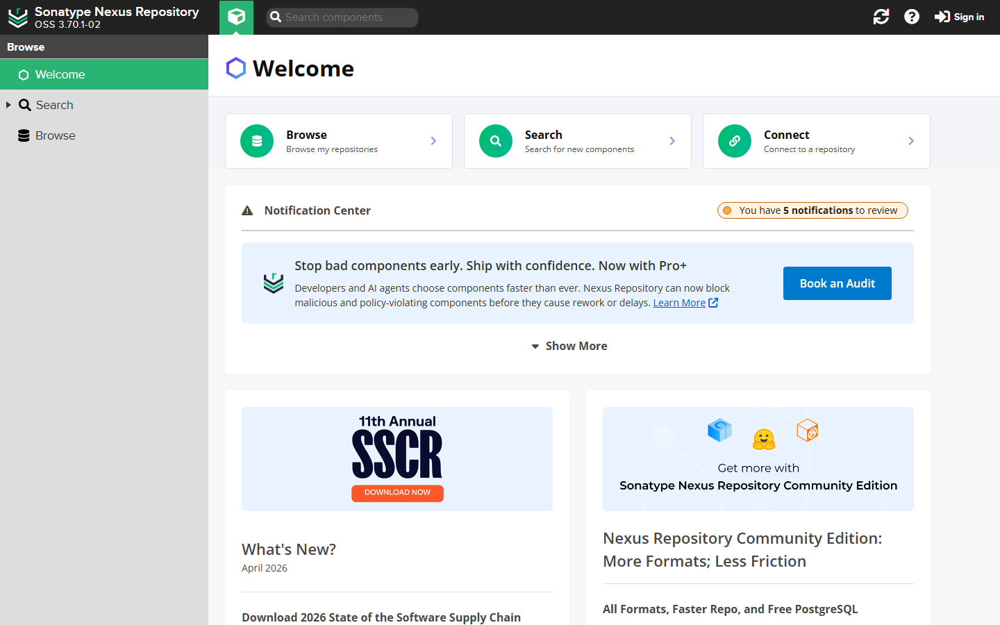

*Figura 8. Nexus Repository OSS 3.70.1 en 52.14.6.11:8081.*

Extracto de `bash infra/bootstrap/test-bootstrap-env-idempotency.sh`, ejecutado el 9 de noviembre de 2026 (38 pruebas, 0 fallidas):

```text
[3/4] Validando CA3 e idempotencia en los 3 ambientes (dev, stage, prod)...
  [PASS] [dev] Ejecución #1 crea directorio aislado y archivo .env
  [PASS] [dev] Define red aislada circleguard_dev_net
  [PASS] [dev] Define base de datos aislada circleguard_dev
  [PASS] [dev] Ejecución #2 detecta sysctl ya actualizado
  [PASS] [dev] Ejecución #2 preserva secretos generados sin sobrescribirlos
  [PASS] [stage] Ejecución #2 preserva secretos generados sin sobrescribirlos
  [PASS] [prod] Ejecución #2 preserva secretos generados sin sobrescribirlos
  [PASS] Secretos JWT son únicos y aislados entre dev y stage
  [PASS] Secretos JWT son únicos y aislados entre stage y prod
  [PASS] Inyección desde Jenkins actualiza POSTGRES_PASSWORD en prod/.env
  [PASS] Rechaza correctamente un ambiente inválido con código != 0
```

El registro de la segunda ejecución sobre AWS, con las líneas «ya existe; reutilizando de forma idempotente», está en `docs/arquitectura/BOOTSTRAP_CI_US04.md` §4. Documentos: `BOOTSTRAP_CI_US04.md` y `BOOTSTRAP_ENV_US05.md`.

## 4. E1.3 Empaquetamiento inmutable

- **Dockerfile multi-stage** por microservicio: compilación con Gradle y ejecución sobre JRE, con usuario no root (US-06). El cliente web también es multi-stage: `expo export` y luego nginx sin root con `/runtime-config.js` generado al arrancar (US-07).
- **Versión semántica** en cada imagen: `52.14.6.11:5000/circleguard/<svc>:X.Y.Z`. Ni los scripts ni los compose aceptan `latest`, y `pipelineUtils` bloquea `:latest`.
- **Un compose por ambiente** (`deploy/compose/docker-compose.{dev,stage,prod}.yml`) con 12 contenedores, healthchecks funcionales y `depends_on: service_healthy`. `validate-compose.sh` pasa 53 verificaciones.


*Figura 10. Imágenes publicadas en el repositorio `circleguard-docker`.*

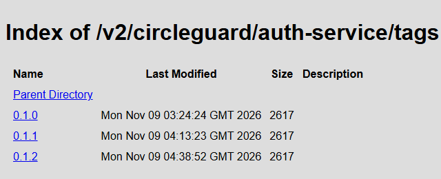

*Figura 11. Tags SemVer de `auth-service` publicados en Nexus.*


*Figura 12. Contenedores de cada ambiente y sus dependencias (`docs/arquitectura/diagramas/arquitectura-microservicios.svg`).*

## 5. E1.4 Pipeline Jenkins (CI)


*Figura 13. Flujo del pipeline CI/CD por carriles y contexto (`docs/arquitectura/diagramas/pipeline-cicd.svg`).*

- **Multibranch y webhook.** El job `circleguard-monorepo` se declara con JCasC y descubre 20 ramas y 16 PR. El webhook `/github-webhook/` lo registra `setup-github-webhook.sh`, y el estado se publica en GitHub.
- **Shared Library.** `jenkins/vars/` incluye `detectChangedServices`, `multibranchFlow`, `pipelineUtils`, `publishBuildStatus`, `rollbackDeployment`, `notifyPipeline` y `sonarQualityGate`, con validadores de 6, 22, 8 y 13 casos.
- **Ejecución por servicio.** Solo se compilan y prueban los servicios modificados. Un cambio compartido o `FORCE_FULL_BUILD` construye los 8.
- **Etapas:** checkout, Gradle, pruebas unitarias e integración (Testcontainers) con JaCoCo, compuerta de cobertura ≥ 60 %, análisis SonarQube, Quality Gate, E2E, empaquetado y publicación.
- **SonarQube y Quality Gate (US-10).** `SonarQube Analysis` ejecuta `./gradlew sonar` dentro de `withSonarQubeEnv('SonarQube')` con los reportes XML de JaCoCo. `Quality Gate` espera el veredicto de `CircleGuard-Quality-Gate` (cobertura ≥ 60 %) con `waitForQualityGate(abortPipeline: true)` y corre **antes** de publicar imágenes y desplegar: una versión que no lo cumple nunca llega a Nexus ni a los ambientes. Documento: `docs/agil/JENKINS_SONARQUBE_JACOCO_US10.md`.

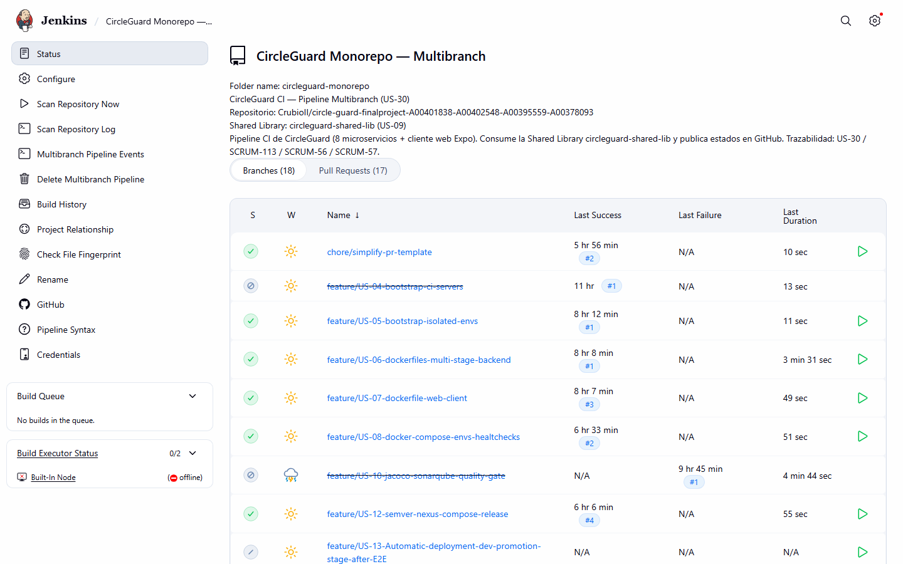

*Figura 14. Ramas descubiertas por el job Multibranch.*

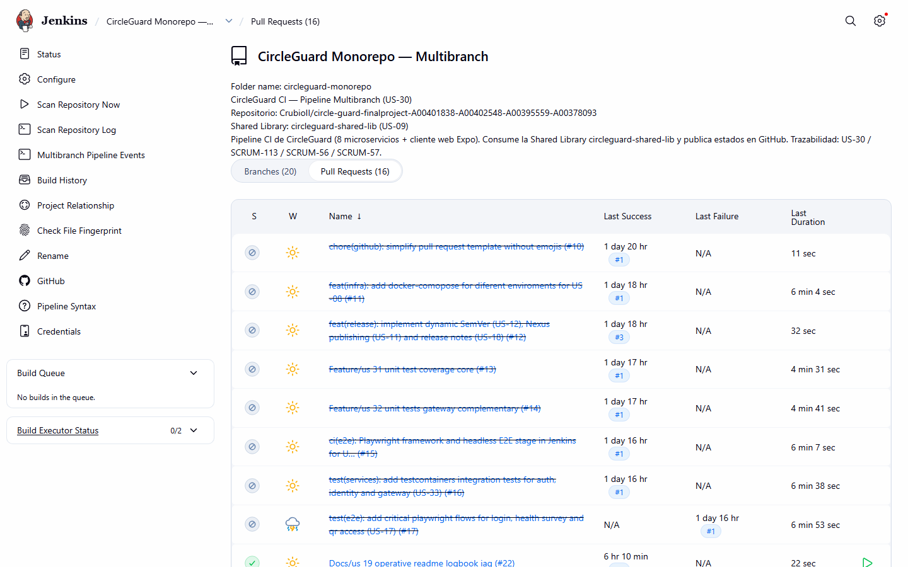

*Figura 15. Pull Requests construidos por Jenkins.*

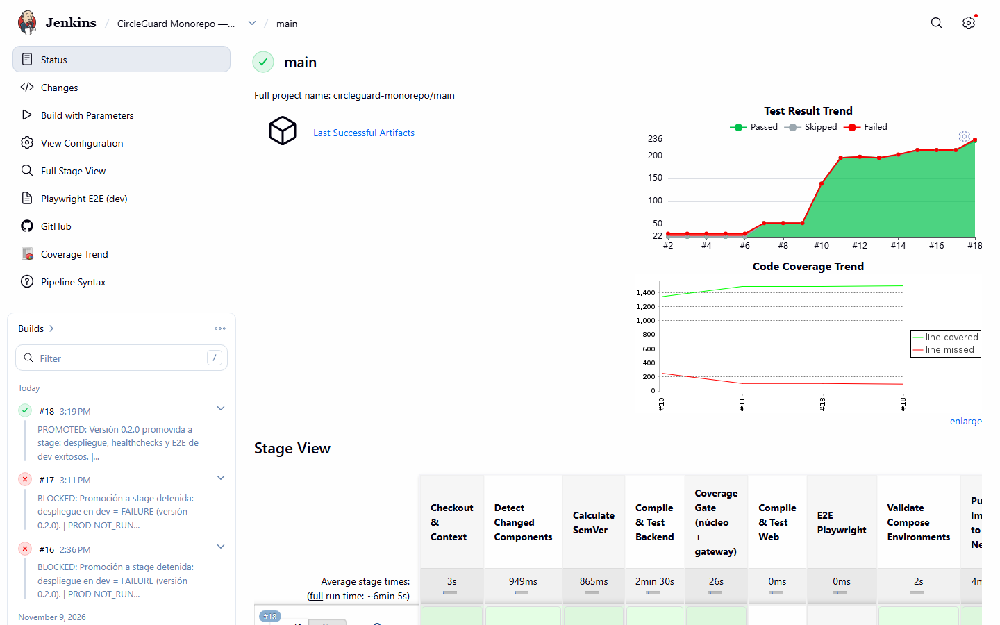

*Figura 16. Job `main`: tendencia de pruebas y Stage View.*


*Figura 17. Build #18 de `main` (SUCCESS).*

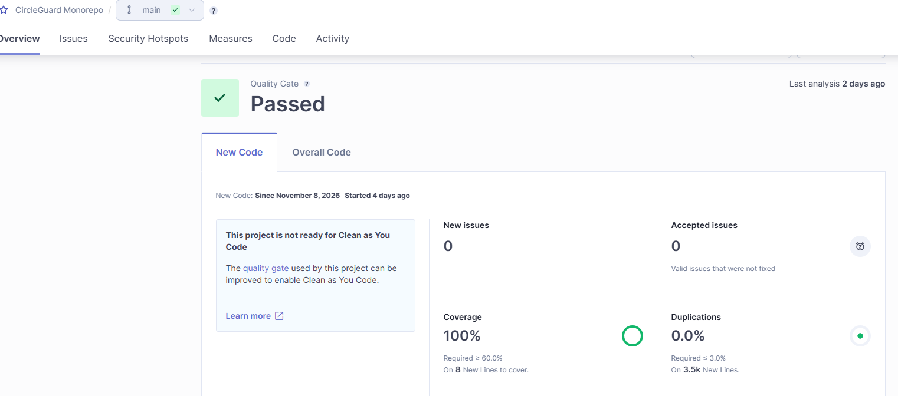
>
*Figura 19. Quality Gate de SonarQube.*

## 6. E1.5 Entrega continua y promoción

| Capacidad | Implementación | Estado |
|---|---|---|
| Versionado semántico automático y tag | `calculate-semver.sh` (Conventional Commits) y `git-tag-release.sh` | **En ejecución** build #18 → `0.2.0` y build #20 → `0.3.0`; el tag se crea en el workspace de Jenkins pero no se empuja a GitHub |
| Despliegue automático a dev | `Deploy to dev` y `Verify dev health` (US-13) | **En ejecución** build #18: 12 contenedores sanos en dev |
| Promoción a stage tras E2E | `E2E against dev`, `promotionDecision` y `Promote to stage` | **En ejecución** build #18: E2E contra dev en verde y 0.2.0 `PROMOTED` a stage |
| Aprobación manual a prod | `input` restringido a `CG_PROD_APPROVERS` (`jrubio`, `jpordonez`), con versión y comentario obligatorio (US-31) | **En ejecución** build #20: 0.3.0 aprobado por `jpordonez` con su justificación y desplegado en prod (despliegue y healthchecks `SUCCESS`). Validado además en los casos 20 a 22 y en un Jenkins real: los no aprobadores no pueden aprobar |
| Rollback básico | `infra/scripts/rollback.sh` y `rollbackDeployment` (US-14) | **Probado** 10 casos |
| Notificaciones del pipeline | `notifyPipeline` en `post { cleanup }`: canal `#pipeline` de Discord con rama, commit, autor, versión, etapa fallida y enlace al log (US-14) | **En ejecución** build #18 → «RECUPERADO» (HTTP 204) y build #20 → «ÉXITO» con la aprobación de prod; 8 casos de validación |

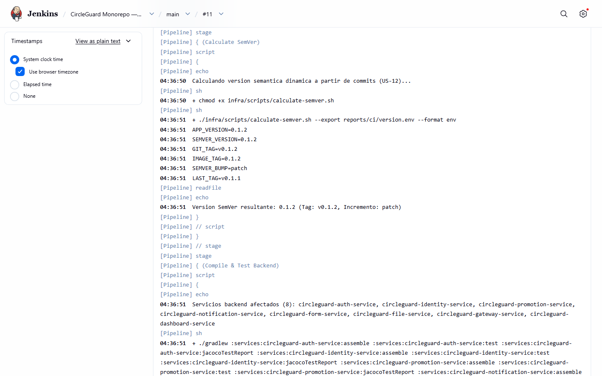

*Figura 20. Cálculo SemVer en el build #18: 0.2.0.*


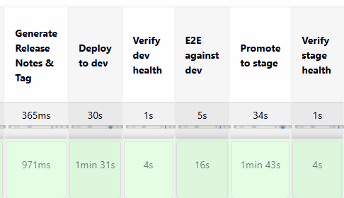

 *Figura 22. Etapas de entrega continua dev → stage en `main`.*

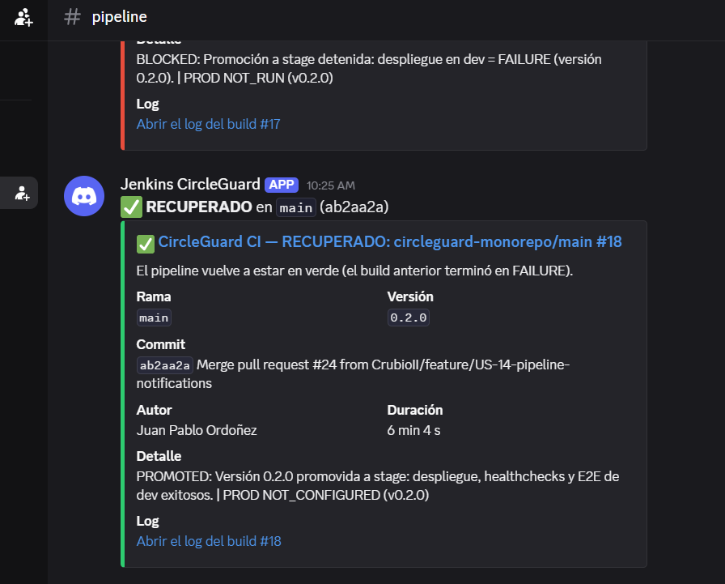

*Figura 23. Notificación del pipeline en el canal `#pipeline` de Discord.*

**Release a prod (build #20).** El build #20 de `main` (commit `63c29c2`, *merge* del PR #25) llevó la versión 0.3.0 por dev y stage y se detuvo en `Approve prod release`. `jpordonez`, uno de los aprobadores de `CG_PROD_APPROVERS`, aprobó con la justificación obligatoria. Jenkins registró quién aprobó, la versión y el comentario, desplegó en prod y verificó sus healthchecks. La duración total fue de 14 min 6 s, incluida la espera de la aprobación.

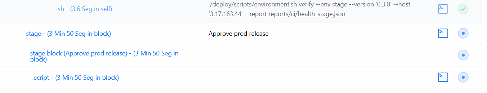

*Figura 24. Build #20: `Verify stage health` en verde y el pipeline detenido en `Approve prod release`.*

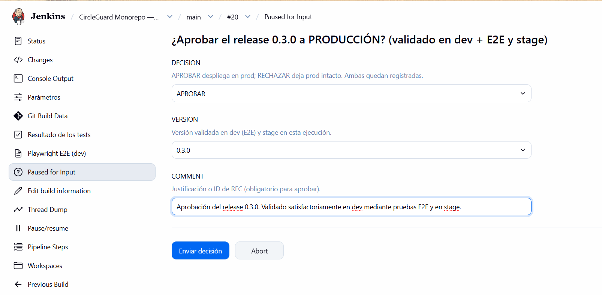

*Figura 25. Formulario de aprobación: decisión, versión validada en dev y stage, y justificación obligatoria.*

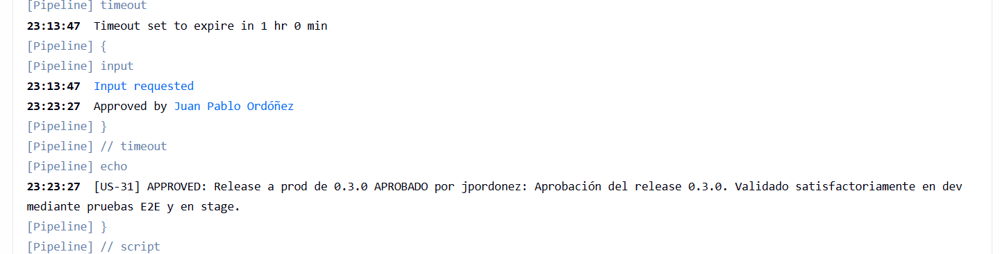

*Figura 26. Consola del build #20: aprobación registrada con el usuario, la versión y el comentario.*

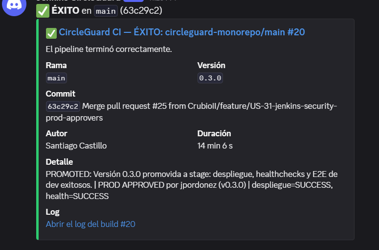

*Figura 27. Notificación del build #20: promoción a stage, aprobación de prod por `jpordonez` y despliegue y healthchecks en prod `SUCCESS`.*

Las decisiones quedan registradas en `reports/ci/promotion-stage.json` (PROMOTED o BLOCKED, con el motivo) y en `reports/ci/prod-approval.json` (quién aprobó o rechazó, la versión y el comentario). Documentos: `DEPLOY_PROMOTION_US13.md`, `PROD_APPROVAL_US31.md`, `JENKINS_SEGURIDAD_US31.md`, `ROLLBACK_US14.md` y `NOTIFICACIONES_US14.md`.

## 7. E1.6 Pruebas automatizadas

| Nivel | Qué hay | Evidencia |
|---|---|---|
| Unitarias y cobertura | Pruebas en los 8 servicios. Compuerta `jacocoTestCoverageVerification` ≥ 60 % de líneas en auth, identity, promotion, form y gateway | Build #18: 236 pruebas, 0 fallos y 3 omitidas; JaCoCo con 94 % de líneas en el agregado |
| Integración (Testcontainers) | `FormKafkaPromotionIntegrationTest` (US-16): el productor real de form-service publica `survey.submitted` en un Kafka real, promotion-service lo consume, marca al usuario como `SUSPECT` en Neo4j y publica `promotion.status.changed` (3 casos). Además: `LocalUserRepositoryPostgresIntegrationTest` (auth↔PostgreSQL), `IdentityMappingRepositoryPostgresIntegrationTest` (identity↔PostgreSQL) y `QrValidationRedisIntegrationTest` (gateway↔Redis) | Se ejecutan dentro de `test` en cada build del backend. La prueba de US-16 detectó que promotion-service publicaba sus eventos sin serializador JSON, y se corrigió en su `application.yml` |
| E2E (Playwright) | Flujos de login, cuestionario de salud y validación de acceso con QR, más smoke. Contra dev: contratos `@deployed` | Build #18: los flujos `flows_*`, `smoke` y los contratos `deployed_*` corrieron contra dev y pasaron (pestaña Tests) |


*Figura 28. Resultados JUnit del build #18 (236 pruebas).*


*Figura 29. Reporte JaCoCo del build #18.*


*Figura 30. build de `main`.*

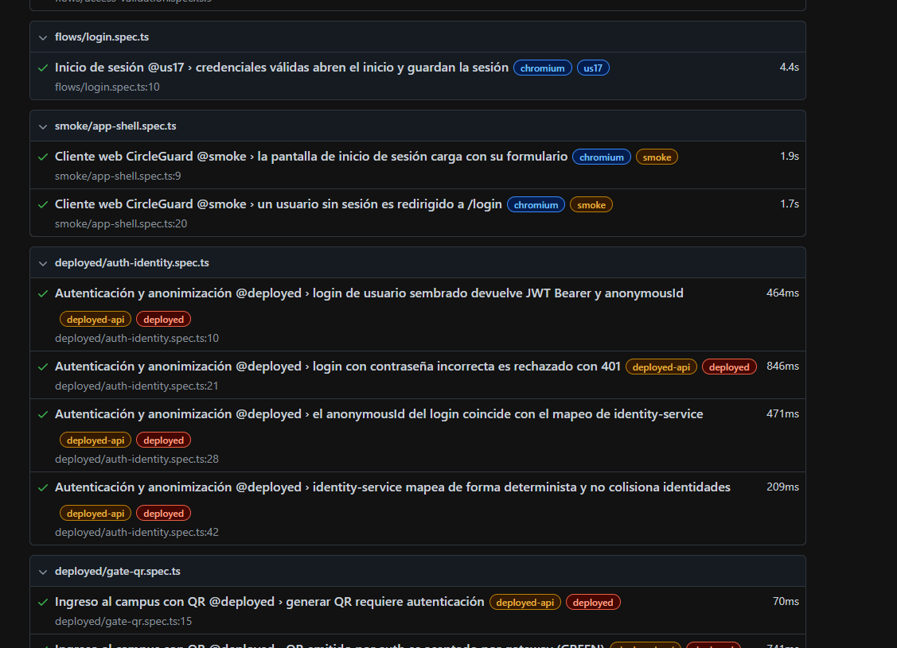
*Figura 31. Reporte HTML de Playwright.*

## 8. E1.7 Change management y release notes

- **Plantilla de solicitud de cambio:** `docs/release-notes/PLANTILLA_RFC.md` y `.github/ISSUE_TEMPLATE/change_request.md`.
- **Política de aprobación por tipo de cambio** (estándar, normal y emergencia), con su matriz de responsables: `POLITICA_GESTION_CAMBIOS.md`. Los cambios normales y de emergencia exigen la aprobación manual de Jenkins para prod, que US-31 implementa con comentario o RFC obligatorio.
- **Release notes automáticas** desde commits y PR: `generate-release-notes.sh` genera `CHANGELOG.md` y `docs/release-notes/RELEASE_NOTES_vX.Y.Z.md`, agrupadas por tipo de Conventional Commit y con la lista de imágenes del release.
- **Etiquetado:** `vX.Y.Z` en Git (`git-tag-release.sh`) y `X.Y.Z` en las imágenes. MAJOR, MINOR o PATCH según `BREAKING CHANGE`/`!`, `feat` o `fix`/`perf`/`refactor`.

## 9. E1.8 Documentación

- **README operativo** (`README.md`): estructura del repositorio, URLs de ambientes y herramientas, matriz de puertos, reproducción paso a paso (bootstrap de CI y ambientes, configuración de Jenkins y primera ejecución), operación del pipeline, aprobación, rollback, pruebas e índice de documentos.
- **Diagramas** en `docs/arquitectura/`: arquitectura de microservicios y de despliegue en la nube (`ARQUITECTURA_P1.md`) y flujo del pipeline con sus 20 etapas (`PIPELINE_CICD.md`). Son SVG versionados, editables como texto y renderizados por GitHub.
- **Bitácora de IAG** (`docs/BITACORA_IAG_EQUIPO.md`): declaración de Nivel 3, usos de la IA con sus prompts, organización del equipo y responsabilidad sobre lo integrado.
- **Este informe**: `docs/informe/INFORME_PARTE1.md`, en Markdown, que GitHub muestra directamente con sus figuras. Las capturas viven en `docs/informe/capturas/`; las de Jenkins y Nexus se regeneran con `capture-evidence.mjs`, usando un API token de Jenkins.


## Anexo A. Resultados de las validaciones (11 de noviembre de 2026)

Se ejecutaron en una estación del equipo (Windows 11 con Git Bash) sobre la rama de US-19. Cualquier integrante o el docente puede repetirlas con los comandos del README, sección 7.

| Comando | Resultado |
|---|---|
| `./gradlew validateJenkinsSharedLibrary` | 6/6 casos OK |
| `./gradlew validateJenkinsMultibranchPipeline` | 22/22 casos OK (plan, compuertas, promoción y aprobación de prod) |
| `./gradlew validateJenkinsNotifications` | 8/8 casos OK (mensaje, política, recuperación, errores de Discord, dry-run y firmas CPS) |
| `./gradlew validateJenkinsSonarQualityGate` | 13 casos: carga en el *sandbox*, JaCoCo, comando de SonarQube, Quality Gate bloqueante, orden de etapas y script del webhook (el caso 12 se ejecuta con `bash jenkins/test/validateSonarWebhookScript.sh` en Windows) |
| `./gradlew validateJenkinsSecurity` | 32/32 verificaciones OK (cuentas, permisos, aprobadores y secretos) |
| `bash deploy/compose/validate-compose.sh` | 53 verificaciones OK en dev, stage y prod |
| `bash deploy/scripts/test-deploy-scripts.sh` | 40 pruebas OK |
| `bash infra/bootstrap/test-bootstrap-ci-idempotency.sh` | 65 pruebas OK, 0 fallidas |
| `bash infra/bootstrap/test-bootstrap-env-idempotency.sh` | 38 pruebas OK, 0 fallidas |
| `bash infra/scripts/test-calculate-semver.sh` | 5/5 casos OK |
| `bash infra/scripts/test-rollback.sh` | 10/10 casos OK |

Jenkins real, build #18 de `main` (`ab2aa2a`, 6 min 5 s): SUCCESS. SemVer 0.2.0, 236 pruebas, JaCoCo 94 %, publicación de las 9 imágenes en Nexus, despliegue y healthchecks en dev, E2E contra dev, promoción y healthchecks en stage (`PROMOTED`) y notificación en Discord. Las imágenes 0.1.0 a 0.3.0 están en `circleguard-docker` (consultado en Nexus).

Jenkins real, build #20 de `main` (`63c29c2`, 14 min 6 s con la espera de la aprobación): SUCCESS. SemVer 0.3.0, promoción a stage (`PROMOTED`), aprobación de prod por `jpordonez`, despliegue y healthchecks en prod `SUCCESS` y notificación en Discord.

Seguridad en un Jenkins 2.580.2 real con la configuración de US-31: 34 verificaciones (anónimo sin acceso, webhooks sin sesión, permisos por cuenta, contraseñas fuera del entorno de los builds y aprobación de prod solo por los aprobadores), más la actualización desde un Jenkins sin seguridad conservando los jobs.

## Anexo B. Resumen del uso de IA generativa

El equipo declara **Nivel 3: Colaboración con IAG**. La bitácora completa es [`docs/BITACORA_IAG_EQUIPO.md`](../BITACORA_IAG_EQUIPO.md). Contiene:

1. El propósito: analizar el enunciado y las historias, explorar alternativas de implementación, apoyar la escritura de pruebas, investigar fallos del pipeline y apoyar la documentación.
2. Los usos, con sus prompts: análisis del alcance y coordinación del equipo; implementación de pruebas y solución de problemas, incluidos los errores del código base que encontramos (la expiración del QR en milisegundos, el rol `GATE_STAFF` sin `gate:scan` y el cuestionario que enviaba respuestas vacías); y documentación y trazabilidad.
3. La organización del equipo: ramas por historia, Conventional Commits y PR revisados por otro integrante. Cada commit, *push* y PR lo hizo un integrante.
4. La responsabilidad: la IA fue una herramienta de apoyo. El equipo revisó las sugerencias, decidió qué integrar, verificó los resultados y puede explicar cada decisión técnica.


