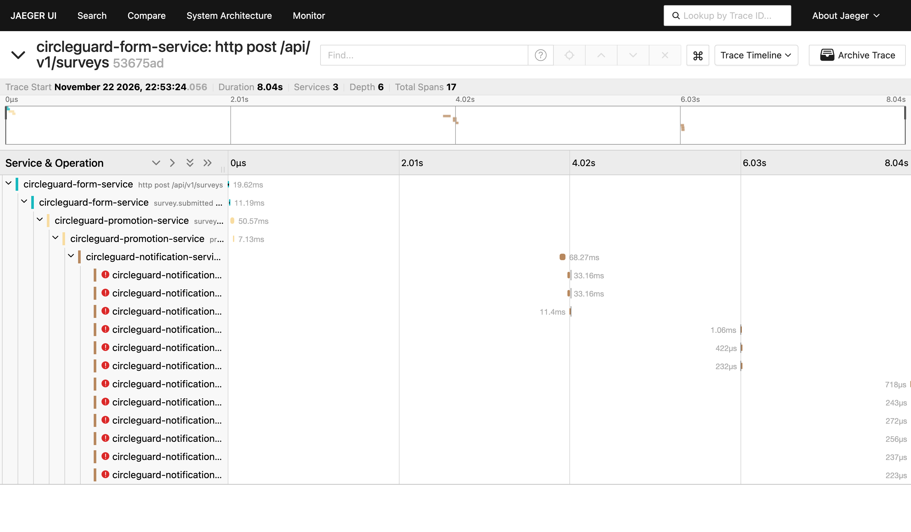

# Trazado distribuido con OpenTelemetry y Jaeger (`US-25` / `SCRUM-94`)

Responsable: Santiago Castillo. Esta historia permite seguir una solicitud desde `form-service`, a través de Kafka, hasta `promotion-service` y `notification-service`, y ver en Jaeger cuánto tarda cada paso y dónde falla. Complementa las métricas de `US-24`: las métricas dicen *que* algo va lento o falla; la traza dice *dónde*.

## 1. Criterios de aceptación y evidencia

| Criterio | Cómo se cumple | Evidencia |
| :--- | :--- | :--- |
| **CA1**: una traza completa aparece en Jaeger para `form → Kafka → promotion → notification` | Los tres servicios generan spans con Micrometer Tracing + OpenTelemetry y los exportan por OTLP a Jaeger. | Traza `53675ad…` de la sección 5 (17 spans, 3 servicios), captura `img/us25-jaeger-traza.png` |
| **CA2**: el contexto de traza se propaga entre los servicios que procesan el evento | El productor de Kafka escribe el header `traceparent` (W3C Trace Context) en cada mensaje y el consumidor lo lee (`spring.kafka.template/listener.observation-enabled`). En `notification-service` el contexto también pasa a los hilos `@Async`. | Los spans `receive` de promotion y notification son hijos del `send` anterior; el mismo `traceId` aparece en los logs de los tres servicios |
| **CA3**: se documenta una ejecución verificable y cómo buscar sus spans | Script `observability/scripts/demo-trace.sh` y las secciones 4 y 5 de este documento. | Salida del script y búsqueda en Jaeger |

## 2. Conceptos

- **Traza (trace)**: el recorrido completo de una solicitud por el sistema. Tiene un identificador único, el `traceId` (32 caracteres hexadecimales).
- **Span**: un paso de ese recorrido con inicio, duración, servicio y etiquetas (por ejemplo `http post /api/v1/surveys` o `survey.submitted send`). Cada span tiene su `spanId` y conoce a su span padre; así se arma el árbol.
- **Propagación de contexto**: pasar el `traceId` y el `spanId` actual de un servicio al siguiente. En HTTP y en Kafka viaja en el header `traceparent` (estándar W3C), por ejemplo `00-53675ad3…-3e1042fb…-01`. Sin propagación, cada servicio crearía una traza suelta.
- **OpenTelemetry (OTel)**: el estándar abierto (API, SDK y protocolo OTLP) para *producir* y *enviar* trazas. No guarda ni muestra nada.
- **Jaeger**: el *backend* que recibe los spans (por OTLP), los guarda y ofrece la interfaz para buscarlos y verlos como línea de tiempo. Se podría cambiar por Tempo o Zipkin sin tocar el código de los servicios.
- **Micrometer Tracing**: la fachada de Spring Boot 3. Spring instrumenta HTTP y Kafka con Micrometer, y el *bridge* `micrometer-tracing-bridge-otel` traduce eso a OpenTelemetry. Es la misma librería que usa `US-24` para métricas.
- **Muestreo (sampling)**: qué fracción de solicitudes se trazan. En desarrollo es 100 % (`1.0`); en producción se puede bajar con `TRACING_SAMPLING_PROBABILITY`.

## 3. Qué cambió

En `form`, `promotion` y `notification`:

- `build.gradle.kts`: `micrometer-tracing-bridge-otel` y `opentelemetry-exporter-otlp` (versiones gestionadas por Spring Boot 3.2.4).
- `application.yml`:

```yaml
spring:
  kafka:
    template:
      observation-enabled: true   # el productor crea el span "<topic> send" y escribe traceparent
    listener:
      observation-enabled: true   # el consumidor lee traceparent y crea "<topic> receive"
management:
  tracing:
    sampling:
      probability: ${TRACING_SAMPLING_PROBABILITY:1.0}
  otlp:
    tracing:
      endpoint: ${OTEL_EXPORTER_OTLP_TRACES_ENDPOINT:http://localhost:4318/v1/traces}
```

- `notification-service/config/TracingAsyncConfig.java`: un `ContextPropagatingTaskDecorator` para que los envíos `@Async` (SMS, push, email, LMS, auditoría) sigan dentro de la traza.
- Los logs incluyen `[traceId-spanId]` automáticamente (Spring Boot 3.2), así que un log se puede llevar a Jaeger y al revés.
- `observability/docker-compose.tracing.yml`: Jaeger `all-in-one` 1.62.0 con OTLP activo, puertos solo en `127.0.0.1` (16686 interfaz, 4317/4318 OTLP).

No se tocó la configuración de métricas de `US-24`. En Kubernetes o en los compose de ambiente basta con fijar `OTEL_EXPORTER_OTLP_TRACES_ENDPOINT` apuntando al colector; si no hay Jaeger, el exportador solo registra un aviso y los servicios siguen funcionando.

## 4. Cómo reproducirlo

```bash
# 1. Jaeger
docker compose -f observability/docker-compose.tracing.yml up -d

# 2. Middleware (Postgres, Neo4j, Redis, Kafka), por ejemplo con docker-compose.dev.yml y su .env

# 3. Servicios (JDK 17 para Gradle; el toolchain descarga el 21)
./gradlew :services:circleguard-form-service:bootRun
./gradlew :services:circleguard-promotion-service:bootRun
./gradlew :services:circleguard-notification-service:bootRun

# 4. Traza de prueba: crea el usuario y un contacto en Neo4j, un cuestionario y envía una encuesta con síntomas
NEO4J_CONTAINER=circleguard-neo4j NEO4J_PASSWORD=<clave> bash observability/scripts/demo-trace.sh
```

El script termina con el `traceId` y el enlace a la traza, y falla si alguno de los tres servicios no aparece en ella.

### Buscar los spans en Jaeger (http://localhost:16686)

- **Search** → *Service* `circleguard-form-service`, *Operation* `http post /api/v1/surveys` → *Find Traces*.
- O *Service* `circleguard-notification-service`, *Operation* `promotion.status.changed receive`.
- Con un `traceId` de los logs: pegarlo en *Lookup by Trace ID*.
- Para ver solo fallos: *Tags* `error=true`.
- **System Architecture** dibuja el grafo `form → promotion → notification` a partir de las trazas.

## 5. Ejecución verificada (22/11/2026)

Encuesta con síntomas del usuario `f30b0524-…`; traza `53675ad3e3ad367623a32af519289d08`:

```
circleguard-form-service: http post /api/v1/surveys (19.6 ms)
  circleguard-form-service: survey.submitted send (11.2 ms)
    circleguard-promotion-service: survey.submitted receive (50.6 ms)
      circleguard-promotion-service: promotion.status.changed send (7.1 ms)
        circleguard-notification-service: promotion.status.changed receive (68.3 ms)
          circleguard-notification-service: notification.audit send  ×12  (error=true)
```



La traza ya sirvió para encontrar dos fallos existentes:

1. Los 12 spans `notification.audit send` salen en rojo: `notification-service` publica la auditoría como `Map` pero su productor de Kafka usa `StringSerializer` (`SerializationException`). Falta configurar `JsonSerializer` como en `form` y `promotion`.
2. `promotion-service` no publica `promotion.status.changed` cuando el usuario no tiene contactos: la consulta Cypher de `HealthStatusService.updateStatus` filtra la fila con `WHERE c1 IS NOT NULL` y devuelve vacío. Por eso el script crea un contacto antes de enviar la encuesta.

Ambos quedan fuera del alcance de esta historia.
